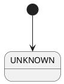

# 核心认知模版

按 `spec/核心认知.md` 的现有结构提炼，供新建或重写核心认知时使用。

## 使用方式

1. 复制「完整骨架」到目标文件，按 0→14 顺序填写。
2. 每节只写该节该装的认知；定义只在此处写一次，下游用章节号引用。
3. 编号一经使用不复用、不改含义；新增前缀先登记再使用。
4. 填完跑「完工检查」与「变更检查」。

## 完整骨架

```markdown
# <产品> 核心认知

> **<一句话主张>**
>
> <其中文表述>

## 0. 文档定位

本文是 <产品> 产品、设计、原型、代码和测试的**唯一事实来源（SSOT）**。

- 本文只保存跨模块、跨版本必须稳定的认知，不复述页面细节。
- 跨模块稳定的术语、功能、实体/值对象、属性、关系、业务状态、领域事件和约束在本文定义；下游引用这些定义，不建立第二份模型或状态定义。
- <直接设计依据> 是本文的设计依据；外部协议和代码是技术事实依据。
- 本文与设计稿、原型、代码或普通设计文档冲突时，以本文为准。
- 新需求先修改本文，再同步设计、原型、代码和测试。禁止在下游重复定义同一规则。
- 未经协议或可执行代码验证的结论，必须标记为「待确认」，不得写成既定事实。

规范词：

- **必须/禁止**：不可违反的产品或技术约束。
- **应该**：默认实现；偏离时必须记录原因。
- **可以**：允许但非必需。

## 1. 是什么

<一句话产品定义：以什么为中心，服务什么。>

平台回答的问题：

1. **<问题一>** — <对应能力>
2. **<问题二>** — <对应能力>
3. **<问题三>** — <对应能力>

根原则：

1. **<原则一>。** <含义与约束。>
2. **<原则二>。** <含义与约束。>
3. **<原则三>。** <含义与约束。>

核心模型：

```text
<控制能力>
  ↓
<产品中心>
  ├── <平行能力一>
  ├── <平行能力二>
  └── <平行能力三>
          ↓
        <事实来源>
```

<说明哪些是基础设施、哪些是产品中心，以及平行能力之间是否互相前置。>

## 2. 术语与命名

### 2.1 领域术语

全局术语与命名定义的唯一事实源。一行一个术语，定义只写「是什么」。

| 术语 | 唯一定义 |
| --- | --- |
|  |  |

### 2.2 用户术语与协议术语

普通界面优先使用：

```text
<用户可见术语>
```

协议细节通过渐进披露：

```text
<协议术语>
```

两个主标识不得降级为隐藏协议细节：

- <主标识一>。
- <主标识二>。

### 2.3 用词禁区

- 禁止 <错误说法>；应使用 <正确说法>。
- 同一操作和状态必须使用同一文案，禁止随意切换同义词。

## 3. 目标

用户必须能够：

1. <可完成的事>
2. <可完成的事>

体验必须满足：

- **易用性**：<判据>
- **一致性**：<判据>
- **确定性**：<判据>
- **可验证性**：<判据>

## 4. 全局不变量

以下规则优先于所有页面和实现细节：

1. <不变量>
2. <不变量>

## 5. 结构

### 5.1 模块

业务模块：

```text
<模块清单>
```

<模块工作区与跨模块展示的规则。>

| 模块 | 职责 |
| --- | --- |
|  |  |

后续模块：

```text
<未实现模块>
```

横切能力：

```text
<横切能力清单>
```

#### 5.1.1 子域类型

子域分类依据产品能力，不依据代码规模、团队规模或技术难度。同一模块可在不同交付阶段改变类型，改变须先修改本节再调整投入。

| 类型 | 判定标准 | 投入方式 |
| --- | --- | --- |
| 核心域 | 去掉它会使第 3 节某项用户能力消失，且该能力是产品差异所在 | 建深模型，按第 7、8、9 节完整表达实体、关系与状态 |
| 支撑域 | 不直接产生差异，但核心域的用例依赖它才能完成 | 契约充分、行为正确，不追求模型深度 |
| 通用域 | 行业已有成熟实现，自研不产生差异 | 优先复用，只做接入与产品校验 |

| 编号 | 子域 | 类型 | 判定依据 |
| --- | --- | --- | --- |
| SD-01 |  |  |  |

边界规则：

1. 核心域之间不得共享数据库、实体或聚合。
2. 支撑域只提供能力，不反向持有核心域的业务规则。
3. 通用域不进入产品状态机；内部状态须归一化为产品语义后使用。
4. 子域类型不决定部署方式。

#### 5.1.2 限界上下文

**限界上下文**是一套统一语言与模型成立的有效范围。边界内术语只有一种含义、模型只有一份定义、事实只有一种判定；边界外允许同名异义，通过映射与领域事件协作。

子域是**问题空间**的能力划分，限界上下文是**解决方案空间**的语言与模型边界，两者不必一一对应。

| 限界上下文 | 承载子域 | 业务模块 | 边界说明 |
| --- | --- | --- | --- |
|  |  |  |  |

边界规则：

1. 业务模块是用户可见的工作区划分，限界上下文是语言与模型边界，两者不要求同名或同目录。
2. 同一术语跨上下文可含义不同，但每个上下文内只保留一种含义。
3. 通用域不建立独立限界上下文，作为库、设计系统或运行时能力被引用。
4. 上下文边界不决定部署方式。
5. 上下文之间只通过稳定标识、证明、公开端口与领域事件协作。

### 5.2 接口边界

业务层只依赖以下抽象：

| 接口 | 职责 |
| --- | --- |
|  |  |

禁止业务组件直接依赖外部服务 API。适配关系必须为：

```text
业务组件 → 领域接口 → 外部 Adapter
```

<未确定能力的补齐责任与本期表达方式。>

### 5.3 事实来源

| 事实 | 权威来源 |
| --- | --- |
|  |  |

查询派生事实必须保留来源、更新时间和重新解析能力。

### 5.4 支撑能力与产品领域的责任

| 支撑能力 | 能力提供方 | 本产品的责任 |
| --- | --- | --- |
|  |  |  |

<本人状态与公开可发现性的区分、证据分层、归一化要求。>

## 6. 功能

### 6.1 MVP

#### <模块一>

| 编号 | 功能/用例 | 输入与可验证结果 |
| --- | --- | --- |
| F-<前缀>-01 |  |  |

#### <模块二>

- <功能项，一行一个，写成可验收的结果。>

### 6.2 <专题规则>

- <跨模块的业务规则>

### 6.3 统一高影响操作流

```text
User Intent
  → Review
  → Confirmation
  → Processing
  → Business Result
  → Details
```

Review 必须显示的内容：<必须展示的上下文与影响>。

### 6.4 <签名/授权等全局约束>

- <适用范围>
- <职责区分>
- <失效与禁止条件>

### 6.5 后续能力

```text
<未实现能力>
```

后续能力优先采用既有协议，禁止无依据创建私有 Schema。

## 7. 实体与属性

以下实体和派生模型使用稳定编号。编号用于跨文档引用，不代表必须新建同名类、数据表或 HTTP DTO。

| 编号 | 模型/类别 | 归属、存储与事实源 | 定义 |
| --- | --- | --- | --- |
| E-<前缀>-01 |  |  | §7.1 |
| V-<前缀>-01 |  |  | §7.1 |
| Q-<前缀>-01 |  |  | §7.1 |

### 7.1 `<实体名>`

<一句话说明其地位、生命周期由谁管理、不持有什么。>

| 编号 | 属性/类型 | 必填与默认 | 唯一性、可变性与格式/来源 |
| --- | --- | --- | --- |
| <前缀>-A01 |  |  |  |

<补充说明：模型边界、不组建的事务、必须保留的原值。>

### 7.2 <专用专题模型>

| 模型 | 属性编号与逻辑内容 | 约束与来源 |
| --- | --- | --- |
|  |  |  |

### 7.3 <相关领域事件>

事件是业务意图、执行观测或核实事实的记录，分类不能互相替代。适用时携带网络/scope、来源、观测时点及实际交易/Proof；交易尚未产生时不制造 TxID。

| 编号 | 事件 | 触发与可信度 |
| --- | --- | --- |
| EV-<前缀>-01 |  |  |

## 8. 关系

| 编号 | 主体 | 关系 | 客体 | 基数及唯一定位 |
| --- | --- | --- | --- | --- |
| REL-01 |  |  |  |  |

<关系基数描述业务约束，不自动等同数据库外键；禁止的推断路径。>

## 9. 状态

原则：系统状态可以详细；用户状态必须简单、可解释。产品状态不得直接复用外部系统的原始枚举。

### 9.1 <对象一>

```text
系统：<状态流转>
异常：<异常分支>
用户：<用户可见表达>
```

### 9.2 <对象二>

状态维度分别表达，禁止合并为一个布尔值。

#### 9.2.1 <维度一>

<取值、进入条件、退出条件。>

```plantuml
@startuml
[*] --> <初始状态>
<迁移>
@enduml
```

#### 9.2.2 <维度二>

| 结果 | 成立条件 | 不能推断 |
| --- | --- | --- |
|  |  |  |

#### 9.2.3 <维度三>



#### 9.2.4 操作与异常边界

| 情况 | 允许的处理 |
| --- | --- |
|  |  |

### 9.3 <对象三>

<状态集合与稳定阈值。>

```text
<产品或系统状态流转>
<异常分支>
```

| 状态 | 判定条件 | 用户表达 |
| --- | --- | --- |
|  |  |  |

```plantuml
@startuml
[*] --> <初始状态>
@enduml
```

<多维度状态可拆 9.4、9.5 等小节；有迁移时补 PlantUML，仅列取值时用文本块。>

## 10. 界限

### 10.1 安全与权限

- <禁止事项与授权要求>
- <切换、取消、终止时的处理>

### 10.2 <对象> 规则索引

规则本体由所引章节定义，本节只做索引，不在下游维护同名规则表。

| 规则标识 | 权威定义 |
| --- | --- |
| <前缀>-01 | § |

### 10.3 <对象> 界限

- <约束>

### 10.4 UI 与无障碍

- <唯一主设计系统与使用要求>
- <主题、语言、标识展示约束>
- <异常必须说明的内容>

### 10.5 平台责任

平台负责：<清单>。

平台不拥有：<清单>。

### 10.6 生产集成与测试事实

- 各阶段证据分别记录，一项成功不能替代其他项。
- 模拟结果必须带来源标记、隔离存储，不得进入生产事实。
- 读取失败不得解释为不存在。

## 11. 可验证验收

1. <可观察、可判定的验收条件>
2. <可观察、可判定的验收条件>

## 12. 待确认

以下问题未在当前本地资料中形成稳定契约，实现前必须用实际 SDK、输出或验证器关闭：

1. **<事项>**：<未确定的具体内容>。由<责任方>负责，以<关闭证据>验证。未关闭时<降级表达>。

## 13. 参考文档

### 13.1 直接设计依据

- <设计依据文档>

### 13.2 协议与实现依据

- <协议与源码路径>

## 14. 变更检查

每次变更本文，必须检查：

- 是否改变术语、实体、关系、属性、状态或边界；
- 是否破坏第 4 节任一不变量；
- 是否与协议资料或可执行 API 冲突；
- 是否需要同步设计、原型、代码、迁移和验收测试；
- 是否引入重复定义；若有，删除下游重复知识并改为引用本文。
```

## 逐节要求

| 节 | 只装什么 | 常见缺陷 |
| --- | --- | --- |
| 0 定位 | 本文的地位、效力、规范词 | 写了创作背景或变更历史 |
| 1 是什么 | 产品定义、根原则、核心模型 | 混入页面或技术栈 |
| 2 术语 | 全局命名的唯一定义 | 写实现名、写同义词 |
| 3 目标 | 用户能完成的、体验判据 | 写成功能清单 |
| 4 不变量 | 优先于一切的硬约束 | 写成建议或偏好 |
| 5 结构 | 模块、子域、上下文、接口、事实来源、支撑责任 | 与第 7 节实体混淆 |
| 6 功能 | 带编号的功能与可验证结果 | 结果不可验证、无编号 |
| 7 实体与属性 | 模型分类、编号、属性约束 | 与 DTO 或表结构对齐 |
| 8 关系 | 基数与唯一定位 | 写成调用关系 |
| 9 状态 | 状态维度、迁移、判定表 | 直接复用外部枚举 |
| 10 界限 | 禁止项、规则索引、平台责任 | 重复规则正文 |
| 11 验收 | 可观察的判定条件 | 写成实现说明 |
| 12 待确认 | 未定事项与关闭条件 | 用「后续实现」敷衍 |
| 13 参考 | 依据与源码位置 | 引用不可解析路径 |
| 14 变更检查 | 每次改动的自检项 | 省略或改成一次性记录 |

## 编号约定

| 前缀 | 含义 |
| --- | --- |
| `E-` | 实体与聚合根 |
| `V-` | 值对象与证据视图 |
| `Q-` | 查询结果与派生视图 |
| `F-` | 功能与用例 |
| `REL-` | 关系 |
| `EV-` | 领域事件 |
| `SD-` | 子域类型 |
| `<实体前缀>-Axx` | 属性编号，`Axx` 为该模型内的属性序号（如 `ID-A01`） |
| `ID-`、`PR-` 等 | 属性编号的实体段，按所属实体取，不单独指代一类概念 |
| `<规则前缀>-nn` | 规则索引，正文另见所引章节 |

规则：

1. 编号用于跨文档引用，不要求新建同名类或表。
2. 编号一经使用不改含义，不复用于新概念。
3. 新增前缀先在本表登记，再在正文使用。
4. Identity 相关编号固定用 `ID` 段；其他上下文按模块名缩写。

## 完工检查

- [ ] 0～14 节齐全，无空标题。
- [ ] 每个术语只定义一次，可在第 2 节查到。
- [ ] 第 3 节每条目标可验收；第 11 节每条验收可观察。
- [ ] 第 7 节每个模型有编号、有归属、有属性表或属性说明。
- [ ] 第 8 节每条关系有基数与唯一定位。
- [ ] 第 9 节每个状态维度有判定条件，图用 PlantUML。
- [ ] 第 10 节只做索引与禁止项，不重复规则正文。
- [ ] 第 12 节每项有责任方与关闭证据。
- [ ] 全文未出现第二份定义；下游均以章节号引用。
- [ ] 相对路径与锚点可解析。

## 与其他文档的分工

| 文档 | 回答 | 本文的动作 |
| --- | --- | --- |
| 核心认知 | 是什么 | 全部定义在此 |
| PRD | 用户任务与页面验收 | 被引用 |
| Domain | 用例编排、责任、端口 | 引用本文编号 |
| Contracts | 接口输入输出 | 引用本文语义 |
| 实现设计 | 代码映射 | 引用本文编号 |

一句话判据：**答案属于「是什么」的写进本文；属于「为什么、谁来做、失败怎么办、范围到哪」的写到下游并引用本文。**

下游领域设计的七维结构见 [domain-design](../../domain-design/SKILL.md)。
