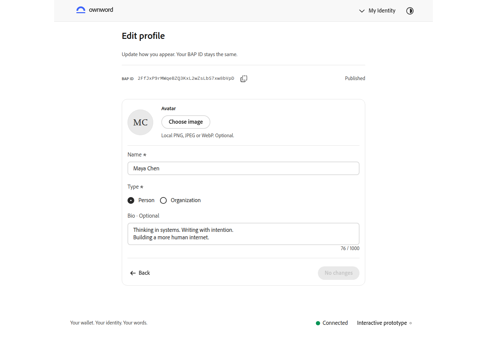
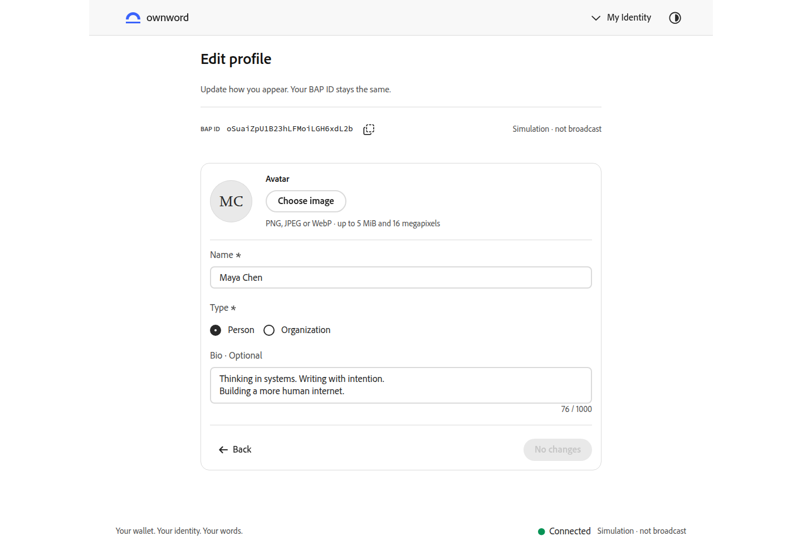
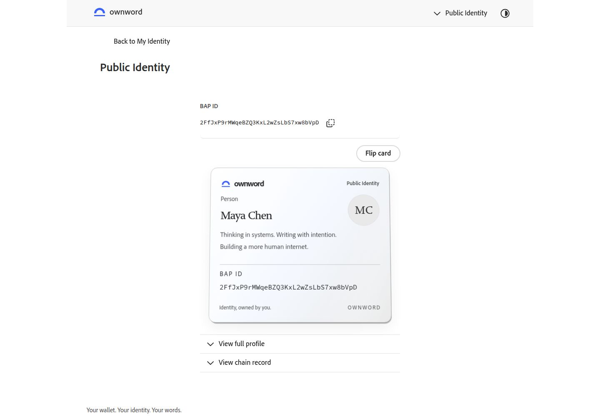
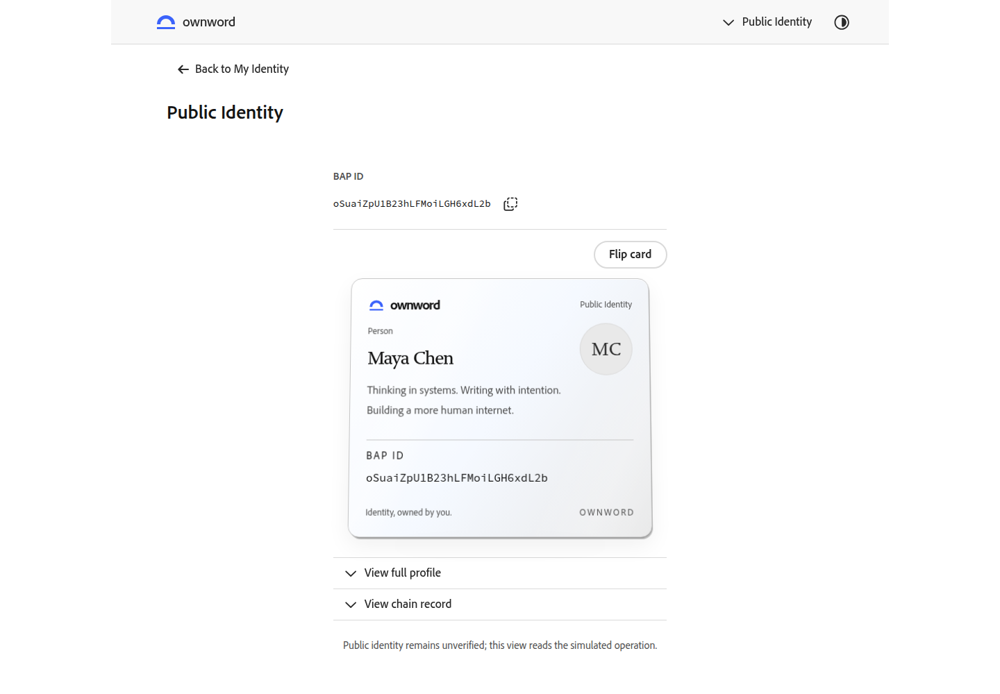

# OwnWord v0.1.0 当前验收

## 结论与边界

已实现指定身份范围，采用 Next.js、React、TypeScript、Tailwind CSS 4.3.3 和官方 Spectrum S2 1.6.0。首页、设置／编辑、核对、结果、我的身份及双面卡片已按用户确认的冻结 tag 修正，前端提交为 `bbf47d9`。本次 UI 还原检查通过，视觉结果保留人工复核入口；整个任务尚未完成。真实公共已发布／未发布／不完整三种分流缺少可验证索引来源，主网首次发布和更新还等待充值。

认知与实现依据保持为总核心认知 → 本次独立核心认知 → 集成设计。当前原型固定为 `prototype/official-s2-20261013-213507`，commit `a86850a225b00962277cf1160ed70f8129924fba`，tree `bd4488099d23199f79d65a5c987771e256258e95`；原型未修改、tag 未移动、未推送。

钱包授权、资金和广播使用允许的独立 CWI 测试适配。交易构造、BAP ID 派生、AIP 校验、Java API、MongoDB、文件和主网只读真实。模拟完成不会更新公开身份投影，networkAccepted 为 null；Yours 实际扩展及主网新交易不在本次通过范围内。

## 当前服务与复跑

- production：http://127.0.0.1:5041；Java API：5043；隔离测试钱包：5042。
- 从本任务目录运行 `./init.sh` 和 `python3 run-services.py status`；启动为 `python3 run-services.py start`。
- 配置 `_runtime/services.json` 权限为 0600，已加入根 Git 忽略；不输出或提交。数据库为本任务隔离命名空间，未清空共享数据。
- 启动、构建和配置说明见 [前端 README](own-word-web/README.md)。API 运行独立 jar 副本，编译不会覆盖正在运行的 jar。
- 原型还原对照：http://127.0.0.1:5047；静态文件为 [对照入口](evidence/prototype-restoration-20261014/index.html)。复跑可从本任务目录运行 `python3 -m http.server 5047 --bind 127.0.0.1 --directory evidence/prototype-restoration-20261014`。
- 测试钱包记录驻留钱包进程；本次恢复测试保留该进程。完整停机后恢复钱包记录、live 索引重建和 reorg 仍需后续验收，不能用当前模拟操作替代。

## 集成门禁

| 门禁 | 当前结果 | 实际证据与范围 |
| --- | --- | --- |
| I01 | passed | lint、typecheck、连续两次 production build 退出 0，npm start 实际页面与同源 HTTP |
| I02 | passed | 真实 MongoDB 意图、幂等、8 路并发许可仅授予一次；许可返回后真实 TCP 断连仍可查询原 UUID；无 TxID 操作及资料在 API 重启后回读 |
| I03 | passed | JPEG、PNG、WebP 真上传并逐字节回读；无效图片拒绝；本任务头像目录暂时取消写权限时真实 503，随后恢复；头像重启可读 |
| I04 | passed（只读／未知路径） | 主网创世交易由实际 WOC 原始数据和 Java SDK 计算同一 TxID；公共 BAP 请求实际出现 403／404，覆盖、checkpoint 和观测证据不足时维持 unknown，未声明未发布 |
| I05 | passed | 真实 AIP/BAP 验签与双输出；损坏签名、旧资料版本、账户变化在钱包转交前拒绝，转交次数为零；内部字段注入拒绝，迟到取消不能覆盖已验证回执 |
| I06 | passed（允许的 CWI 适配） | 28 方法契约；本期外证书等明确 unsupported；两阶段及 createAction 内处理均经过真实预检。连接取消／失败重试、账户切换、提交后迟到结果、丢回执和同一操作恢复已实际检查 |
| I07 | passed（明确模拟） | 创建和更新使用真实 Actions、Java 验签和真实存储；公开查询仍未知；取消保留上一版模拟预览，Profile 更新后 BAP ID 不变 |
| I08 | waiting-funds | 未进行主网首次 ID+ALIAS 广播、真实索引与页面回读；同时缺少充分索引覆盖 |
| I09 | waiting-funds | 未进行主网 ALIAS 更新、历史与最新资料回读 |
| I10 | passed（已检查范围） | 1440×1000 英文浅色与 320×740 中文深色截图；完整复制、实际权限拒绝、键盘翻面、减少动态效果、对话框焦点与 Escape、相关稳定态 axe |

I04 通过的是实际网络读取及未知结果处理；B06/B07/B08 正向业务分流没有关闭。全局任务和主网门禁不记 done。

## 执行数和来源

`OWNWORD_API_TEST_URL=http://127.0.0.1:5043 NO_PROXY=127.0.0.1,localhost npm test`：18 项通过、失败 0、skip 0，其中 16 项通过真实 Java HTTP，2 项为真实 Actions/密码学的钱包检查。许可丢失用一次性传输代理转发到真实 Java/MongoDB 后断开 TCP；没有伪造业务响应。[实际日志](evidence/api-tests.log)

此次 UI 还原后再次执行同一真实集成套件：18 项通过、失败 0、skip 0。[还原后日志](evidence/prototype-restoration-20261014/acceptance-api-tests.txt)。最终源码的 [lint](evidence/prototype-restoration-20261014/delivery-lint.txt)、[typecheck](evidence/prototype-restoration-20261014/delivery-typecheck.txt)、[production build](evidence/prototype-restoration-20261014/delivery-build.txt) 均退出 0；运行中的 production 使用此构建。

后端基线的 `-pl metanet4j-api-ownword -am clean test` 实际执行 183 项，失败／错误／skip 均为 0。此次 UI 还原没有修改 Java，这 183 项沿用后端基线证据，不计作此次新增运行。api-ownword 当前没有 JUnit 用例，接口证据来自上述真实 HTTP；既有模块中的测试替身只作为兼容回归，不计作本期真实服务验收。过往未参加该 reactor 的报告已排除。[基线日志](evidence/java-clean-test.log)

| 本轮模块 | 实际用例 |
| --- | --- |
| metanet4j-api-common | 59 |
| metanet4j-component-common | 42 |
| metanet4j-component-model | 20 |
| metanet4j-store-mongo | 62 |
| metanet4j-component-core / api-ownword | 0（没有 JUnit） |

构建通过后，已实际查看正常 production 会话的页面错误与 console，未出现正常路径错误。受控取消、丢回执及服务断连会有预期错误日志；历史构建诊断不算当前正常路径结果。

## 28 条 BDD 的状态

| 场景 | 状态与来源 |
| --- | --- |
| B01–B05 | passed：实际 CWI 适配与 production 连接、取消、失败重试、切换、断开；旧字段和迟到结果不进入新账户 |
| B06/B07/B08 | not-run：真实完整／未发布／不完整公共身份事实不足；不能用种假 MongoDB 记录或模拟公开索引补齐 |
| B09 | passed：实际停止 API 后保持已连接及可核实原操作，不把失败当不存在 |
| B10/B11 | passed：真实头像与 Review；空名称、101 字符、1001 字符拦截；组合 emoji 在 Java 与前端沿用原型字素簇规则 |
| B12 | simulated-passed：创建 ID+ALIAS、真实签名与存储；主网版本仍等待 I08 |
| B13/B14 | passed：钱包取消／明确未提交保留资料；重试只形成一次钱包交易 |
| B15–B17 | passed：真实模拟记录的资料查看；完整 BAP ID 实际复制再粘贴一致；iframe Permissions Policy 实际拒绝剪贴板时仍提供完整值 |
| B18 | simulated-passed：更新 ALIAS、保留历史、BAP ID 稳定；主网版本仍等待 I09 |
| B19/B20 | passed：取消更新保留草稿及上一版；表单返回／品牌离开提示，焦点限制与 Escape 已检查；浏览器关闭注册 beforeunload。未执行系统关闭、浏览器原生历史后退专项 |
| B21–B26 | passed：新会话英文浅色；中文与深色 cookie 刷新保持；协议 Person/Organization、BAP ID 与资料不随偏好变化；状态有文本 |
| B27/B28 | passed（已检查范围）：320px 无横向溢出；按钮、表单、对话框和卡片键盘交互及名称检查；未执行真实读屏 |

## 原型与 S2 检查

用户确认沿用冻结 tag，标题保持该基线的左对齐。按相同 1440×1000 视口审阅首页、身份、编辑、设置、核对与卡片；资料查看／编辑为 Maya Chen、Person、76 字符简介、无头像，核对图使用相同追加编辑值。真实钱包标识、模拟提示和未知公共状态保留实际来源。原型的 Artifact、内容、关系、公开搜索与 Key Rotation 按 v0.1 范围过滤。

修正包含欢迎页穹顶与字体、导航和偏好弹层、720px 表单、960px 身份区、行内标识、字级与间距、原型返回图标、核对与结果结构、卡片两面和折叠详情。CSS reset 放入 base layer，避免覆盖 Tailwind 间距；短屏固定操作栏。Tailwind 负责布局／响应式，S2 保留官方表单、按钮、Popover、对话框与状态交互。卡片预览硬刷新保持原路由，隐藏面设置 aria-hidden 与 inert。

[原型／修正前／修正后交互对照](evidence/prototype-restoration-20261014/index.html) 提供八种页面状态，未采集的改前状态明确留空；19 个截图链接实际返回 HTTP 200。已逐页查看截图，没有宣称像素完全一致或编造视觉评分。

| 固定原型 | 当前实现 |
| --- | --- |
|  |  |
|  |  |

卡片基准来自 tag 中 `ArtifactPublicIdentity → IdentityCard` 的独立视觉参考，隐藏本期不包含的 Artifact 摘要。它没有参与生产业务或真实 API 验收；[七份源文件摘要](evidence/prototype-restoration-20261014/card-reference-source.json) 全部与 tag 一致。原型组件参考页依赖 5045 的冻结静态资源，截图对照本身只依赖 5047。

本次实际验证：原生复制按钮后以 Control+v 粘贴到真实名称文本框，完整 BAP ID 一致；Space 键翻面和两处折叠详情；预览硬刷新；中文深色偏好刷新保持；320px 无横向溢出；减少动态效果时卡片 transition 为 0s；脏资料离开对话框的焦点与 Escape；停止本任务 API 后出现查询错误，恢复 API 后点击重试成功。钱包取消的操作为 cancelled、TxID 为 null，重试后为 simulated、签名 valid、networkAccepted 为 null，测试资料已恢复。旧资料版本实际被 409 预检拒绝，未进入钱包授权。

[复制证据](evidence/prototype-restoration-20261014/native-clipboard-paste.json)、[键盘翻面](evidence/prototype-restoration-20261014/card-keyboard.json)、[手机偏好](evidence/prototype-restoration-20261014/mobile-preferences.json)、[API 恢复](evidence/prototype-restoration-20261014/api-retry.json)、[钱包取消](evidence/prototype-restoration-20261014/wallet-cancelled.json)、[重试恢复](evidence/prototype-restoration-20261014/wallet-retry-restored.json)。截图另见 [手机编辑](evidence/prototype-restoration-20261014/after-mobile-edit.png)、[中文深色卡片全页](evidence/prototype-restoration-20261014/after-mobile-preview-full.png)、[取消结果](evidence/prototype-restoration-20261014/wallet-cancelled.png)、[模拟结果](evidence/prototype-restoration-20261014/simulation-result.png)、[实际停机](evidence/prototype-restoration-20261014/api-unavailable.png)。

本次稳定态欢迎、设置、核对、身份、编辑、卡片和手机卡片 axe 均为 0 违规。欢迎及卡片渐变存在 incomplete 对比度项，已查看截图与 S2 Token，仍保留人工检查限制；自动审计不替代读屏或全部加载过渡。正常新会话无页面错误或 console 错误；版本冲突、钱包取消与实际停机产生预期诊断。

WebP 原始样例来自 [Google WebP Gallery](https://developers.google.com/speed/webp/gallery1)，只用于本地上传和字节回读。格式、SHA-256、文件权限故障与首次登记恢复见 [汇总](evidence/verification-summary.json)、[格式回读](evidence/avatar-formats.json)、[真实存储故障](evidence/storage-permission.json)、[原 UUID 恢复](evidence/registration-recovery.json)。

## 提交与剩余工作

前端：f344695（栈与钱包）、dd9aa88（真实 API／预检）、3e67a21（身份页面及恢复）、bbf47d9（冻结原型还原与预览刷新）。后端 component：6e127d6、9063f89、265c657。仅提交本任务，未推送；原迁移工作区及无关根工作区改动保留。

下一步需要真实 BAP 索引地址、可验证签名历史与同步 checkpoint。取得来源后实现／验证公共解析和 live 投影重建，补 B06/B07/B08；充值真实 Yours 钱包后执行 I08/I09。当前未执行主网新交易、真实扩展发布、公共索引重建／reorg 和真实读屏，整体保持未完成。
