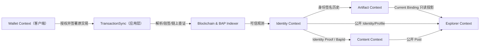
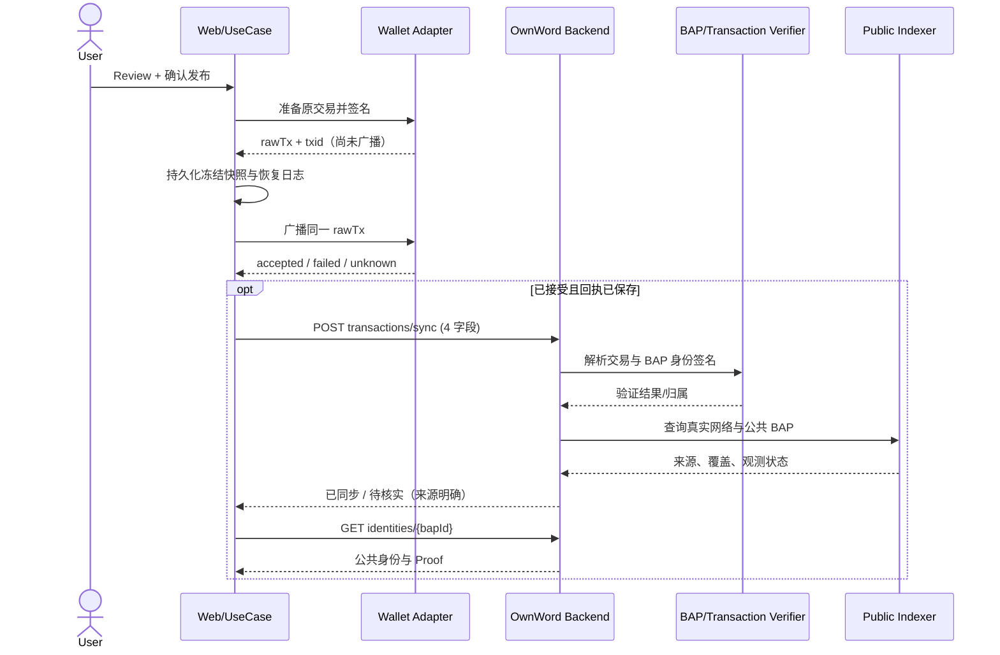
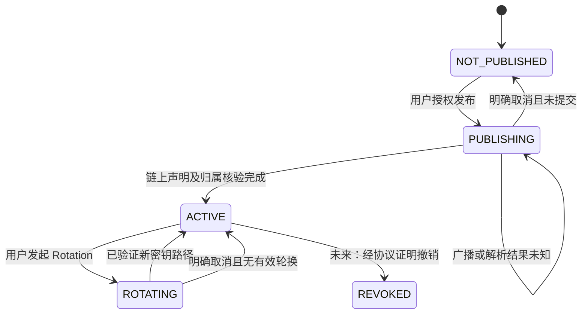

# OwnWord 后端领域设计：Identity（v0.1.0）

> 状态：**待评审（needs-review）**。本文是后端领域建模与实现方案，不表示所述组件已实现或通过生产链上验证。
>
> 范围：以 Identity 为核心，分析 Wallet、Artifact Binding、Content、Explorer、Blockchain 的协作边界；Identity v0.1.0 为首个实现切片，Artifact 业务依据 v0.3.0 设计。
>
> **事实权威**：[OwnWord 核心认知](../核心认知.md)。本文只规定后端设计与技术实现建议；协议事实、产品不变量、属性和状态以核心认知为准。若本文与核心认知冲突，应先修正本文，不得静默改写全局约束。

## 1. 目标、范围与设计原则

### 1.1 目标

后端服务必须支持钱包控制的 BAP 身份发现、发布、资料更新、签名密钥轮换及公开身份读取，使用原交易和独立验证建立可重建的身份状态；为 Content 的作者归属、Artifact 的有效 Binding、Explorer 的公开解析提供可信 BAP ID 和 Proof。

第一阶段输出领域模型与端口契约；代码实施仍应遵循现有 metanet4j 组件及已核实的前后端真实集成基线，不凭本文另行更换数据库、框架或交易协议。

### 1.2 业务边界

- **OwnWord 不托管私钥**；Wallet 持有密钥并负责权限确认、身份签名与花费签名。后端仅接受公开交易及可验证证明。
- **BAP ID 为身份主标识**；Wallet Connection、Profile、Artifact 与身份相互独立。
- **比特币链上事实为权威**；后端持久化交易观测与派生投影，保留原始证据以便重放、重组核查和索引重建。
- **所有 OwnWord 发起的链上交易**均须满足[核心认知 `6.4](../核心认知.md#64-全部链上交易的身份归属)的逐笔 identityKey 身份签名要求；UTXO 花费签名不是其替代品。
- 不实现 Relationship、内容版本、Artifact 创建与转移的内部业务规则；只定义其与 Identity 的端口契约和领域协作。
- 不增设中心化注册账号、私钥托管、链下自报的“已发布身份”，也不以钱包本地 basket 替代公共 BAP 索引。

### 1.3 设计方法

`领域发现 / 通用语言 → 限界上下文 → 业务不变量 → 聚合及一致性边界 → 事件/状态机 → Use Case → 端口与适配器 → 持久化投影 → BDD 验收`。

采用 **DDD + 模块化单体 + Ports & Adapters** 作为初期设计方向；**限界上下文不等于必须独立部署**。领域模型使用业务语言表达；MyBatis/Mongo/HTTP/钱包 SDK 逻辑留在适配器中。

## 2. 战略设计：通用语言和上下文

### 2.1 通用语言（引用权威定义）

以[核心认知 `2、`7](../核心认知.md#2-术语与命名)定义为准；本文使用以下稳定代码术语：

| 术语 | 后端建模用途 | 禁止混淆 |
| --- | --- | --- |
| `BapId` | Identity 的稳定主键 | 不等于签名地址、TxID、钱包账号 |
| `BapIdentity` | 身份生命周期与签名路径归属 | 不等于 WalletConnection |
| `BapProfile` | 公共展示资料的独立可变事实 | 不等于 BapIdentity 本身 |
| `IdentitySignatureProof` | 本笔交易的身份签名证据及校验结果 | 不等于花费签名、布尔参数 |
| `IdentityKeyHistory` | 有效签名路径和历史轮换链 | 不得只按当前密钥验证历史 |
| `IdentityNFTBinding` | BAP ID 与 Ordinal Origin 的独立关联 | 不等于 NFT owner / creator |
| `InscriptionNumber` | Indexer 在链上确认后解析的十进制数字 ID | 不等于 Inscription ID、Ordinal Number |
| `ChainObservation` | 一次链上事实查询及来源、覆盖、时点 | 不是不可变“全网真相” |
| `TransactionSync` | 已授权广播后，按原交易同步与验证 | 不是后端代签、代广播 |

术语与数值约束直接引用核心认知的唯一事实来源，避免在本文件形成第二份规格。

### 2.2 子域和限界上下文

| 上下文 | 子域定位 | 主责与边界 | 输出给其他上下文 |
| --- | --- | --- | --- |
| **Identity** | 核心域 | 公开 BAP 身份、Profile、身份签名历史及其解析；验证身份证据 | BapId、ProfileSnapshot、VerifiedIdentityProof |
| **Artifact** | 支撑域 | `BapNFT`、编号/Origin、ownership、`IdentityNFTBinding` 及转移后的重验 | CurrentBinding、ArtifactProof |
| **Content** | 核心域 | Post、草稿、发布及 Revision，按 BAP ID 归属 | PublishedPost、AuthorBapId |
| **Relationship** | 后续核心/支撑域 | Follow、Friend，以 BAP ID 为端点 | 公开关系投影 |
| **Explorer** | 查询组合 | BAP ID、Inscription Number 精确查找及公开读取 | 可溯源的查询 DTO |
| **Wallet** | 接入/通用域 | 客户端会话、授权、签名与交易能力；私钥不进入后端 | 钱包回执、签名结果 |
| **Blockchain / Indexer** | 基础设施端口 | 主网交易查询、BAP/Ordinal 解析、重组检测及覆盖度 | VerifiedObservation |

上下文之间交换稳定标识和经验证的事实快照；不得直接共享可变实体或把别的上下文的数据库集合当领域 API。



**一致性所有权**：Identity 维护身份发布、Profile 与密钥轮换的业务规则；Artifact 维护当前 NFT Binding。Identity 首页所见 Current Artifact 是读取 Artifact 的**投影引用**，不要求在 BapIdentity 聚合内维护一套可写 Binding。

## 3. 事件风暴：身份最小业务闭环

| 序号 | 意图/命令 | 已发生的事实（领域事件或可信观测） | 失败、取消或待核实 |
| --- | --- | --- | --- |
| E01 | Connect Wallet | WalletConnected（会话事件） | Disconnect / AccountChanged |
| E02 | Resolve Identity | BapIdComputed（本地计算）、IdentityObserved（公共索引） | CoverageUnknown；不得宣称不存在 |
| E03 | Publish Identity | SignedRawTransactionPrepared、BroadcastReceiptRecorded、IdentityPublishedVerified | WalletCancelled / SubmissionUnknown / SignatureInvalid |
| E04 | Update Profile | ProfileUpdateVerified | 某笔 ID、图片、ALIAS 已完成而后续取消：保留部分成功 |
| E05 | Rotate Key | IdentityKeyRotationVerified | 待验证时旧授权不能被本地提前替换 |
| E06 | Browse Public Identity | VerifiedIdentityProjectionRead | 未覆盖、未找到、服务异常分别表达 |
| E07 | Set Current Artifact | ArtifactBindingVerified（Artifact 上下文） | NumberPending、Origin/owner/签名证据不明，不产生 ACTIVE |
| E08 | Transfer Artifact | ArtifactOwnershipObserved、BindingReevaluated | 暂时查询失败为 UNKNOWN，不直接判 INVALID |

**事件命名规则**：`*Verified` 表示有可追溯验签和公开观测依据，`*Requested/Prepared/Submitted` 表示操作阶段，不能用“前端点了按钮”产生 `IdentityPublishedVerified`。

### 3.1 身份发布的时序



如果钱包广播结果未知，优先按同一 TxID 核查，不能重构交易、自动重签或因为 API 404 就认定未广播。身份首次带头像可能是多笔交易，逐笔执行签名和恢复，完整阶段见[身份真实集成设计 `3.2](../frontend/设计文档v0.1.0-真实集成-20261013-183000.md#32-创建补全与更新)。

## 4. 战术设计：实体、值对象、聚合

### 4.1 领域对象与一致性职责

| 对象 | DDD 分类 / 所属上下文 | 标识或关键值 | 一致性职责 |
| --- | --- | --- | --- |
| `BapIdentity` | 聚合根 / Identity | `BapId` | 公开身份状态、不可变 ID、密钥轮换的已验证演进 |
| `BapProfile` | 独立资料实体/投影 / Identity | `BapId` | 从已验证 Profile 记录派生最新有效资料；不以本地修改直接宣称公开 |
| `IdentityKeyHistory` | Identity 聚合内部历史记录 | 交易、签名路径、生效链序 | 还原签名发生时有效的授权路径 |
| `BapNFT` | 聚合根 / Artifact | `InscriptionId`、`OrdinalOrigin` | 资产编号、Origin、Outpoint、ownership 的各自证据 |
| `IdentityNFTBinding` | 聚合/独立关联 / Artifact | `BapId + OrdinalOrigin` | 单 BAP ID 和单 Origin 的 Current 唯一性及历史 |
| `BlockchainTransaction` | 跨域交易记录 / 基础设施及应用层 | `network + scope + txid` | 原交易、操作归属、签名验证、公开观测 |
| `WalletConnection` | 客户端会话状态 / Wallet | `sessionEpoch + account` | 账户切换后旧授权失效，绝不作为身份凭证 |

是否将 BapProfile 作为一个持久化聚合根是**实现选择**；MVP 更适合将它作为从 ALIAS/图片等有效交易派生的独立查询投影，由 Identity 应用服务负责合成 Identity Detail。它不参与 BAP ID 不变性所需的单聚合事务。

### 4.2 值对象（建议）

| 类型 | 值与验证职责 |
| --- | --- |
| `BapId` | 非空、格式经 BAP 适配器验证；不能任意猜测固定长度 |
| `TransactionId` | 完整 TxID；十六进制规范化不改变字节 |
| `IdentitySigningPath` | BAP Root / Current / Previous 的可验证关联；不能保存私钥 |
| `IdentitySignatureProof` | 签名者、被签名交易摘要/覆盖、封装、验证器版本、签名时有效 BAP 归属 |
| `InscriptionId` | `txid_vout`；与转移后变化的 Outpoint 区别 |
| `OrdinalOrigin` | 1Sat 单聪资产的 Origin，可能因 burn/重铭刻产生新 Origin |
| `InscriptionNumber` | 可空十进制**字符串**；仅由 Indexer 回填，reorg 可重解析 |
| `NetworkScope` | 以网络和受控运行 scope 隔离 mainnet 与 broadcast-mock |
| `ObservationEvidence` | 来源、观测时点、链主支确认、覆盖度、可重建引用 |

值对象应在构造时校验输入结构，但“该标识目前有效/归属于谁”必须依赖验证服务；不能用正则表达式替代链上证据。

### 4.3 BapIdentity 聚合

建议对外领域行为：

```text
BapIdentity
  + bapId: BapId                    // 不可编辑
  + rootPath: IdentitySigningPath    // 稳定
  + currentPath: IdentitySigningPath // 轮换后变化
  + keyHistory: IdentityKeyHistory
  + type: PERSON | ORGANIZATION
  + status: NOT_PUBLISHED | PUBLISHING | ACTIVE | ROTATING | REVOKED(未来)
  + publishTxid?: TransactionId
  + createdAt
  + observeVerifiedPublication(proof)
  + beginKeyRotation(commandContext)
  + applyVerifiedKeyRotation(proof)
  + markPublicationPending(observation)
```

- Identity 只在 Proof 与公共观测符合可信门槛后演进为 ACTIVE。`computeBapId` 或服务接收到 rawTx 不足以完成这一演进。
- 轮换必须验证旧有效路径授权与新路径关联；BAP ID 不变，历史记录按当时生效路径验证。
- `type` 属于身份声明，`BapProfile.type` 属于资料展示；二者映射/变更政策必须遵循核心认知，不在本阶段猜测二者永远同步。
- 聚合不直接执行 RPC、数据库写入、钱包授权或数字 ID 查询；这些由应用服务协调。
- `PUBLISHING/ROTATING` 属于产品视角阶段；后端在接收外部原交易后还要保存独立的操作与链上证据状态，不将两者混成单一 `status`。

### 4.4 BapProfile 的变更原则

Profile 更新是**请求构造新的公开事实**，不是对持久化文档执行任意 `setName()`。发布事务可以包含 ID/ALIAS/图片等不同记录，按实际已签名业务输出独立验证、回读及组合。对旧版本的覆盖规则必须来自可信链序；链序未知时表达 `INCOMPLETE/UNKNOWN`，不得用收到 HTTP 请求的本地时间宣称“最新资料”。

Profile 字段类型、必填、长度参考[核心认知 `7.3](../核心认知.md#73-bapprofile)；不得复写一套冲突校验。

### 4.5 Artifact Binding 归属与协作

`IdentityNFTBinding` **归 Artifact 上下文管理**，而不是 Identity 聚合内的可写字段。

```text
Artifact / BindCurrentArtifact
  1. 校验目标 BAP ID 的公开状态与有效身份签名路径
  2. 校验 Artifact 的 Inscription Number 已分配且链上 Origin 可解析
  3. 校验当前 Wallet 对目标单聪 Output 的有效控制权
  4. 校验本笔 Binding 操作的身份签名及其目标覆盖
  5. 验证 BAP ID ↔ OrdinalOrigin 的当前唯一性和公开记录
  6. 产生已验证 Binding 投影，旧 Current 进入历史
  7. Identity 首页按查询接口读取 CurrentBindingSummary
```

- 当前 Binding：同一 BAP ID 最多一个 ACTIVE，同一 Origin 最多对应一个有效 BAP ID。历史保留；不同 Origin 不因相同 NFT 名称合并。
- `creator`、`signer`、`owner`、`binding` 四者分别验证，不互推；NFT 转移不意味着 BAP ID 或内容作者身份转移。
- 编号 1–5 个确认且已核实主链归属时允许关联但需提示未稳定；编号未分配、重组中或来源未知时禁止新增 Current。默认稳定阈值按[核心认知 `9.4](../核心认知.md#94-artifact-与-binding)。
- 用户切换 Current 时，必须验证并确认新 Binding 已生效，旧 Binding 才可转为历史。若一笔链上流程无法原子处理，应将其视为待核实操作，**不能本地先删旧关联再宣称新关联成功**。
- 当前关系最终从公开 Binding 验证器和可重放事件派生；数据库唯一索引仅约束 OwnWord 写入，不证明全网双向唯一。
- **待确认**：公开 Binding、撤销、替换、持有人授权的链上编码和验证器尚无稳定契约，不能把这部分实现建议标成协议既有能力。

## 5. 领域不变量与决策规则

本节是后端约束的**落点映射**，权威规则仍见[核心认知 `4、`6.4、`7.7、`9、`10](../核心认知.md)。

| 编号 | 后端必须保持的约束 | 执行边界 |
| --- | --- | --- |
| INV-01 | BAP ID 不可改变，签名密钥轮换不改变 ID | Identity 聚合 |
| INV-02 | 钱包会话与 BAP 公开存在性分别判断 | Wallet/Identity 应用服务 |
| INV-03 | Profile 公开状态只能从已验证交易派生 | Identity 投影 |
| INV-04 | 每笔 OwnWord 链上交易必须验证覆盖目标内容的 BAP 身份签名 | Transaction Verifier |
| INV-05 | 身份控制权、资产所有权、创建者、Binding 不可互推 | 上下文 ACL / 验证器 |
| INV-06 | 单 BAP ID 和单 Origin 的 ACTIVE Binding 各自唯一 | Artifact Binding 聚合 + 重建投影 |
| INV-07 | 数字 ID 不可本地预估，稳定可降级；资产编号确认与 Transfer 确认独立 | Indexer / Artifact |
| INV-08 | 主网存在性、未找到、索引覆盖不足与暂时不可用分别返回 | Identity/Explorer 查询 |
| INV-09 | 已提交原交易可重放同步，但同 operationId 不允许更换 TxID | TransactionSync |
| INV-10 | 账户切换失效未提交操作；已广播操作归属原 BAP ID | Wallet 日志 / 应用层 |
| INV-11 | mainnet 与 broadcast-mock 的观测及投影永久隔离 | 环境适配器/数据库 |
| INV-12 | 链重组与补索引可以撤销当前投影结论，但不得抹除证据 | Blockchain 投影与修复 |

## 6. 状态机与事实确认

### 6.1 Identity 生命周期



`NOT_PUBLISHED` 必须有**充分查询覆盖且确认没有有效公开声明**的证据才可作为已核实结论；计算出 BAP ID、钱包 basket 没记录、公共索引暂时 404 都不能单独证明它。后端可额外返回 `UNKNOWN` 查询结果，此状态属于**查询证据**，不是随意增加的产品生命周期状态。

### 6.2 交易操作与链上观测分离

```text
Client Operation:
  REVIEW → AWAITING_SIGNATURE → PREPARED → SUBMISSION_UNKNOWN
                                    └──────→ ACCEPTED / CANCELLED / FAILED

Backend Sync:
  NOT_OBSERVED → RAW_TX_STORED → VERIFIED → NETWORK_CHECKED → PROJECTED
                                 └──────→ REJECTED / PENDING

Blockchain:
  BROADCAST → SEEN → ACCEPTED → MINED → IMMUTABLE（产品归一化状态）
```

以上后端状态属于**建议的技术内部状态**，不是 SDK 官方枚举。网络确认层级按实际证据映射；不能以同步 API 的 200/201 替代 BAP 公开可发现性，也不能把 `PENDING` 自动变为 `FAILED`。

### 6.3 轮换和重组

- Rotation 的开始/结束由 Identity 领域决策，但可验证事实来自新交易；待核实时不丢旧历史。
- 历史签名必须按当时的密钥历史和有效链序复核；不同签名地址可归属于同一 BAP ID。
- reorg 可能触发投影回退或重新解析；保留旧证据和新证据、版本、查询时点，不把缓存中的 `valid=true` 当永久真理。
- 编号重组规则完全复用核心认知 `9.4；Identity 只呈现 Artifact 上下文的读取结果。

## 7. 应用层 Use Case 与领域事件

### 7.1 命令及查询

| Use Case | 输入 | 输出与验证责任 |
| --- | --- | --- |
| `ResolveMyIdentity` | 当前 Wallet 会话中的 BapId、network | 结合公共来源与覆盖证据得出 ACTIVE / 已核实未发布 / UNKNOWN；不接受本地 basket 作为权威 |
| `PublishIdentity` | 用户已冻结 Review 与钱包签名交易回执 | 逐笔同步/验签/核对网络，再按 BAP 解析结果投影 |
| `UpdateIdentityProfile` | 新资料冻结快照（钱包侧）、对应签名交易 | 后端只从 rawTx 解析资料并派生有效 Profile |
| `RotateIdentityKey` | 已授权轮换交易及可验证旧路径证据 | 保持 BapId，更新历史与当前有效路径 |
| `GetPublicIdentity` | BapId、受控 network/scope | 返回公开身份、Profile、Proof 与覆盖信息 |
| `GetIdentityHistory` | BapId | 依据有效交易与链序的历史观察，未知时不编造最新 |
| `ResolveCurrentArtifact` | BapId | 调 Artifact 的 CurrentBindingSummary；独立返回来源和未核验状态 |
| `ResolveByInscriptionNumber` | 十进制字符串或 #前缀 | Number → Artifact/Origin → Current Binding → BapId，任何一步无证据均不误认身份 |

### 7.2 领域事件分类

建议把事件分成两组：

**内部操作事件**：`IdentityPublicationRequested`、`ProfileUpdateRequested`、`KeyRotationRequested`、`TransactionSyncPending`。用于恢复与追踪；这些不证明公开链上事实。

**验证事件**：`IdentityPublicationVerified`、`ProfileUpdateVerified`、`IdentityKeyRotatedVerified`、`IdentityProjectionRevised`、`BindingVerified`（由 Artifact 发布）。每条必须引用 `network/scope/txid`、交易/输出、操作 BAP ID、验证器版本和观测时点，要求下游消费幂等。

领域事件是派生通知，不是链上证据的替代；原交易可按确定顺序重放。跨模块投影与消息投递通过幂等 upsert/必要时 Outbox 协调，MVP 不强制引入消息队列。

## 8. 端口、适配器与安全边界

### 8.1 推荐端口

```text
domain / application ports
  IdentityRepository             // Identity 当前聚合状态和证据引用
  PublicIdentityResolver         // 公共 BAP 查询 + 查询覆盖
  IdentitySignatureVerifier      // BAP 历史归属 + 签名覆盖
  RawTransactionVerifier         // TxID/输出/协议/金额检查
  BlockchainObservationPort      // 网络原交易、主链状态、时点
  ProfileProjectionRepository    // BAPProfile 可重建投影
  BindingQueryPort               // Artifact Current 只读引用
  TransactionSyncRepository      // operationId + txid + 原交易与重试
  DomainEventPublisher           // 已验证事件幂等通知
```

对外领域端口沿用[核心认知 `5.2](../核心认知.md#52-接口边界)的 `IdentityProvider / BlockchainIndexer / IdentifierResolver` 等名字和能力边界；上列是 Java 后端内部为测试与适配进一步拆分的**建议端口**，不增加第二套公共 Wallet API。

### 8.2 依赖方向

```text
HTTP / Adapter
    ↓
Application Use Cases
    ↓
Identity Domain (Aggregates, Policies, Events, Ports)
    ↑
Infrastructure: metanet4j BAP/Transaction Verifier,
                public Indexer, Mongo projection, chain read
```

建议将领域代码封装到现有 metanet4j 服务体系内；包名/模块名应在实施时对照当前真实源代码与 POM 确认。本设计不宣称 `metanet4j-api-ownword` 的未来接口已部署。

### 8.3 已有集成契约优先

根据[前端 v0.1.0 真实集成设计 `4](../frontend/设计文档v0.1.0-真实集成-20261013-183000.md#4-http-契约)与[内容 v0.2.0 `6](../frontend/设计文档v0.2.0-内容真实集成-20261014-215514.md#6-后端与-http-契约)，首批接口沿用：

| HTTP | 领域意义 | 合同属性 |
| --- | --- | --- |
| `GET /api/v1/identities/{bapId}` | 公共 Identity + Profile + Proof + 来源/覆盖 | 已有设计契约；部署需实测 |
| `POST /api/v1/transactions/sync` | 同步已经过 Wallet 授权/广播的原交易 | 已有设计契约；后端不代签代广播 |
| `GET /api/v1/transactions/{txid}` | 查询同笔原交易及网络观测以恢复不确定结果 | 已有设计契约；404 不授权重新广播 |
| `GET /api/v1/identity-operations/{operationId}` | 兼容旧操作回执 | 只读兼容，实际消费者需核对 |
| `GET /api/v1/assets/{txid}` | 头像字节等已验证链上内容缓存 | 已有设计契约；不能接收任意图片 URL 当事实 |
| `GET /api/v1/operations/{operationId}` | 通用操作只读查询 | v0.2 提议契约，需核对实现 |

`transactions/sync` 请求体仅包含 `operationId`、`bapId`、`txid`、`rawTx`，使用 `Idempotency-Key: txid`；传入 BAP ID 仅作为期望值核对，作者事实来自原交易验签及链上归属。服务端受控配置决定 network/scope，普通请求不允许自选 mainnet 与 mock。

### 8.4 服务端交易验收流水线

```text
Validate shape/size
→ Parse rawTx and recompute TxID
→ Check operationId / TxID idempotency
→ Decode and classify output (ID / ALIAS / image / Post / ...)
→ Verify full identity signature and signed payload
→ Resolve signer using BAP key history at signing time
→ Verify public network transaction/source/coverage
→ Persist raw transaction + evidence
→ Derive Identity/Profile projection
→ Publish verified events and return source-aware status
```

混合/错误协议应直接拒绝，不通过逐一捕获异常降级到其他协议解释。未确认网络来源或签名覆盖不足，保留 Pending/Unverified，不生成 Verified 身份投影。主网与 `broadcast-mock` 独立存储和查询。

## 9. 持久化与可重建读模型

### 9.1 数据类型及主键建议

**以现有 Mongo 持久化与服务设计为基线**；以下集合是逻辑模型，不宣称代码已有同名集合，也不规定必须迁移或新增集合。

| 逻辑记录 | 建议唯一键 | 主要内容 |
| --- | --- | --- |
| `raw_transactions` | `network + scope + txid` | 原交易、摘要、输出、网络观测、验证器版本 |
| `sync_operations` | `network + scope + operationId` | 固定 txid、操作类型、重试、同步结果、首次观测 |
| `identity_projection` | `network + scope + bapId` | 当前身份、根/现签名路径、状态、事实来源 |
| `identity_key_history` | `network + scope + bapId + txid` | 已验证轮换、签名路径及链序 |
| `profile_projection` | `network + scope + bapId` | 已验证公开资料、对应交易与链序 |
| `artifact_binding_projection` | `network + scope + bapId + origin + evidenceTxid` | Artifact 上下文维护的当前/历史关联与有效证据 |

建议针对 BAP ID、TxID、链序及 `observedAt` 建立业务查询索引；对有效当前 Binding 的两个方向使用受控冲突检测和数据库索引辅助，但**最终是否有效由验证器与可重放事件裁决**。如果公开来源有两个互斥候选，不能“最后写入获胜”后向用户返回唯一有效身份。

### 9.2 投影与事实分离

- 保存来自可信来源的 rawTx / 交易输出 / 签名证明引用，投影可幂等重建；不能用 Mongo 中旧的布尔 `signatureValid` 代替重新验签。
- 签名成功、网络接收、入块确认、BAP 公开索引可见性是不同维度；API DTO 按 `proof`、`chain`、`meta.coverage` 分开。
- 主链重组、解析器升级、BAP 密钥历史补齐需支持重放与修订投影；保留历史观察及当前验证版本。
- 分页/空结果必须返回查询覆盖说明，`unknown` 不伪装 `not-found`；原交易暂时不可用不等于链上不存在。
- 由 Identity 首页展示的 Current Artifact 由 Artifact 只读查询聚合，返回 BAP ID、Origin、可用 Inscription Number、Binding 状态、证据和最近观测时间。

### 9.3 一致性和幂等

- `operationId` 固定绑定唯一 TxID，同 operationId 换 TxID 或同 TxID 换 rawTx/BapId 返回冲突；同笔重新提交幂等重放。
- Wallet 广播后后端可能暂时不可用：保留浏览器原交易回执并只重放同步，不重签。
- 写本地操作日志失败时不能进入可能广播的流程；已提交状态未知时先查询同一 TxID。
- Artifact 双向唯一要求若涉及多笔链上操作，只能在公开验证已确认状态后更新 ACTIVE 视图，不依赖数据库跨服务事务假设。
- 并发投影采用可比较的链上证据版本和幂等写入；不得按进程接收顺序覆盖更新后的有效链序。

## 10. 异常、权限及恢复

| 场景 | 后端行为 / 用户可见含义 |
| --- | --- |
| Wallet 拒绝或关闭授权 | 客户端 `CANCELLED`，不提交后端业务交易；保留未发布资料 |
| Wallet Account Switch | 客户端销毁旧 Review 的授权快照；已提交旧交易仍由原 BAP ID 查询 |
| `rawTx` 与请求 TxID 不一致 | 4xx 拒绝并保留校验上下文，不生成身份投影 |
| 仅 UTXO 花费签名，无有效身份签名 | 422 级业务/协议拒绝，禁止宣称身份归属 |
| 已广播、网络结果未知 | Pending，按原 TxID 查询，不自动重广播或重签 |
| Identity 不在本地索引 | 走可信公共索引；覆盖不足返回 UNKNOWN，不直接 Setup |
| 已创建头像但 Profile 发布取消 | 保留已发布图片/交易，不回滚为“全部未发生” |
| Key Rotation 后验证旧内容 | 按签名发生时密钥历史验证，不用最新地址否定历史 |
| NFT owner 变化 / Origin 失效 | Artifact 重新验证 Binding；身份仍是同一 BAP ID |
| Indexer 不可用 / reorg | 显示带时点的最后观测及待核实，不编造编号、确认数或关联 |

安全边界：服务端不接收 Seed、WIF、私钥；请求体和日志不得收录钱包签名秘密；签名内容与操作对象冻结，任何改变必须重新 Review 和 Wallet 授权；签名有效只证明相应 BAP 身份归属，不代表现实身份认证。

## 11. 验收场景（BDD / 设计到测试映射）

> 以下为后端验收切片，产品全量验收以[核心认知 `11](../核心认知.md#11-可验证验收)及[Identity PRD v0.1](../prd/v0.1/设计文档v0.1.md)为准。生产验收必须用真实网络证据；隔离模拟只验证应用逻辑。

| 编号 | Given | When | Then / 核查证据 |
| --- | --- | --- | --- |
| B01 | 钱包能够计算 BAP ID，公共记录未查明 | 查询身份 | 返回 UNKNOWN 而非谎称 NOT_PUBLISHED，带覆盖与来源 |
| B02 | 已有有效 BAP 公开声明 | 读取该 BAP ID | 返回 ACTIVE 与能追溯到交易的 Proof |
| B03 | 两次同步同一 operationId/txid/rawTx | 重试 | 只生成一次有效投影，返回幂等结果 |
| B04 | 相同 operationId 对应不同 txid | 同步第二笔 | 冲突拒绝，不覆盖第一笔原交易 |
| B05 | 原交易缺少本笔有效身份签名 | 尝试同步 | 不建立 Verified 身份归属投影 |
| B06 | Profile 更改涉及多笔交易，后续授权取消 | 重新回读 | 保留已发生的链上结果和未完成状态 |
| B07 | Identity 签名密钥已成功轮换 | 查询历史内容 | BAP ID 不变，旧交易按旧有效路径通过验证 |
| B08 | 同一 BAP ID 已有 Current Origin | 尝试设立另一 Current | 未验证新 Binding 前旧关联保持，最终最多一个 ACTIVE |
| B09 | 新 Artifact 编号尚未解析 | 请求 Current Binding | 禁止新 Binding，不预估数字编号 |
| B10 | 编号已稳定后出现重组 | 重新解析 | 旧编号进入待核实，可变更；BAP ID 不变 |
| B11 | Artifact 转给他人 | 更新资产观测 | 重新验证 ownership 与 Binding，不自动转移 BAP Identity |
| B12 | 切换 Wallet 账户、前笔已提交 | 查询旧操作 | 旧 TxID 仍归属原身份，旧 Review 不在新会话恢复 |
| B13 | mainnet 与 broadcast-mock 使用同一 BAP ID | 分别读取 | 两套数据严格隔离，模拟投影不充当真实发布 |
| B14 | 本地投影被清空，仍保留 rawTx/公共源 | 重建索引 | 身份及 Profile 由已验证证据恢复，重建前后 BAP ID 一致 |
| B15 | 数字 ID 对应资产无有效 Binding | Explorer 解析 | 仅返回 Artifact，不通过 owner/creator 推断身份 |

**最低验证方式**：纯领域单测覆盖 INV-01/06/09；原交易验签测试覆盖 INV-04 与篡改场景；投影重放/源隔离集成测试覆盖 INV-02/03/11/12；主网真实读写及广播验证在有资金和受控环境后单独执行，不能用 Mock 成功替代。

## 12. 实施切片与验收门禁

| 切片 | 实施重点 | 完成证据 |
| --- | --- | --- |
| D01 | BapId、Identity 状态、历史密钥和公共查询证据模型 | 领域单测、公开查询 UNKNOWN/已发布分支 |
| D02 | TransactionSync 原交易解析与身份签名归属验证 | 固定测试向量、篡改失败、按 TxID 幂等测试 |
| D03 | Profile 派生投影、首次头像/ALIAS 多笔恢复 | rawTx 重放、部分成功、资料回读一致 |
| D04 | Rotation 归属历史与主网再查询 | 历史签名有效性、轮换后 BAP ID 稳定 |
| D05 | Artifact 的 BindingQueryPort 与公开解析 | 单身份/Origin 唯一、控制权变动、编号及重组 |
| D06 | 全链路故障恢复、覆盖度与链上重建 | 数据库投影清空后恢复、mock/mainnet 隔离 |

先复用已实现/已设计的 `metanet4j-api-ownword` 服务、公共接口与 Mongo 原始交易投影，再拆出有价值的领域边界；不为了 DDD 人为新增一套服务器、ORM 或重复的抽象。

## 13. 仍待验证的技术契约和负责人

| ID | 待确认问题 | 责任方 / 关闭证据 |
| --- | --- | --- |
| R01 | metanet4j 编号、Origin、主链确认数、reorg、精确数字查找 API | Indexer 后端负责人；真实 API 响应、主链归属、重组样例 |
| R02 | 各类链上交易（尤其普通 Artifact Transfer）的 identityKey 签名封装和覆盖 | Wallet Adapter + BAP 验证器负责人；原交易与验签向量，不以 `signWithBAP` 选项本身认定 |
| R03 | 公共 Binding 创建、替换、移除、双向唯一及持有者授权协议 | Artifact + metanet4j；链上交易、验证器及冲突恢复实验 |
| R04 | 公共身份“确无记录”的查询覆盖门槛、错误及分页语义 | Indexer + Identity；覆盖定义、故障注入与未发布/未知对照 |
| R05 | Rotation 的密钥路径、时间/链序及历史归属验证细节 | BAP 实现负责人；旧新密钥签名向量、重组/历史回放 |
| R06 | 当前部署的 Java、Mongo 集合/索引、API 返回及版本情况 | Java 服务负责人；当前源码、POM、接口集成测试与运行记录 |

以上问题不得通过猜测 API 路径或自定义链上协议关闭；涉及产品不变量变化须先更新核心认知并经评审。

## 14. 依据

### 唯一产品事实
- [OwnWord 核心认知：业务模块、属性、不变量、状态、待确认](../核心认知.md)
- [产品设计 V7（文件名 V6）](../prd/设计文档V6.md)
- [Identity v0.1 PRD](../prd/v0.1/设计文档v0.1.md)
- [Artifact v0.3 PRD](../prd/v0.3.0/设计文档v0.3.0-20260918-215142.md)

### 已有实现方案与源码线索
- [前端/后端 Identity 真实集成设计 v0.1.0](../frontend/设计文档v0.1.0-真实集成-20261013-183000.md)
- [Content 真实集成设计 v0.2.0（交易同步和 Proof 复用）](../frontend/设计文档v0.2.0-内容真实集成-20261014-215514.md)
- [后端仓库清单](../../../../backend/README.md)
- [后端知识库](../../../../知识库/README.md)
- [参考仓库来源与版本锁定](../../../../reference/sources.lock.json)
- [BAP 官方实现仓库](https://github.com/BitcoinSchema/bap)
- [Yours Wallet Provider 文档](https://github.com/yours-org/yours-wallet/tree/main/docs)
- [BitcoinSchema 规范](https://github.com/BitcoinSchema/schema)
- [1Sat Ordinals 官方文档](https://docs.1satordinals.com/readme/introduction)

**评审重点**：Identity 与 Binding 的聚合分离、全交易身份签名、公开查询覆盖、Profile 多笔发布恢复、Rotation 历史验证、主网与模拟来源隔离、编号及重组、待确认契约的关闭责任。人工复核和真实协议验证前，此文档维持 needs-review。
