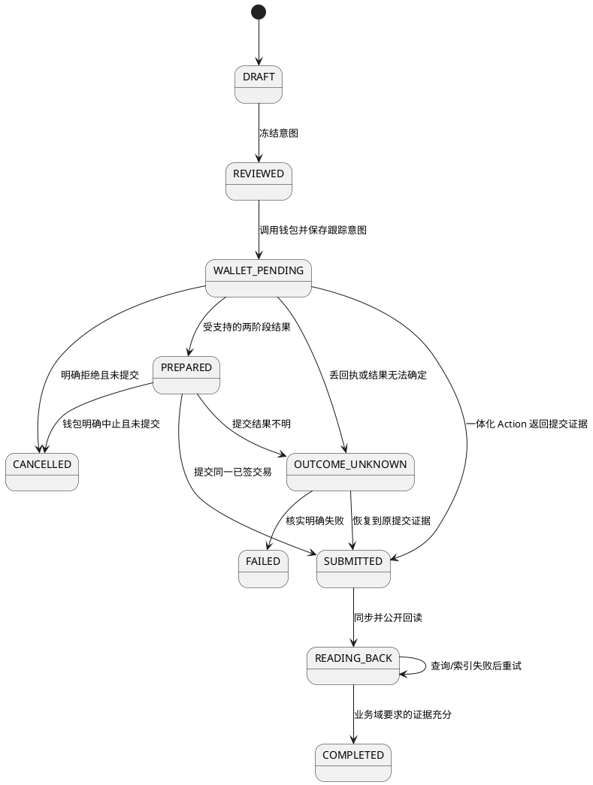

# 钱包、交易与链上查询支撑域（OwnWord v0.4.0）

> 状态：needs-review。稳定职责以[核心认知 §5.4](../../核心认知.md#54-支撑能力与产品领域的责任)为权威；本文落实用例、模型、协作与验收。用户已明确本人身份管理复用 Yours Wallet，本轮确定签名、提交、链状态与 Ordinal 查询的支撑边界。源码取证不等于扩展或主网运行验收。

## 1. 范围与所有权

| 逻辑边界 | 支撑责任 | 消费方与业务决策 |
| --- | --- | --- |
| Wallet Integration | 连接、账户、授权、本人 BAP 身份/Profile/轮换、钱包持有资产、签名和交易执行 | Identity/Content/Artifact/Relationship 发起业务意图；钱包控制密钥和权限 |
| Transaction Support | 适配钱包执行结果；关联操作、子交易、签名证据、提交结果、同步与恢复 | 各业务领域决定何时构成业务成功；此处不定义 Post、Binding 或关系协议 |
| Chain / Ordinal Query | 原交易/BEEF/Proof、广播状态、主链观测、输出/花费、Origin/历史/内容查询 | Identity 判归属；Artifact 判资产与 Binding；Explorer 组合公开读取 |

以上为逻辑支撑边界的能力分工，可用现有模块和适配器实现，不据此新建三个服务。公开 BAP 验证也消费 Chain Query；Wallet 的本人身份记录不是公开查询投影。

Identity、Content、Artifact、Relationship 保留自己的业务规则。Transaction Support 只保存关联及证据；钱包密钥状态、链上事实、Current Binding 都不在此复制为第二个权威。

## 2. 版本与文档边界

支撑域采用[统一产品版本规则](../../decisions/ADR-001-统一产品版本与文档职责-20261117-175100.md)：当前交付目标为 OwnWord v0.4.0；领域设计通过稳定入口维护当前视图，发布时由 Manifest 锁定文档 Git 快照。支撑能力的设计、实现和真实验收分别记录；不为支撑域创建独立产品版号，也不随每个产品版本复制全部文档。

依赖包版本、参考源码提交和线上观测属于工程证据，按[上游接入依据](../../contracts/upstream/接入依据-Yours与1sat-20261118-164032.md)与[版本清单](../../versions/v0.4.0.yaml)核查；不同参考版本不能合并为已验证的生产组合。前后端调用、HTTP 路径、凭据和示例分别由 §8 的实施文档承载。

## 3. 能力与用例

| 编号 | 用例 | 输入与输出 | 执行主体 |
| --- | --- | --- | --- |
| SUP-01 | Connect / ReadWalletIdentity | 当前 provider/账户 → 钱包会话、BAP ID、钱包身份记录和资料 | Yours/SDK；OwnWord Adapter 映射 |
| SUP-02 | ManageWalletIdentity | 冻结资料/发布或轮换意图 → 钱包 Action 引用、TxID/错误 | Yours/SDK；Identity 协调 Review 与回读 |
| SUP-03 | SignBusinessPayload | 业务内容、关键目标、操作 BAP ID → 协议内身份签名及覆盖证据 | Wallet 签名；SDK 编码；验证端独立校验 |
| SUP-04 | ExecuteTransaction | 冻结意图、资金/资产输入 → Action 引用、已签材料、提交结果 | Wallet/SDK；Transaction Support 关联结果 |
| SUP-05 | RecoverTransaction | 原 operation/Action reference/TxID → 原交易当前结果或 UNKNOWN | Wallet 查询 + Chain Query；不重建业务交易 |
| SUP-06 | SyncTransactionEvidence | 已提交交易 rawTx/TxID → 幂等同步回执 | 现有 Java API；不再次构造或广播 |
| SUP-07 | QueryTransaction / ChainState | 网络 + TxID → 原交易、状态、Proof、主链及来源 | SDK Client/公共服务/metanet4j 适配 |
| SUP-08 | ListWalletOrdinals | 当前钱包会话与分页 → 钱包管理的 Ordinal outputs/可选 BEEF | Yours/SDK listOrdinals |
| SUP-09 | QueryOrdinalTransaction | TxID/outpoint/Origin → 交易输出、花费、Origin、历史和内容 | 公共 Txo/Ordfs/Beef 查询；必要时 metanet4j 补齐 |
| SUP-10 | QueryInscriptionNumber | Inscription ID/Origin/十进制编号 → 编号与主链证据 | 当前缺口，由 metanet4j 补齐；Artifact/Explorer 消费 |

SUP-02 采用钱包已有初始化、资料与轮换语义。OwnWord 不新增独立 Root 初始化授权协议。公开查询 UNKNOWN 只表达公开证据不足；钱包 Action 的能力、授权、记录一致性与待恢复操作共同决定是否可以发起请求。

| 钱包/公开观测 | 应用处理 |
| --- | --- |
| 钱包明确尚未初始化；公开结果 UNKNOWN；无待恢复/已知冲突 | 可发起钱包已有创建/更新资料 Action，由钱包按自身契约处理；公开结果保持 UNKNOWN 直到独立回读 |
| 钱包已有身份或资料不全 | 打开本人身份/补全，复用已有更新能力 |
| 钱包记录读取失败、账户不匹配或返回语义无法确定 | 保留 Draft，重试/恢复；不把失败当作钱包无身份 |
| 已有 Action 结果未知、已签原交易、未决 TxID | 先恢复原操作，禁止再次创建另一笔相同业务交易 |
| 有效公开身份存在而钱包缺记录/密钥路径冲突 | 同步/恢复钱包记录并核实控制能力，不能自动重新初始化 |

资料完整度由钱包返回资料与产品必填规则派生，不保存为另一套身份生命周期。钱包授权资格由钱包决定；应用的 Review、禁止自己关注自己等规则仍由对应产品领域决定。

## 4. 签名与交易执行

### 4.1 三种签名责任

| 证明 | 签署/验证 | 验证对象 |
| --- | --- | --- |
| BAP 身份签名 | Wallet 使用正确 BAP 签名密钥；公共验证器检查历史归属 | 协议载荷、业务目标、操作身份与有效密钥历史 |
| UTXO 花费签名 | Wallet 处理资金输入；交易脚本验证器验签 | 输入锁定条件与交易 sighash |
| Ordinal 资产解锁 | SDK 合约模板构造，Wallet 授权，脚本验证器检查 | 当前资产输入、接收输出及单聪连续性 |

三者不得互相替代。全交易身份签名要求引用[核心认知 §6.4](../../核心认知.md#64-全部链上交易的身份归属)，包括操作拆出的每笔交易。

身份签名必须绑定本笔业务载荷、关键目标与有效签名路径，并能从链上材料独立重验。任意离链消息签名或数据库附件不能替代该证明。公开 Identity Proof 验证签名发生时的历史归属；钱包选择密钥，后端不管理用户密钥。

### 4.2 钱包执行契约

已核实的身份高层 Action 在内部完成签名并尝试提交，执行返回后才提供最终交易材料。领域不能统一要求“先取得最终 rawTx 再批准广播”；具体版本、执行次序和材料格式见[钱包接入 §2](../../frontend/supporting/实现设计-钱包与交易执行-v0.4.0-20261118-164032.md#2-已核实的身份-action-顺序)。授权拒绝与提交结果未知必须分别处理。

### 4.3 执行路径与恢复

既有 Action 路径在调用前冻结意图并保存本地关联，执行后保存真实返回的材料。定制路径需证明签名覆盖、检查和提交边界；能力不足标为 UNSUPPORTED。一次操作选定一个提交主体；结果未知时定位原操作，不重新构造或签名另一笔交易。跟踪引用缺失与跨会话恢复的具体限制见[钱包接入 §3](../../frontend/supporting/实现设计-钱包与交易执行-v0.4.0-20261118-164032.md#3-执行路径与恢复)。

### 4.4 提交后取得最终 rawTx

依次使用钱包返回的最终签名材料、按原 TxID 查询的实际交易字节、其他已核实的持久原交易来源。获取后解析并重算 TxID，检查签名与冻结业务目标，再保存 network/scope、txid、rawTx 与原 operationId。实际格式转换见[钱包接入 §4](../../frontend/supporting/实现设计-钱包与交易执行-v0.4.0-20261118-164032.md#4-提交后取得最终-rawtx)和[Java 查询接入](../../backend/supporting/实现设计-链与Ordinal查询-v0.4.0-20261118-164032.md)。

获取 rawTx 不要求交易入块；暂不可得时保持 UNKNOWN 并继续原查询，不重建交易。材料可得也不等于网络接受或业务生效。

## 5. 模型、关联与数据责任

下表是目标逻辑模型，不是新增 HTTP DTO 或数据库表。实际接口须用 fixtures 确认后进入 Contracts。

| 模型/字段 | 约束与保存方 |
| --- | --- |
| `OperationIntent.operationId` | 应用内唯一、调用前生成；关联冻结的业务快照和操作 BAP ID，OwnWord 保存 |
| `OperationIntent.network/scope/accountRef` | 必填、冻结；模拟隔离与账户切换校验；不含私钥/Seed/WIF |
| `OperationIntent.flowId/step` | 多笔业务操作的父引用/步骤；父流程 1:N 子操作，每笔分别恢复 |
| `WalletExecution.actionRef/providerRef` | 钱包实际提供的稳定跟踪材料；缺失表达 UNKNOWN，不能制造引用 |
| `TransactionEvidence.txid/rawTx` | TxID 从实际材料取得并重算；rawTx 可暂缺，获取后按网络+TxID 定位且字节不可变 |
| `TransactionEvidence.signatureProof` | 协议位置、签名者、覆盖内容及验证结果；归属与密码学结果分别表达 |
| `SubmissionObservation` | accepted/rejected/unknown、提交主体、原始状态、观测时点；存在 TxID 不等于已被网络接收 |
| `ChainObservation` | 网络、来源、observedAt、原始状态、可选块高/块哈希/Proof、主链结论和 coverage；查询失败保留上次成功观测 |
| `OrdinalObservation` | 查询键类型与原值、当前 outpoint、Origin、花费/历史、可选内容/编号及覆盖；字段缺失表达未知 |

钱包保存自身 Action、密钥与资产管理记录；OwnWord 保存业务意图、恢复引用和可重建读投影；链与公共索引提供公开事实。相同字符串形状的 tracking id、Origin、Inscription ID 与 outpoint 也必须有不同语义类型。

当前同步契约将单个 operationId 绑定到单个 TxID。多笔操作使用独立子 operationId，通过 flowId 关联；同一 TxID 的恢复复用原 operationId，不能用父流程 id 同步多笔不同交易。

## 6. 状态、恢复与链上观测

### 6.1 操作与提交分别跟踪

操作状态用于表达用户动作，不替代业务或链状态；具体 SDK 阶段可合并执行。

`OUTCOME_UNKNOWN` 不允许直接重新创建交易。账户切换使旧 Review/未提交授权失效；已提交子交易保留原归属。后续步骤被取消不撤销先前提交。只有核实未提交且钱包操作已安全终止，才可重新 Review 发起新尝试。

### 6.2 归一化链状态

| 上游观测 | 归一化解释 | 不得推断 |
| --- | --- | --- |
| HTTP 成功/RECEIVED/仅 TxID | 提交服务收到请求或材料已生成 | 网络接收、确认或业务发布 |
| SENT_TO_NETWORK | 已尝试传播 | ACCEPTED 或 MINED |
| SEEN_ON_NETWORK | SEEN，附来源 | MINED/唯一主链归属 |
| ACCEPTED_BY_NETWORK | ACCEPTED，保留服务证据 | 公共 BAP/Profile/Binding 已可读 |
| MINED + 块/Proof + 主链核实 | MINED，可根据同一链观测计算确认数 | 永不 reorg、编号或 Binding 有效 |
| IMMUTABLE | 保留服务原始结论和策略来源 | 密码学上的永久不可逆；不得借用编号的 6 确认阈值 |
| REJECTED/DOUBLE_SPEND_ATTEMPTED | 提交拒绝/冲突观测，保留原因及 competingTxs | 另一来源已接受或已入块的事实自动消失 |
| UNKNOWN/404/超时/坏响应 | UNKNOWN，带 scope/source/error | 从未广播、未发布、已删除或零确认 |

链状态不强制单向递增。reorg、冲突或来源失败可让当前结论降级；保留历史观测。多来源冲突返回 CONFLICT，附各自证据，不能以“最后响应”覆盖。

区块高度与块哈希/Proof 必须对应同一网络和被核实的主链；仅有当前高度不足以推导确认数。轮询/SSE 均是观测传输；断流后查询原 TxID。生产适配必须独立核实主链与重组；新块通知或同步标记不能替代该验证。

## 7. Ordinal 交易查询

| 查询 | 查询责任 | 输出与限制 |
| --- | --- | --- |
| 本人持有资产 | 钱包持有资产查询 | wallet tracking id、当前 outpoint、tags/CI、按需 BEEF；不是全网资产或完整转移历史 |
| 指定交易的 Ordinal 候选输出 | 交易输出查询 + 原交易校验 | 逐输出核对 satoshis/脚本与 Ordinal 解析；不能将交易全部 outputs 自动视为 Ordinal |
| 指定 outpoint 及花费 | 输出与花费查询 | 输出/花费 TxID；null 的“未花费”结论须有来源与覆盖，失败不能转换为 null |
| Origin/指定历史位置/最新内容 | 资产 Origin、历史位置及内容查询 | Origin、outpoint、sequence、contentType/MAP；最新内容结果不能单独证明持有人或完整历史 |
| 单条资产转移历史 | Ordfs 历史位置 + TXO 花费追踪 + 原交易/Proof | 同时保存父输出、花费交易、后继输出和覆盖；跨多输出须按实际 sat 连续性解析，不选第一个 1-sat 输出 |
| 地址资产查询 | 地址输出查询 | 按分页/流 coverage 表达；截断或异常不是完整持仓 |
| 全局 Inscription Number/按编号查询 | 已有上述接口不充分 | metanet4j 待补；不得使用 sequence、score、blockIdx 或 tracking id 代替编号 |

公开交易详情按 `(network, txid, vout)` 定位；Origin 是追踪资产的另一查询键。转移前通过 Wallet 重新装载当前输出与所需 BEEF，公共旧缓存不授予花费能力。Origin 进入大于 1 satoshi 输出后的语义、编号稳定性与 Binding 判定引用核心认知，不由支撑域重定义。

历史查询返回 `COMPLETE / PARTIAL / UNKNOWN / CONFLICT` 和 cursor/continuation；连续性有断点时保留已核实部分并指出缺失，不宣称已到达当前持有人。已找到的只读输出可展示，不能用于绕过 Artifact 的转移/Binding 前置条件。

## 8. 跨端端口与实现导航

| 逻辑端口（设计名） | 提供方/消费方式 |
| --- | --- |
| `WalletIdentityPort.read/manage` | 客户端 Adapter 调用 Yours/SDK；保留钱包 scope 和错误 |
| `WalletExecutionPort.execute/recover/abort` | 调用钱包执行适配器；按实际能力选高层/两阶段路径 |
| `IdentityProofVerifier.verify` | 独立验证签名覆盖与 BAP 历史；Identity 发布验证结果供其他业务域消费 |
| `TransactionQueryPort.get` | 原交易、提交服务状态、Proof 和主链观测；保留各来源 |
| `OrdinalQueryPort.getOutput/history/content` | 组合公开输出、内容和原交易查询；与钱包持仓端口独立 |
| `InscriptionNumberQuery` | metanet4j 待实施能力，接口路径尚未确定 |

前端负责钱包会话、Review、执行引用、交互及恢复。后端负责原交易校验、公共事实查询、历史验签和可重建投影。产品组件依赖领域端口，具体 Yours/SDK 依赖留在 Adapter。

| 文档职责 | 当前入口 |
| --- | --- |
| 上游协议、API、鉴权、依赖与源码依据 | [Yours 与 1sat 接入依据](../../contracts/upstream/接入依据-Yours与1sat-20261118-164032.md) |
| 钱包调用、TypeScript 材料处理与恢复 | [钱包与交易执行](../../frontend/supporting/实现设计-钱包与交易执行-v0.4.0-20261118-164032.md) |
| Java HTTP、原交易处理与公共查询接入 | [链与 Ordinal 查询](../../backend/supporting/实现设计-链与Ordinal查询-v0.4.0-20261118-164032.md) |

领域端口不表示已部署同名 Java 类或 HTTP 路由；接口与验收状态由[Contracts](../../contracts/README.md)和 Manifest 表达。

## 9. v0.4.0 实施与验收

| 次序 | 能力范围 | 必需证据 |
| --- | --- | --- |
| A | 固定 Yours/SDK 生产版本，接通本人身份、授权和交易执行 | SUP-01/02/04；真实参数/错误 fixtures、拒绝/切换账户、已存在身份、丢回执恢复 |
| B | 身份签名、同步与交易观测/公开身份回读 | SUP-03/05/06/07；逐笔 rawTx 与签名覆盖、旧密钥/历史、接收与确认、幂等及公开投影 |
| C | 钱包资产与公共 Ordinal 交易/输出/历史查询 | SUP-08/09；已花费/未花费、历史缺口、最新输出、多输出、分页与 reorg |
| D | Artifact 的全局编号、Binding 和普通 Transfer 身份签名 | SUP-10 及 Artifact 验收；协议与验证器样例，按实际实现单独关闭 |

均归统一 v0.4.0，不创建支撑域独立产品版本。Identity/Content 的可交付能力分别记录；Artifact 的外部能力缺口不改变 Identity 无资产也可使用的规则。整版发布仍按 Manifest 范围与门禁验收。

派生场景见 [supporting.feature](../../contracts/acceptance/supporting.feature) 与 [identity.feature](../../contracts/acceptance/identity.feature)。本轮只做文档与源码一致性检查，未执行这些场景。

## 10. 能力缺口与关闭责任

| 项 | 责任方 | 关闭方式 |
| --- | --- | --- |
| Yours/SDK 实际版本与 sources.lock 不一致 | Wallet Adapter / 工程负责人 | 固定实际依赖组合、来源 SHA 与响应 fixtures；不凭目录说明认定版本 |
| 身份 Action 丢回执关联、交易获取与跨会话恢复 | Wallet Adapter | 高层接口未返回 actionId/reference；Toolbox pending reference 会话外恢复未实现。验证持久查询关联或补受支持适配，覆盖中断/重启/切换；不得靠原 Action 重试恢复 |
| 普通 Transfer 的 identityKey 签名封装 | Wallet/SDK + metanet4j | 现有路径存在协议限制，详见钱包接入依据；验证受支持的封装和覆盖，不添加重铭刻绕过 |
| 历史签名归属、未确认交易及 reorg | Identity Proof / Indexer | BAP 历史、链序和原交易向量；单个当前地址校验接口不自动关闭该项 |
| 完整链观测与 Ordinal 转移历史 | Chain/Ordinal Query | 部署 fixtures、Proof/主链重查、多输出 sat 追踪、分页/缺口/reorg |
| 编号与公开 Binding | Artifact / metanet4j | 遵循核心认知 §12，独立原始记录与验证器 |

上述为实施与协议门禁；不把已明确的支撑职责再次标为待定，也不把缺少公共阴性证明等同于需要 OwnWord 自建钱包初始化协议。

## 11. 设计依据

[核心认知 §5.4](../../核心认知.md#54-支撑能力与产品领域的责任)定义稳定职责；[Identity 领域](../identity/README.md)定义身份业务规则；[统一版本基线](../../versions/v0.4.0.yaml)记录文档、工程版本及门禁。源码与发布包证据统一见[上游接入依据 §1、§4](../../contracts/upstream/接入依据-Yours与1sat-20261118-164032.md)，不在领域文件复制包哈希或 HTTP 接入细节。
