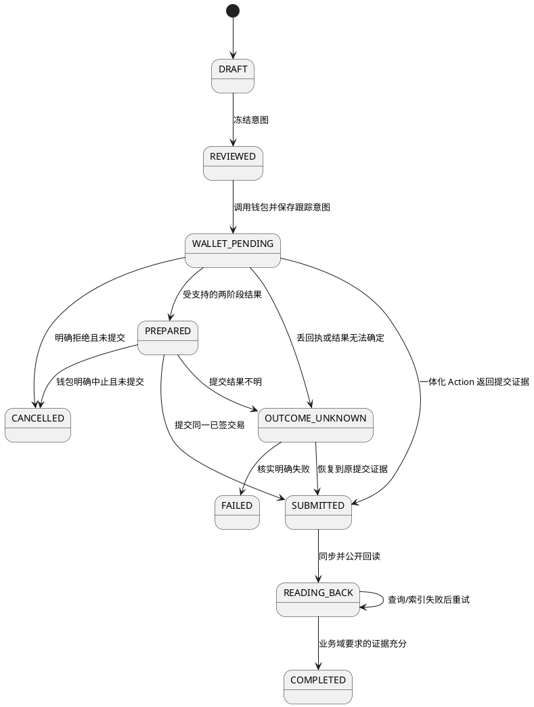

# 钱包、交易与链上查询支撑域（OwnWord v0.4.0）

> 状态：needs-review。稳定职责以[核心认知 §5.4](../../核心认知.md#54-支撑能力与产品领域的责任)为权威；本文落实用例、模型、协作与验收。用户已明确本人身份管理复用 Yours Wallet，本轮确定签名、提交、链状态与 Ordinal 查询的支撑边界。源码取证不等于扩展或主网运行验收。

## 1. 范围与所有权

| 逻辑边界 | 支撑责任 | 消费方与业务决策 |
| --- | --- | --- |
| Wallet Integration | 连接、账户、授权、本人 BAP 身份/Profile/轮换、钱包持有资产、签名和交易执行 | Identity/Content/Artifact/Relationship 发起业务意图；钱包控制密钥和权限 |
| Transaction Support | 适配钱包执行结果；关联操作、子交易、签名证据、提交结果、同步与恢复 | 各业务领域决定何时构成业务成功；此处不定义 Post、Binding 或关系协议 |
| Chain / Ordinal Query | 原交易/BEEF/Proof、广播状态、主链观测、输出/花费、Origin/历史/内容查询 | Identity 判归属；Artifact 判资产与 Binding；Explorer 组合公开读取 |

以上为逻辑支撑边界的能力分工，可用现有模块和适配器实现，不据此新建三个服务。公开 BAP 验证也消费 Chain Query；Wallet 的本人身份记录不是公开查询投影。

Identity、Content、Artifact、Relationship 保留自己的业务规则。Transaction Support 只保存关联及证据；钱包密钥状态、链上事实、Current Binding 都不在此复制为第二个权威。

## 2. 当前源码证据与版本边界

以下路径相对工作区根，具体引用见 §11；各份参考源码的版本不能合并成一个已验证依赖组合。

| 依据 | 本次实际观察 | 可以确认的范围 |
| --- | --- | --- |
| Yours `package.json` | `5.1.0`；`@1sat/actions 0.0.212` | 与 `sources.lock.json` 记录的 5.1.1 不一致，尚未重锁来源；本次以实际 package.json 与 bun.lock 为准 |
| Yours `useIdentity.ts` | 计算/解析 BAP ID、读取 Profile、调用 updateProfile 并重读 | 本人身份管理已有调用链；不是 OwnWord 待自研能力 |
| Yours `background.ts` | 认证/权限、createAction/signAction/abortAction/listActions/listOutputs 转发 | 钱包执行及权限边界已有；外部调用保留 originator |
| Yours 锁定 Actions 发布包 | `@1sat/actions 0.0.212`；已下载只读核查，SHA-512 与 bun.lock 一致 | 已核实身份 Action 的内部签名/提交顺序；未安装或执行包 |
| Yours 锁定 Toolbox 发布包 | `@bsv/wallet-toolbox-client 2.12.0`；SHA-512 与 bun.lock 一致 | 已核实 signAction→processAction→postBeef 及 Atomic BEEF 返回 |
| SDK `packages/actions/package.json` | `@1sat/actions 0.0.221` | 独立参考实现，不等于 Yours 0.0.212 的准确行为 |
| SDK Identity/Signing/Ordinals | 已有 Actions、AIP/BAP/Sigma、资产列表及转移构造 | 优先复用；普通 Transfer 身份签名仍有明确限制 |
| Yours 锁定的 Client/Types/Wallet/Browser | 0.0.51 / 0.0.43 / 0.0.106 / 0.0.92；发布包哈希均与 bun.lock 一致 | 默认 API、实际广播/状态与 TXO/OrdFS 方法已核实，见 §8.1 |
| 独立 SDK Client | Arcade/Beef/Chaintracks/Txo/Owner/Ordfs/Bap 客户端 | 用于其他适配依据；不将其广播实现与 Yours 锁定版混用 |
| Java `metanet4j-api-ownword` | 本地 `fbb048eab9ff565ea2f4aff1bd01720b9240d407` | 已有同步、验签、原交易和有限链观测；不是完整 Ordinal 查询或身份投影管线 |

本轮不升级参考目录，不改锁定清单，不把 SDK 0.0.221 的实现冒充 Yours 0.0.212 的运行结果。接入前先固定实际生产组合，并逐项核对 SDK 方法、参数、授权和回执。

## 3. 能力与用例

| 编号 | 用例 | 输入与输出 | 执行主体 |
| --- | --- | --- | --- |
| SUP-01 | Connect / ReadWalletIdentity | 当前 provider/账户 → 钱包会话、BAP ID、钱包身份记录和资料 | Yours/SDK；OwnWord Adapter 映射 |
| SUP-02 | ManageWalletIdentity | 冻结资料/发布或轮换意图 → 钱包 Action 引用、TxID/错误 | Yours/SDK；Identity 协调 Review 与回读 |
| SUP-03 | SignBusinessPayload | 业务内容、关键目标、操作 BAP ID → 协议内身份签名及覆盖证据 | Wallet 签名；SDK 编码；验证端独立校验 |
| SUP-04 | ExecuteTransaction | 冻结意图、资金/资产输入 → Action 引用、已签材料、提交结果 | Wallet/SDK；Transaction Support 关联结果 |
| SUP-05 | RecoverTransaction | 原 operation/Action reference/TxID → 原交易当前结果或 UNKNOWN | Wallet 查询 + Chain Query；不重建业务交易 |
| SUP-06 | SyncTransactionEvidence | 已提交交易 rawTx/TxID → 幂等同步回执 | 现有 Java API；不再次构造或广播 |
| SUP-07 | QueryTransaction / ChainState | 网络 + TxID → 原交易、状态、Proof、主链及来源 | SDK Client/公共服务/metanet4j 适配 |
| SUP-08 | ListWalletOrdinals | 当前钱包会话与分页 → 钱包管理的 Ordinal outputs/可选 BEEF | Yours/SDK listOrdinals |
| SUP-09 | QueryOrdinalTransaction | TxID/outpoint/Origin → 交易输出、花费、Origin、历史和内容 | 公共 Txo/Ordfs/Beef 查询；必要时 metanet4j 补齐 |
| SUP-10 | QueryInscriptionNumber | Inscription ID/Origin/十进制编号 → 编号与主链证据 | 当前缺口，由 metanet4j 补齐；Artifact/Explorer 消费 |

SUP-02 采用钱包已有初始化、资料与轮换语义。OwnWord 不新增独立 Root 初始化授权协议。公开查询 UNKNOWN 只表达公开证据不足；钱包 Action 的能力、授权、记录一致性与待恢复操作共同决定是否可以发起请求。

| 钱包/公开观测 | 应用处理 |
| --- | --- |
| 钱包明确尚未初始化；公开结果 UNKNOWN；无待恢复/已知冲突 | 可发起钱包已有创建/更新资料 Action，由钱包按自身契约处理；公开结果保持 UNKNOWN 直到独立回读 |
| 钱包已有身份或资料不全 | 打开本人身份/补全，复用已有更新能力 |
| 钱包记录读取失败、账户不匹配或返回语义无法确定 | 保留 Draft，重试/恢复；不把失败当作钱包无身份 |
| 已有 Action 结果未知、已签原交易、未决 TxID | 先恢复原操作，禁止再次创建另一笔相同业务交易 |
| 有效公开身份存在而钱包缺记录/密钥路径冲突 | 同步/恢复钱包记录并核实控制能力，不能自动重新初始化 |

资料完整度由钱包返回资料与产品必填规则派生，不保存为另一套身份生命周期。钱包授权资格由钱包决定；应用的 Review、禁止自己关注自己等规则仍由对应产品领域决定。

## 4. 签名与交易执行

### 4.1 三种签名责任

| 证明 | 签署/验证 | 验证对象 |
| --- | --- | --- |
| BAP 身份签名 | Wallet 使用正确 BAP 签名密钥；公共验证器检查历史归属 | 协议载荷、业务目标、操作身份与有效密钥历史 |
| UTXO 花费签名 | Wallet 处理资金输入；交易脚本验证器验签 | 输入锁定条件与交易 sighash |
| Ordinal 资产解锁 | SDK 合约模板构造，Wallet 授权，脚本验证器检查 | 当前资产输入、接收输出及单聪连续性 |

三者不得互相替代。全交易身份签名要求引用[核心认知 §6.4](../../核心认知.md#64-全部链上交易的身份归属)，包括操作拆出的每笔交易。

优先复用 `applyBapAip / resolveBapSigner / signWithBap / Sigma`，但方法名不能证明覆盖充分。`signWithBap(message)` 返回的离链消息签名，只有在已确认的协议封装把它绑定到本笔业务并可从链上材料独立重验时，才能满足交易身份签名要求。不能把任意消息签名附在数据库中就认定链上交易合格。

`SigningPathAt` 和历史校验由公开 Identity Proof 验证端提供。Wallet 选择签名密钥；后端不管理或轮换用户密钥。现有 BapClient.validByAddress(address, block) 可作为适配依据，但同块顺序、未确认交易、历史覆盖及 reorg 的充分性仍需交易向量验证。

### 4.2 已核实的身份 Action 顺序

以下结论针对 Yours 锁定的 `@1sat/actions 0.0.212` 默认钱包路径，且未注入 fundingProvider。已核对该发布包及 `@bsv/wallet-toolbox-client 2.12.0`，两者 SHA-512 均与 Yours 的 bun.lock 一致；不是由独立 SDK 0.0.221 推断。

| 步骤 | 固定版本源码位置 | 结论 |
| --- | --- | --- |
| 钱包调用资料 Action | Yours useIdentity.ts:192 | 等待 updateProfile.execute 完成后才取得返回值 |
| 发布/更新入口 | Actions dist/identity/index.js:153、424 | 内部调用 executeTrackedAction；设置 acceptDelayedBroadcast=false，未设置 noSend |
| 默认流水线 | Actions dist/utils/createTrackedAction.js:208；dist/pipeline/runPipeline.js:26、52 | createAction 使用 signAndProcess=false，随后内部继续 completeSignedAction，不向高层调用方暴露暂停点 |
| 补齐签名 | Actions dist/utils/completeSignedAction.js:107；Toolbox signer/methods/signAction.ts:61 | 调用 signAction，钱包完成资金输入签名；此前 signable BEEF 的资金输入尚未完成签名 |
| 提交处理 | Toolbox signer/methods/signAction.ts:68；storage/methods/processAction.ts:281、326 | 签名后先调用 processAction；非 noSend 且非延迟路径进入 attemptToPostReqsToNetwork |
| 发网与返回 | Toolbox storage/methods/attemptToPostReqsToNetwork.ts:28；signer/methods/signAction.ts:89 | 调用 services.postBeef 后返回结果；tx 是 Atomic BEEF，非 rawTx hex |
| 身份 Action 对外结果 | Actions dist/identity/index.js:172、447 | 返回 txid/tx/bapId 或 error；不返回内部 actionId、reference，也没有提供 noSend 或提交前回调参数 |

Toolbox 位置取自其发布包 `out/index.client.mjs.map` 内的 sourcesContent，行号为对应 TypeScript 源文件行号。[BRC-100](https://github.com/bsv-blockchain/BRCs/blob/master/wallet/0100.md)定义 noSend 默认为 false；acceptDelayedBroadcast=false 要求前台尝试提交。两者不能解释为“只签名”。网络接受或入块仍由独立查询确认。

**结论范围**：现有身份高层 Action 调用内部完成签名并尝试提交，调用方在执行返回后才取得最终交易材料，没有“取得最终 rawTx 后再批准提交”的中间接口。不能将 signAndProcess=false 返回的未签完 BEEF 当最终 rawTx。此结论不外推到全部高层 Actions、外部 fundingProvider、不同依赖版本或特殊批处理配置；这些路径逐项核查。

### 4.3 两条执行路径


1. **既有 Action 路径**：发布/更新身份、资产等优先调用 Wallet/SDK 的高层 Action。Review 前冻结业务资料、身份和目标，调用前再次核对会话；已核实的身份 Action 内部完成构造、签名并尝试提交。调用前保存本地 operationId/意图，返回后立即保存实际 TxID 及提供的交易材料。身份 Action 当前没有暴露调用方跟踪标签/reference，不能声称可直接把 operationId 传入；丢回执关联需要适配实证或扩展。
2. **定制协议路径**：现有 Action 不能表达业务时，复用 SDK 模板与钱包 createAction/signAction。适配器必须证明能在提交前检查冻结内容、逐笔身份签名及关键目标；若要求先取得最终交易再提交，需验证 noSend=true 的完整路径与后续同笔提交；单独 signAndProcess=false 仅停在待签阶段，后续 signAction 仍可提交。现有前端 prepare/broadcast 两阶段实现可保留，但不把 prepareWithoutBroadcast 作为所有高层 Action 的共同前置条件。

既有 Action 若不能保证本产品需要的授权和签名覆盖，则标为 UNSUPPORTED，先补适配；不能因复用钱包而绕过签名约束。一次操作选定一个提交主体。默认通过 Wallet/SDK 提交；独立 broadcaster 只在受支持的明确路径提交同一已签 rawTx，不自动并行向多个主体新建交易。

已核实的身份 Action 不暴露提交前的最终 rawTx。生产适配须验证执行关联、交易获取和丢回执恢复；Toolbox 2.12.0 的 signAction 还显式拒绝恢复会话外的 pending reference，不能把保存 reference 等同于支持跨重启恢复。可通过受支持的持久查询恢复已提交交易；未提交签名阶段的跨会话续接须另行验证。能力不足保持 UNKNOWN，禁止盲重试高层 Action。

身份 Action 的 catch 分支只返回 error 文本，可能不保留底层异常携带的 TxID/交易材料。不能将所有 error 解释成“未提交”；只有核实明确拒绝且未提交才可取消，其余结果需按原执行查询恢复。

### 4.4 提交后取得最终 rawTx

| 优先级 | 获取方式 | 校验与失败处理 |
| --- | --- | --- |
| 1 | 身份 Action 返回 txid/tx；tx 是最终签名交易的 Atomic BEEF | 用 Transaction.fromAtomicBEEF 取目标交易，重算 TxID，再用 toHex 得 rawTx；不能把整个 BEEF 直接 hex 编码后作为 rawTx |
| 2 | 只有 TxID 时，通过 BeefClient.getRawTx(txid) 取得原交易字节 | 当前参考 Client 实现请求 /1sat/beef/{txid}/tx；注释中的 /raw 已与实现不符。按原交易解析后重算 TxID，服务部署/版本用 fixtures 核对 |
| 3 | 使用其他已核实的原交易来源或钱包持久记录 | 必须返回实际已签字节，不是重新构造；现有 Java GET 交易接口可能只返回 receipt，不能一律假设含 rawTx |
| 待恢复 | 无返回交易材料、补查尚不可得或原执行未定位 | 保持 UNKNOWN，保存已知操作/TxID，继续原查询；不重新签名或重建业务交易 |

提取示意（接口能力见本节取证，生产实现须补类型和失败语义）：

```typescript
if (!result.txid) throw new Error('MISSING_TXID')
const tx = result.tx
  ? Transaction.fromAtomicBEEF(result.tx)
  : Transaction.fromBinary(Array.from(await beefClient.getRawTx(result.txid)))
if (tx.id('hex') !== result.txid) throw new Error('TXID_MISMATCH')
const rawTx = tx.toHex()
```

获取最终 rawTx 不要求交易入块；公共查询可能因传播、覆盖或服务故障暂不可得，不能保证提交后立即查到。材料取得后保存 `(network/scope, txid, rawTx)` 与原 operationId，并检查身份签名和冻结业务目标；供同步和恢复使用，不据此宣称网络接受或业务已生效。

## 5. 模型、关联与数据责任

下表是目标逻辑模型，不是新增 HTTP DTO 或数据库表。实际接口须用 fixtures 确认后进入 Contracts。

| 模型/字段 | 约束与保存方 |
| --- | --- |
| `OperationIntent.operationId` | 应用内唯一、调用前生成；关联冻结的业务快照和操作 BAP ID，OwnWord 保存 |
| `OperationIntent.network/scope/accountRef` | 必填、冻结；模拟隔离与账户切换校验；不含私钥/Seed/WIF |
| `OperationIntent.flowId/step` | 多笔业务操作的父引用/步骤；父流程 1:N 子操作，每笔分别恢复 |
| `WalletExecution.actionRef/providerRef` | 钱包实际提供的稳定跟踪材料；缺失表达 UNKNOWN，不能制造引用 |
| `TransactionEvidence.txid/rawTx` | TxID 从实际材料取得并重算；rawTx 可暂缺，获取后按网络+TxID 定位且字节不可变 |
| `TransactionEvidence.signatureProof` | 协议位置、签名者、覆盖内容及验证结果；归属与密码学结果分别表达 |
| `SubmissionObservation` | accepted/rejected/unknown、提交主体、原始状态、观测时点；存在 TxID 不等于已被网络接收 |
| `ChainObservation` | 网络、来源、observedAt、原始状态、可选块高/块哈希/Proof、主链结论和 coverage；查询失败保留上次成功观测 |
| `OrdinalObservation` | 查询键类型与原值、当前 outpoint、Origin、花费/历史、可选内容/编号及覆盖；字段缺失表达未知 |

钱包保存自身 Action、密钥与资产管理记录；OwnWord 保存业务意图、恢复引用和可重建读投影；链与公共索引提供公开事实。相同字符串形状的 tracking id、Origin、Inscription ID 与 outpoint 也必须有不同语义类型。

现有 Java Sync 将单个 operationId 绑定到单个 TxID。多笔操作使用独立子 operationId，通过 flowId 关联；同一 TxID 的恢复复用原 operationId，不能用父流程 id 同步多笔不同交易。

## 6. 状态、恢复与链上观测

### 6.1 操作与提交分别跟踪

操作状态用于表达用户动作，不替代业务或链状态；具体 SDK 阶段可合并执行。



`OUTCOME_UNKNOWN` 不允许直接重新创建交易。账户切换使旧 Review/未提交授权失效；已提交子交易保留原归属。后续步骤被取消不撤销先前提交。只有核实未提交且钱包操作已安全终止，才可重新 Review 发起新尝试。

### 6.2 归一化链状态

| 上游观测 | 归一化解释 | 不得推断 |
| --- | --- | --- |
| HTTP 成功/RECEIVED/仅 TxID | 提交服务收到请求或材料已生成 | 网络接收、确认或业务发布 |
| SENT_TO_NETWORK | 已尝试传播 | ACCEPTED 或 MINED |
| SEEN_ON_NETWORK | SEEN，附来源 | MINED/唯一主链归属 |
| ACCEPTED_BY_NETWORK | ACCEPTED，保留服务证据 | 公共 BAP/Profile/Binding 已可读 |
| MINED + 块/Proof + 主链核实 | MINED，可根据同一链观测计算确认数 | 永不 reorg、编号或 Binding 有效 |
| IMMUTABLE | 保留服务原始结论和策略来源 | 密码学上的永久不可逆；不得借用编号的 6 确认阈值 |
| REJECTED/DOUBLE_SPEND_ATTEMPTED | 提交拒绝/冲突观测，保留原因及 competingTxs | 另一来源已接受或已入块的事实自动消失 |
| UNKNOWN/404/超时/坏响应 | UNKNOWN，带 scope/source/error | 从未广播、未发布、已删除或零确认 |

链状态不强制单向递增。reorg、冲突或来源失败可让当前结论降级；保留历史观测。多来源冲突返回 CONFLICT，附各自证据，不能以“最后响应”覆盖。

区块高度与块哈希/Proof 必须对应同一网络和被核实的主链；仅有当前高度不足以推导确认数。轮询/SSE 均是观测传输；断流后查询原 TxID。ChaintracksClient 的 subscribeReorgs 当前抛出未实现错误，生产适配须补主链重查，不能把订阅新块或固定 true 的 isSynchronized 当作重组验证。

## 7. Ordinal 交易查询

| 查询 | 已有入口 | 输出与限制 |
| --- | --- | --- |
| 本人持有资产 | listOrdinals → wallet.listOutputs | wallet tracking id、当前 outpoint、tags/CI、按需 BEEF；不是全网资产或完整转移历史 |
| 指定交易的 Ordinal 候选输出 | TxoClient.getByTxid + BeefClient.getRawTx | 逐输出核对 satoshis/脚本与 Ordinal 解析；不能将交易全部 outputs 自动视为 Ordinal |
| 指定 outpoint 及花费 | TxoClient.get/getSpend | 输出/花费 TxID；null 的“未花费”结论须有来源与覆盖，失败不能转换为 null |
| Origin/指定历史位置/最新内容 | OrdfsClient.getMetadata(outpoint, seq)、getContent | Origin、outpoint、sequence、contentType/MAP；seq=-1 是现有 latest 查询约定，不能单独证明持有人或完整历史 |
| 单条资产转移历史 | Ordfs 历史位置 + TXO 花费追踪 + 原交易/Proof | 同时保存父输出、花费交易、后继输出和覆盖；跨多输出须按实际 sat 连续性解析，不选第一个 1-sat 输出 |
| 地址资产查询 | OwnerClient.getTxos | 按分页/流 coverage 表达；截断或异常不是完整持仓 |
| 全局 Inscription Number/按编号查询 | 已有上述接口不充分 | metanet4j 待补；不得使用 sequence、score、blockIdx 或 tracking id 代替编号 |

公开交易详情按 `(network, txid, vout)` 定位；Origin 是追踪资产的另一查询键。转移前通过 Wallet 重新装载当前输出与所需 BEEF，公共旧缓存不授予花费能力。Origin 进入大于 1 satoshi 输出后的语义、编号稳定性与 Binding 判定引用核心认知，不由支撑域重定义。

历史查询返回 `COMPLETE / PARTIAL / UNKNOWN / CONFLICT` 和 cursor/continuation；连续性有断点时保留已核实部分并指出缺失，不宣称已到达当前持有人。已找到的只读输出可展示，不能用于绕过 Artifact 的转移/Binding 前置条件。

## 8. 跨端端口与既有 API

| 逻辑端口（设计名） | 提供方/消费方式 |
| --- | --- |
| `WalletIdentityPort.read/manage` | 客户端 Adapter 调用 Yours/SDK；保留钱包 scope 和错误 |
| `WalletExecutionPort.execute/recover/abort` | 复用现有 WalletProvider；按实际能力选高层/两阶段路径 |
| `IdentityProofVerifier.verify` | 独立验证签名覆盖与 BAP 历史；Identity 发布验证结果供其他业务域消费 |
| `TransactionQueryPort.get` | 原交易、提交服务状态、Proof 和主链观测；保留各来源 |
| `OrdinalQueryPort.getOutput/history/content` | 封装 Txo/Ordfs/Beef；与钱包持仓端口独立 |
| `InscriptionNumberQuery` | metanet4j 待实施能力，接口路径尚未确定 |

前端负责钱包会话、Review、执行引用、交互及恢复。后端负责原交易校验、公共事实查询、历史验签和可重建投影。产品组件依赖领域端口，具体 Yours/SDK 依赖留在 Adapter。

现有 OwnWord `POST /api/v1/transactions/sync` 和 `GET /api/v1/transactions/{txid}` 可复用，但后者目前会返回 storage receipt 或有限 chain observation，不能冒充本设计完整的 TransactionQuery/OrdinalQuery。尚无已核实的 OwnWord Ordinal 历史/编号 HTTP 端点，本轮不在 OpenAPI 发明路径。SDK 公共客户端的上游路由也不等于 OwnWord 后端已实现同名路由。

Java `IdentityApi` 目前缺投影时丢弃公共 BAP 响应正文并返回 unknown，`TransactionSyncApi` 写 chain_events 后未见身份投影生成路径；实现时应接通公共 BAP/事件→可重建身份投影，供业务回读，不能以同步回执代替。

### 8.1 Yours 实际 API 与可复用入口

这些 `@1sat/*` 包来自 [b-open-io/1sat-sdk](https://github.com/b-open-io/1sat-sdk) monorepo；公共 HTTP 服务端是 [1sat-stack](https://github.com/b-open-io/1sat-stack)。OwnWord 按需复用 Client 和已有 Wallet Adapter / Actions，无需引入整套钱包运行时。

本节按 Yours 锁定的 Client 0.0.51、Types 0.0.43、Wallet 0.0.106、Wallet Browser 0.0.92 核查，四个发布包均只下载读取且完整性哈希与 bun.lock 一致。Yours ServiceProvider.tsx:22 和 initSyncContext.ts:37 创建 OneSatServices(main)，initWallet 未覆盖 servicesBaseUrl；Wallet factory.js:15–24 将 OneSatServices 注入钱包。默认主网基址为 https://api.1sat.app，测试网为 https://testnet.api.1sat.app。

| 能力 | Client 0.0.51 的方法 | 相对主网基址的 HTTP 路径/输入 |
| --- | --- | --- |
| 钱包广播 | postBeef → submitToStack | POST /1sat/tx；application/octet-stream；钱包传 Atomic BEEF，submitToStack 也接受已签原交易字节 |
| 提交状态 | getStackStatus(txid)；getStatusForTxids 为归一化封装 | GET /1sat/tx/{txid}；不存在/异常时封装可尝试 BEEF，不能把 known 当作主链证明 |
| 地址同步/UTXO 流 | owner.getTxos(address, options)；owner.sync | GET /1sat/owner/{address}/txos；GET /1sat/owner/sync?owner=...；SSE，不是普通 JSON 数组 |
| 地址未花费输出 | txo.search(own:address, options) | GET /1sat/txo/search?key=own%3A{address}&unspent=true；按需 sats/events/block/spend 与分页 |
| 指定输出与花费 | txo.get(outpoint)；txo.getSpend(outpoint) | GET /1sat/txo/{outpoint}；GET /1sat/txo/{outpoint}/spend |
| 指定交易的输出 | txo.getByTxid(txid, options) | GET /1sat/txo/tx/{txid}；再解析实际 Ordinal 输出 |
| BEEF/最终原交易/Proof | beef.getBeef/getRawTx/getProof | GET /1sat/beef/{txid}、/1sat/beef/{txid}/tx、/1sat/beef/{txid}/proof；返回二进制 |
| Ord 元数据/Origin/指定版本 | ordfs.getMetadata(outpoint, seq) | GET /1sat/ordfs/metadata/{outpoint}[:seq] |
| Ord 图片/内容 | ordfs.getContent/getContentUrl | GET /content/{outpoint}[:seq]；内容不在 /1sat 前缀下 |
| 链高与块锚 | getHeight → chaintracks.currentHeight；getMerklePath | 当前锁定客户端从 /1sat/chaintracks/tip 取高度；Proof 联合块头核验 |

上述均是外部 1sat API，不是新增 OwnWord HTTP 路由。outpoint 按相应接口返回值传递，不能使用钱包 tracking id。地址扫描按 Yours scanner.ts:171–194 先触发 owner 同步，再用 txo.search 取未花费输出；OneSatServices.isUtxo/getUtxoStatus 也使用这些 TXO 接口。

**广播版本差异**：Client 0.0.51 的 postBeef 实际调用 submitToStack → /1sat/tx。它另有 arcade.submitTransaction/getStatus，对应 /1sat/arcade/tx 及 /1sat/arcade/tx/{txid}。当前独立参考 SDK 的 postBeef 已改为 Arcade Client 入口；不能据此声称 Yours 0.0.51 的默认广播就是 /1sat/arcade/tx。复用时固定一个已核实路径，保留原始状态。

**钱包资产入口**：Yours OrdWallet.tsx:295 调用 listOrdinals.execute，Actions 0.0.212 dist/ordinals/index.js:557 再调用 wallet.listOutputs，basket 为 ordinals；这读取钱包管理记录。OrdWallet.tsx:385 用 sendOrdinals.execute，按 tracking id 发起转移；铭刻可复用 inscribe。对 OwnWord，钱包资产与动作通过既有 BRC-100 Wallet Adapter / Actions 使用，公共交易/资产读取通过 Client 使用；不把扩展内部 ChromeCWI 或 admin originator 复制进站点。

只读复用示意，按 Client 0.0.51 的公开导出：

```typescript
import { OneSatServices } from '@1sat/client'
const services = new OneSatServices('main', 'https://api.1sat.app')
const outputs = await services.txo.search(`own:${address}`, {
  unspent: true, sats: true, events: true,
})
const txOutputs = await services.txo.getByTxid(txid, { sats: true, spend: true })
const spender = await services.txo.getSpend(outpoint)
const metadata = await services.ordfs.getMetadata(outpoint)
const rawTxBytes = await services.beef.getRawTx(txid)
const status = await services.getStackStatus(txid)
```

需要独立广播已签材料时，Client 0.0.51 的 submitToStack(bytes) 是对应入口；若已调用自动提交的 Wallet Action，则继续保存回执和查询，不再另行发起同一业务的创建/广播流程。查询和广播可复用，OwnWord 的签名覆盖、历史归属、reorg 和业务验收仍由各领域验证。

源码中的 WhatsOnChain/GorillaPool 旧常量或汇率调用，不改变上述 BRC-100 默认支撑链路。公共服务接入、鉴权和只读验证范围见 §8.2。

### 8.2 api.1sat.app 接入与鉴权

**当前接入结论**：按 §8.1 使用 `@1sat/client`，公共查询无需先申请 API Key。Yours 锁定 Client 0.0.51 的 `BaseClient` 使用普通 fetch，`ClientOptions` 仅有 timeout/fetch，没有 apiKey 配置，也没有默认添加 Authorization 或 X-Api-Key。OneSatServices 的第二个参数填主机基址，保持 `https://api.1sat.app`；各客户端自行补 `/1sat/...`，内容路径自行补 `/content/...`。

直接 HTTP 调用示例（PowerShell）：

```powershell
curl.exe 'https://api.1sat.app/1sat/chaintracks/tip'
curl.exe 'https://api.1sat.app/1sat/txo/search?key=own%3A1A1zP1eP5QGefi2DMPTfTL5SLmv7DivfNa&unspent=true&limit=1'
```

示例地址为公开的 Bitcoin 创世地址，只用于演示参数编码。OwnWord 的查询服务由后端 Adapter 调用并统一转换结果；前端保留钱包连接与执行入口。浏览器公共读取可以直接接入，但服务域名、超时和响应差异仍封装在 Adapter 中。

| 机制 | 源码中的用途 | OwnWord 接入要求 |
| --- | --- | --- |
| 公共查询与交易提交路由 | Stack 的 Beef、TXO、Owner、OrdFS、Chaintracks、Broadcast 直接挂载，没有挂 AdminGuard 或认证中间件 | 公共读取按匿名请求接入；提交仍须先由钱包完成签名。广播路由的匿名开放已核对源码，线上真实提交尚未验证 |
| BRC-103/104 双向认证 | `/.well-known/auth` 与受保护管理路由使用钱包认证中间件 | 按具体服务要求使用钱包协议认证；本次公共查询不依赖该流程。钱包授权、BAP 业务签名与服务访问认证分别处理 |
| `auth.api_key` / `ONESAT_AUTH_API_KEY` | 运营者配置的静态开发/Agent 凭据；中间件匹配 `X-Api-Key` 后跳过 BRC-103/104，AdminGuard 也放行 | 属于节点管理权限，不是面向每个 dApp 发放的普通查询 Key。自建节点由运营者配置并保存在服务端；不得放入 OwnWord 浏览器配置 |
| 上游 ARC 凭据、广播 callback token | Stack 与矿工/上游服务之间的配置和回调关联 | 调用公共 Stack 不需要申请或传入这些凭据；callback token 不作为 API 访问密钥 |

服务端依据为本地 [路由装配](../../../../../reference/1sat-stack/cmd/server/config.go)和[启动中间件](../../../../../reference/1sat-stack/cmd/server/main.go)，参考仓库提交为 `3d4062a1fffef1b10af5c9e97d5d22c1996c42fb`。该提交是源码证据，不代表线上部署恰好使用此 SHA。[认证配置](../../../../../reference/1sat-stack/pkg/auth/config.go)默认 allow_unauthenticated=true、api_key 为空；[认证中间件](../../../../../reference/1sat-stack/pkg/auth/middleware.go)与 [AdminGuard](../../../../../reference/1sat-stack/pkg/auth/admin.go)给出实际校验行为。

**密钥如何申请**：在已核查的官方 README、源码、接入说明和公共服务入口中，未找到 `api.1sat.app` 的公开自助发 Key 流程。已验证的公共查询可直接使用。若生产需要专属额度、服务承诺或托管凭据，由工程负责人通过 [官方仓库 Issues](https://github.com/b-open-io/1sat-stack/issues)或 [bOpen 公开联系方式](https://github.com/b-open-io)（info@bopen.io）向运营方确认申请渠道、费用、额度、鉴权头与可用范围；这些商业接入条件目前待运营方确认。自建 Stack 则由节点运营者配置自己的 auth.api_key，无需向公共服务申请；该配置不赋予 api.1sat.app 的管理权限。

**说明与实现的差异**：SDK 附带 [stack-api 说明](../../../../../reference/1sat-sdk/packages/client/skills/stack-api/SKILL.md)写有 `Authorization: Bearer YOUR_API_KEY`、匿名 100 次/分钟、认证 1000 次/分钟。当前锁定客户端没有内置该 Key 参数，Stack 管理中间件实际使用 X-Api-Key，公共路由没有对应 Key/额度实现。本次也未取得线上网关对这些额度及 Bearer 机制的确认，因此不把它们作为生产契约。Swagger 中存在 BearerAuth 定义也不能证明所有公共路由要求 Bearer，管理路由以实际实现为准。

**2026-11-18 匿名只读验证**：请求不携带 Authorization、X-Api-Key 或 Cookie。`GET /1sat/capabilities`、`/1sat/health`、`/1sat/arcade/policy`、`/1sat/chaintracks/tip`、上述公开地址 TXO 查询均返回 200；UTXO 查询返回含 outpoint/score 的数组。`/1sat/api-spec/swagger.json` 最终完整取得并可解析，含 133 条路径，无全局 security 要求；[交互文档](https://api.1sat.app/1sat/docs)可作为接入入口，完整 Schema 和业务语义仍需 fixtures 验证。健康检查使用 `/1sat/health`，根 `/health` 返回 404。

带 `Origin: http://localhost:3000` 的 health、chain tip 和 TXO GET 响应含 `Access-Control-Allow-Origin: *`；仅核查了响应头，未完成浏览器端验收或广播 POST 预检。部分请求首次超时，后续只读重试成功；不据此承诺可用性或限流额度。查询按有限重试处理；广播超时沿用 §6 的提交未知与原交易查询恢复，不能直接新建交易。遇 401/403 时核对服务策略，429 时按 Retry-After/退避处理，不用钱包私钥或管理 Key 尝试绕过。未发送任何广播、付费或管理请求，未验证线上 Ord 全套接口、配额或 SLA。

## 9. v0.4.0 实施与验收

| 次序 | 能力范围 | 必需证据 |
| --- | --- | --- |
| A | 固定 Yours/SDK 生产版本，接通本人身份、授权和交易执行 | SUP-01/02/04；真实参数/错误 fixtures、拒绝/切换账户、已存在身份、丢回执恢复 |
| B | 身份签名、同步与交易观测/公开身份回读 | SUP-03/05/06/07；逐笔 rawTx 与签名覆盖、旧密钥/历史、接收与确认、幂等及公开投影 |
| C | 钱包资产与公共 Ordinal 交易/输出/历史查询 | SUP-08/09；已花费/未花费、历史缺口、最新输出、多输出、分页与 reorg |
| D | Artifact 的全局编号、Binding 和普通 Transfer 身份签名 | SUP-10 及 Artifact 验收；协议与验证器样例，按实际实现单独关闭 |

均归统一 v0.4.0，不创建支撑域独立产品版本。Identity/Content 的可交付能力分别记录；Artifact 的外部能力缺口不改变 Identity 无资产也可使用的规则。整版发布仍按 Manifest 范围与门禁验收。

派生场景见 [supporting.feature](../../contracts/acceptance/supporting.feature) 与 [identity.feature](../../contracts/acceptance/identity.feature)。本轮只做文档与源码一致性检查，未执行这些场景。

## 10. 能力缺口与关闭责任

| 项 | 责任方 | 关闭方式 |
| --- | --- | --- |
| Yours/SDK 实际版本与 sources.lock 不一致 | Wallet Adapter / 工程负责人 | 固定实际依赖组合、来源 SHA 与响应 fixtures；不凭目录说明认定版本 |
| 身份 Action 丢回执关联、交易获取与跨会话恢复 | Wallet Adapter | 高层接口未返回 actionId/reference；Toolbox pending reference 会话外恢复未实现。验证持久查询关联或补受支持适配，覆盖中断/重启/切换；不得靠原 Action 重试恢复 |
| 普通 Transfer 的 identityKey 签名封装 | Wallet/SDK + metanet4j | 当前 signWithBAP 无 inscription 会报错；验证受支持的封装和覆盖，不添加重铭刻绕过 |
| 历史签名归属、未确认交易及 reorg | Identity Proof / Indexer | BAP 历史、链序和原交易向量；SDK validByAddress 不自动关闭该项 |
| 完整链观测与 Ordinal 转移历史 | Chain/Ordinal Query | 部署 fixtures、Proof/主链重查、多输出 sat 追踪、分页/缺口/reorg |
| 编号与公开 Binding | Artifact / metanet4j | 遵循核心认知 §12，独立原始记录与验证器 |

上述为实施与协议门禁；不把已明确的支撑职责再次标为待定，也不把缺少公共阴性证明等同于需要 OwnWord 自建钱包初始化协议。

## 11. 固定包取证与设计依据

已核查的发布包（只下载读取，不安装、不执行）：

- [@1sat/actions 0.0.212](https://registry.npmjs.org/@1sat/actions/-/actions-0.0.212.tgz)：`sha512-wQecqjmz95ckxuqqVKdu29Ufzog5T7tDCXfSB25v/b4uYgr/uWUERi4lWahRYmrKbWw9zZszDx565NyqQ0lPPg==`。
- [@bsv/wallet-toolbox-client 2.12.0](https://registry.npmjs.org/@bsv/wallet-toolbox-client/-/wallet-toolbox-client-2.12.0.tgz)：`sha512-nw7t5/m56B55fgbOTA/GUGd9jk9/FQl778y8y/3UV4+Gv6mSz4hJ6vl3taqa3s8LdJl1g2B1JKeK9OOWWJZg5Q==`。
- 两者均与 [Yours bun.lock](../../../../../reference/yours-wallet-main/yours-wallet-main/bun.lock) 一致。§4.2 是固定版本调用链取证；以下 SDK 源码用于其他能力映射，不把不同版本混用为运行证据。


- 本节新增核查 [Client 0.0.51 发布包](https://registry.npmjs.org/@1sat/client/-/client-0.0.51.tgz)、[Types 0.0.43 发布包](https://registry.npmjs.org/@1sat/types/-/types-0.0.43.tgz)、[Wallet 0.0.106 发布包](https://registry.npmjs.org/@1sat/wallet/-/wallet-0.0.106.tgz)、[Wallet Browser 0.0.92 发布包](https://registry.npmjs.org/@1sat/wallet-browser/-/wallet-browser-0.0.92.tgz)，哈希记录在 Manifest。
- [Yours 服务初始化](../../../../../reference/yours-wallet-main/yours-wallet-main/src/contexts/providers/ServiceProvider.tsx)、[钱包工厂调用](../../../../../reference/yours-wallet-main/yours-wallet-main/src/initWallet.ts)、[地址扫描](../../../../../reference/yours-wallet-main/yours-wallet-main/src/sweep/scanner.ts)、[Ord 列表与转移](../../../../../reference/yours-wallet-main/yours-wallet-main/src/pages/OrdWallet.tsx)。
- [Yours 本人身份 Hook](../../../../../reference/yours-wallet-main/yours-wallet-main/src/hooks/useIdentity.ts)、[钱包后台 CWI/权限](../../../../../reference/yours-wallet-main/yours-wallet-main/src/background.ts)、[实际包版本](../../../../../reference/yours-wallet-main/yours-wallet-main/package.json)。
- [SDK Identity Actions](../../../../../reference/1sat-sdk/packages/actions/src/identity/index.ts)、[AIP/当前签名路径](../../../../../reference/1sat-sdk/packages/actions/src/signing/aip.ts)、[BAP 消息签名](../../../../../reference/1sat-sdk/packages/actions/src/signing/bap.ts)、[Sigma](../../../../../reference/1sat-sdk/packages/actions/src/signing/sigma.ts)。
- [Atomic BEEF 解析用例](../../../../../reference/1sat-sdk/packages/actions/src/opns/index.ts)、[Action 执行](../../../../../reference/1sat-sdk/packages/actions/src/utils/createTrackedAction.ts)、[两阶段签署与提交结果](../../../../../reference/1sat-sdk/packages/actions/src/utils/completeSignedAction.ts)、[Ordinal Actions](../../../../../reference/1sat-sdk/packages/actions/src/ordinals/index.ts)。
- [ArcadeClient](../../../../../reference/1sat-sdk/packages/client/src/services/ArcadeClient.ts)、[BeefClient](../../../../../reference/1sat-sdk/packages/client/src/services/BeefClient.ts)、[ChaintracksClient](../../../../../reference/1sat-sdk/packages/client/src/services/ChaintracksClient.ts)、[TxoClient](../../../../../reference/1sat-sdk/packages/client/src/services/TxoClient.ts)、[OwnerClient](../../../../../reference/1sat-sdk/packages/client/src/services/OwnerClient.ts)、[OrdfsClient](../../../../../reference/1sat-sdk/packages/client/src/services/OrdfsClient.ts)、[BapClient](../../../../../reference/1sat-sdk/packages/client/src/services/BapClient.ts)、[服务结果类型](../../../../../reference/1sat-sdk/packages/types/src/services.ts)。
- [Java IdentityApi](../../../../../backend/metanet4j-component/metanet4j-api-ownword/src/main/java/com/metanet4j/api/ownword/IdentityApi.java)、[TransactionSyncApi](../../../../../backend/metanet4j-component/metanet4j-api-ownword/src/main/java/com/metanet4j/api/ownword/TransactionSyncApi.java)、[现有来源清单](../../../../../reference/sources.lock.json)。
- [Identity 领域](../identity/README.md)、[跨端契约](../../contracts/README.md)、[版本清单](../../versions/v0.4.0.yaml)。
