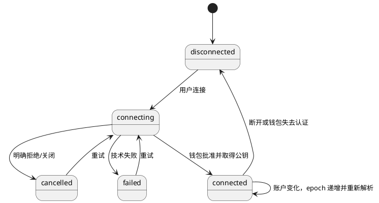
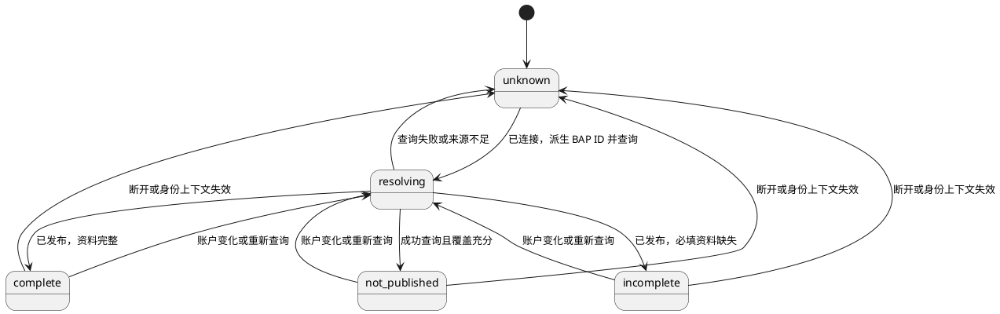
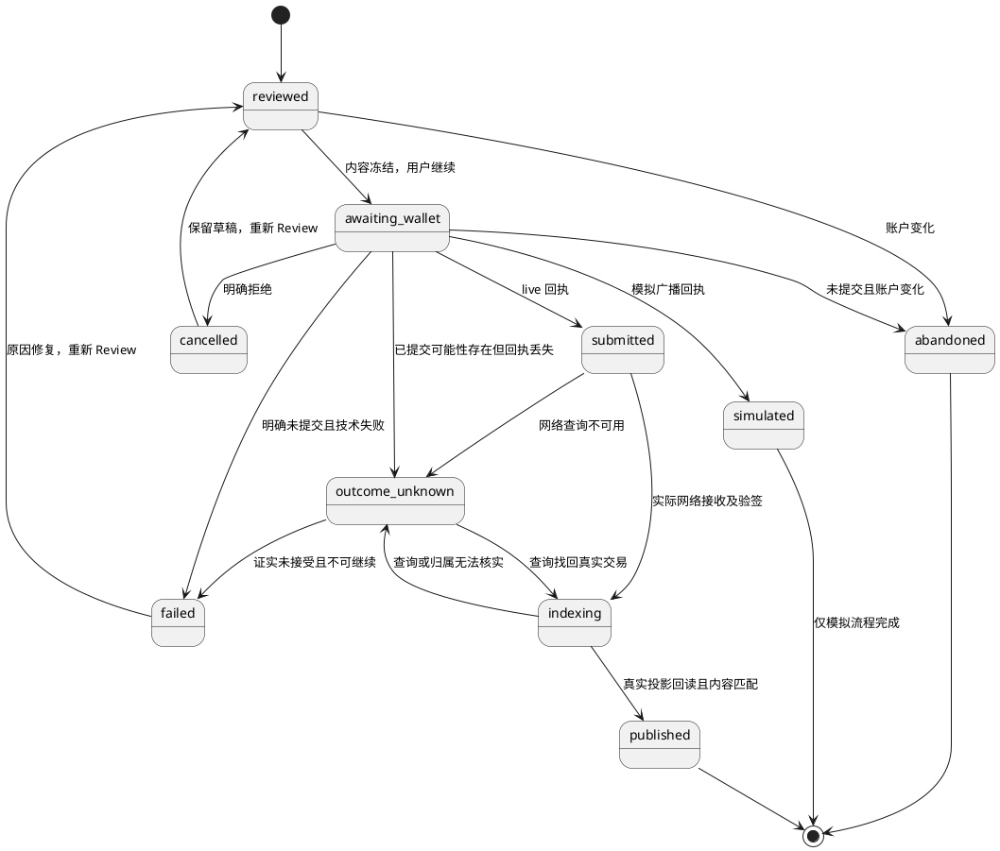

# OwnWord v0.1.0 前后端实现核心认知

## 0. 定位

本文指导本次前端、后端和集成测试的实现原则，独立保留，并以[总核心认知](../核心认知.md)为上位依据。本文只补充实现边界、运行实体、数据一致性及验证要求，不建立第二套产品事实。产品术语、实体、属性、签名、状态和约束与总核心认知一致；发生冲突时先按总核心认知修正本文，不由代码或版本设计覆盖总认知。

依据顺序为：总核心认知 → 本次实现核心认知 → [具体设计文档](设计文档v0.1.0-真实集成-20261013-183000.md) → 代码与测试。本文回答实现必须保持什么；设计文档回答页面、技术选型、HTTP、存储及流程如何落地。包版本、路径、组件选择、接口字段和构建命令不另升格为产品事实。

用户已确定：从官方 S2 原型实现 v0.1.0；后端现有成果先合入 dev，再建立版本 worktree；仅钱包交互和充值前主网广播结果允许模拟，其余服务真实；真实主网发布等待充值。模拟阶段不能关闭最终主网集成验收。

### 0.1 与总核心认知的对应关系

| 总认知依据 | 本次实现要求 |
| --- | --- |
| 第 4.1、7.1 节，WalletConnection 与 Identity 分离 | WalletSession 是连接的运行时映射，IdentityResolution 是查询结果，不新建或替代产品 Identity |
| 第 4.2、6.4 节，BAP ID 稳定及身份签名 | 钱包根公钥、当前签名密钥和 BAP ID 分别处理，资料修改不改变身份 |
| 第 5.3、9.2 节，链上事实与公共存在性 | 原始交易、公共查询及验签决定已发布；钱包 basket 和数据库写入不能单独证明发布 |
| 第 7.3 节，Profile 属性 | 表单及 DTO 只是字段映射，校验与长度边界继承总认知，不重新定义 |
| 第 9 节，产品状态与原始枚举分离 | 会话、查询、操作状态是实现层状态，不能替代 BAPIdentity 生命周期 |
| 第 10.1 节，私钥与账户授权边界 | 私钥只在钱包侧；账户变化终止未提交授权，已提交交易仍归原身份 |
| 第 10.5 节，设计体系与偏好 | 官方 S2 为唯一主系统；语言、主题和复制不进入签名输入 |
| 第 10.8 节，测试来源与真实验收 | 模拟回执隔离且标明未广播，不能更新生产公开投影或关闭主网验收 |

总认知中 Content 的 Draft 与这里的 ProfileDraft 不同：前者是内容实体，后者是尚未提交的表单缓冲。IdentityProjection 也只是总认知实体的查询投影，不成为新的权属事实来源。

## 1. 术语与命名

| 编号 | 术语 | 定义 |
| --- | --- | --- |
| T01 | 产品 Identity | 含义见全局核心认知第 2、7.2 节，公开主标识为 BAP ID |
| T02 | walletIdentityPublicKey | BRC-100 钱包根身份公钥，用于会话识别；不是 BAP ID，也不直接作为 BAP 当前签名者 |
| T03 | Wallet Transport | 页面到 Yours CWI 的调用边界；实际扩展暴露 window.CWI 和账户事件 |
| T04 | Wallet Test Adapter | 替代扩展交互与授权的受控实现；不得替换产品 Actions、后端或公共索引 |
| T05 | broadcastMode | live 或 simulated；后者明确表示没有真实网络接收证据 |
| T06 | operationId | 应用一次用户操作的关联键；不加入 BAP 协议，不替代 TxID |
| T07 | sessionEpoch | 会话代数，账户变化或断开后递增；旧异步结果不能覆盖新上下文 |
| T08 | Projection | 由真实、已验证交易重建的身份与资料查询结果；数据库是派生存储 |
| T09 | Observation | 来源、时点、网络、交易及验证依据；缺失时结果为未知 |
| T10 | 无资金集成 | 真实前端、后端、数据库、文件存储、主网只读及验签，加允许的 Wallet Test Adapter；不声称完成新交易上链 |

## 2. 目标

G01：按 v0.1 PRD 的既有裁决完成 Wallet、Identity、Profile 和偏好闭环，覆盖 28 条适用 BDD；Key Rotation 属于 v0.1.1。

G02：还原指定官方 S2 原型中的身份页面，不带入 Content、Artifact、公开主页和 Relationship 管理功能。

G03：接口缺失先设计后实现；真实服务配置缺失时明确报错，不退回模拟后端。

G04：模拟授权和广播能够验证账户隔离、取消、失败、结果未知及页面流程；真实公共查询、头像上传和签名验证可独立复跑。

G05：充值后以真实创建与 Profile 更新贯通广播、网络读取、签名验证、持久化、索引和浏览器回读，之后才能完成最终集成验收。

## 3. 结构

```text
Web 页面 → Identity 控制器
                ├─ 真实身份 Actions → WalletProvider
                │                       ├─ Yours CWI
                │                       └─ Wallet Test Adapter（仅测试）
                └─ HTTP → 后端 API
                                 ├─ BAP / AIP 解析和验证
                                 ├─ 可重建身份投影与操作记录
                                 ├─ 文件存储
                                 └─ 真实链上读取与索引
```

前端依赖版本化 HTTP 契约，不依赖后端内部对象；后端不接收用户私钥。组件只依赖领域接口，钱包适配是唯一 CWI 接入点。前后端共享协议含义及校验规则，分别负责交互、服务、持久化和验证；技术选型及实现文件组织见设计文档。

## 4. 功能

| 编号 | 功能 | 独立验收 |
| --- | --- | --- |
| F01 | 连接、取消、重试、断开与账户变化 | 会话状态准确，旧操作不污染新账户 |
| F02 | 本地 BAP ID 计算与公共解析四态 | 完整、未发布、不完整、失败分流，未知不等于不存在 |
| F03 | 资料输入、头像上传与 Review | 校验、真实持久化、冻结操作内容，授权前不写发布事实 |
| F04 | 首次身份创建、资料补全 | ID 与 ALIAS、身份签名和业务归属可验证 |
| F05 | 当前身份查看、编辑、复制和会话内预览 | 完整值复制、取消保留草稿、无改动不保存、未保存离开保护 |
| F06 | 语言、主题与响应式无障碍 | 默认英文浅色，偏好持久化，协议值不变 |
| F07 | 交易与操作追踪 | 回执、模拟、未知、真实网络观测分开，重复请求幂等 |
| F08 | 真实集成验收 | API、数据库、头像、主网只读先通过；真实创建和更新充值后补跑 |

## 5. 实体

产品实体引用总核心认知第 7 节。以下是本次运行数据的角色划分，具体物理存储由设计文档落实。

| 编号 | 实体 | 含义、存储与事实来源 |
| --- | --- | --- |
| E01 | WalletSession | WalletConnection 的运行时映射；当前连接和公开钱包身份，来自 CWI |
| E02 | IdentityResolution | 当前 BAP ID 的读取结果；来自后端实际查询与来源元数据 |
| E03 | ProfileDraft | 尚未发布的资料及头像选择；浏览器内存，用户输入 |
| E04 | IdentityOperation | 一次创建或更新的意图、回执与状态；浏览器操作及后端持久操作日志 |
| E05 | AvatarAsset | 已上传图片及摘要；真实文件存储和资产元数据 |
| E06 | TransactionObservation | 原始交易、网络接收、确认与 AIP 验证的独立观测；原始网络结果与可重建记录 |
| E07 | IdentityProjection | 产品 Identity/Profile 的查询投影；应用持久存储，可由已验证主网交易重建 |
| E08 | UIPreference | locale/theme；应用偏好存储，来源为用户选择 |

## 6. 属性

所有公开协议标识保存完整原值。TxID 为 64 个小写十六进制字符；不填充、不截断。BAP ID 校验 Base58 解码后的 20 字节，不能套用 Bitcoin 地址长度。钱包公钥必须能解析为压缩 secp256k1 公钥。

| 编号 | 属性与类型 | 唯一性、必填、可编辑、默认和判断作用 |
| --- | --- | --- |
| P01 | E01.sessionEpoch: 非负整数 | 必填，初始 0，仅应用递增；隔离异步结果，不持久化授权 |
| P02 | E01.walletIdentityPublicKey: string/null | 连接后必填，钱包给出；不能用户填写，不作为 BAP ID |
| P03 | E01.status: enum | 必填，初始 disconnected；连接过程和异常见第 8 节 |
| P04 | E02.bapId: string | 必填，必须等于当前派生值；只读，不能根据后端错误值切换身份 |
| P05 | E02.kind: enum | 必填；published/incomplete/not-published/unknown；未知不进入新建 |
| P06 | E02.profile: Profile/null | 已解析时给出快照，缺失字段显式为 null；产品属性引用全局第 7.3 节 |
| P07 | E02.observation: object | 成功查询必填来源、网络、时点和索引覆盖依据；查询失败不能编造时点 |
| P08 | E03.profile: object | 可修改；name/type/bio/imageUrl 只是界面映射，协议使用 Schema.org |
| P09 | E03.avatarFile: File/null | 可选、可替换，初始 null；blob URL 仅本地预览，不能进入 ALIAS |
| P10 | E04.operationId: UUID | 必填、唯一、不可修改；重复请求必须绑定同一冻结内容 |
| P11 | E04.bapId: string | 必填、不可修改；与会话、签名及交易内容三方核对 |
| P12 | E04.kind: create/profile-update | 必填、不可修改；决定允许的协议输出，不包含延期能力 |
| P13 | E04.profileDigest: 32 字节 SHA-256 hex | 授权前冻结；编码后精确比较，改变资料需要重新 Review |
| P14 | E04.expectedProfileTxid: TxID/null | 更新时保存读取的版本；并发变化拒绝旧 Review，首次可为 null |
| P15 | E04.txid: TxID/null | 取得回执后只读；不得随机生成后宣称为主网交易 |
| P16 | E04.broadcastMode: live/simulated | 必填；启动配置决定，不能由普通 HTTP 请求升级信任 |
| P17 | E04.status: enum | 必填；初始 reviewed，迁移见第 8 节；模拟不能迁移 published |
| P18 | E05.assetId: SHA-256 hex | 唯一、不可编辑，由真实图片字节计算；不可用任意路径替代 |
| P19 | E05.url: HTTPS URI | 真实部署可公开读取、最多 2048 字符；本地测试允许 loopback HTTP，不能声称外部永久可达 |
| P20 | E05.contentType/byteLength | 必填、只读，依据实际文件检查；上传限额为实现配置 |
| P21 | E06.rawTx: hex/bytes | 从钱包或网络取得；来源明确、摘要必须对应 TxID，不能仅信任 JSON 声称 |
| P22 | E06.networkAccepted: boolean/null | 实际网络证据决定；模拟及未知必须为 null |
| P23 | E06.identitySignature: valid/invalid/unverified | 真实验证器决定，与网络接收独立；valid 不证明现实身份 |
| P24 | E06.confirmations: 非负整数/null | 主链归属核实后才给出；模拟为 null，不用缓存推导确认 |
| P25 | E07.key: network+bapId | 复合唯一，投影只接受真实主网数据；同 txid+vout 的事件幂等 |
| P26 | E07.profileTxid/source/observedAt | 只读、可重建；排序依赖交易链关系及主链位置，不能使用前端时钟 |
| P27 | E08.locale/theme | en/zh-CN 与 light/dark；必填、默认 en/light，可修改，独立于签名输入 |

## 7. 关系

| 编号 | 关系、基数与约束 |
| --- | --- |
| R01 | E01 → E02：当前会话 1:0..1，按本地派生 BAP ID 定位；账户变化失效 |
| R02 | E02 → E03：1:0..1 编辑快照，不能以草稿覆盖公开事实 |
| R03 | E01 → E04：1:N；每次操作固定 sessionEpoch+bapId，未提交授权随账户变化终止 |
| R04 | E03 → E05：1:0..1；上传成功才使用持久 URL，取消不删除已发布引用 |
| R05 | E04 → E06：1:0..N；首次 ID+ALIAS 同交易也保留两个输出验证结果 |
| R06 | E06 → E07：N:1；签名、网络来源及顺序均满足后才能更新生产投影 |
| R07 | E07 → 真实事件：1:N；按 network+txid+vout 定位，重放不重复产生资料版本 |
| R08 | E01 → E08：无依附；断开钱包不清空主题和语言 |

## 8. 状态

产品状态以总核心认知第 9 节为准；以下表达运行迁移，分别维护会话、解析和操作。WalletSession 始终可以在 IdentityResolution 解析时保持 connected；查询失败不会将已发布 BAPIdentity 改成未发布。







操作 published 只表示本次真实发布已核实，不新定义 Identity 生命周期。已提交交易不会因断开而撤回，继续归原身份查询。禁止 simulated→published、未经成功查询的 unknown→not-published，以及超时后自动再次签名。结果不明时查询原操作，不能新建另一笔交易掩盖问题。

## 9. 界限

B01：业务范围引用 v0.1 PRD 第 9 节裁决；后续原型页面仅作为指定视觉资料，不扩展本期功能。

B02：仅 Wallet Transport/授权及明确的模拟广播分支允许测试替代。HTTP 服务、数据库、文件存储、身份派生、产品 Actions、AIP 验证器和主网只读保持真实；不得保留通用 Mock 后端。

B03：Wallet Test Adapter 必须覆盖锁定 CWI 的完整方法表，逐方法可调用、输入输出类型正确。实际 v0.1 调用路径必须通过真实密码学实现；非本期方法可明确 unsupported，但不能称为完整功能钱包，也不能伪造成功。

B04：测试钥匙只存在隔离的测试钱包进程，生产前端和后端不得接收钥匙。测试钱包不监听公网，不读取用户真实钱包种子。记录公开公钥、交易及输出摘要，不记录私钥。

B05：模拟原始交易可以由真实验证器验证内容签名，但不证明资金输入可花费、广播或确认；测试记录与生产公开投影隔离，用户界面明确显示未广播。

B06：首次创建的 ID、ALIAS 分别验证；现有 Planaria 转换器只选单一输出，不能直接证明支持 SDK 的双输出首次创建。

B07：最终验收失败、未执行、凭据缺失或等待充值都保持未完成；既有 SDK、JungleBus 的验收不能替代本期端到端测试。

## 10. 依据与待验证

已读本地源码是技术结论的主要依据：

- [v0.1 PRD](../prd/v0.1/设计文档v0.1.md)、[设计总指南](../../../../standard/OwnWord设计与设计系统.md)。
- [指定原型](../../../prototype-worktree/ownword-official-s2/AGENTS.md)、[官方绑定](../../../prototype-worktree/ownword-official-s2/ownword-prototype/_d_meta.json)。冻结已提交版本 f3f68445c953ef988c53b7f4670462e6d09c9ceb；未提交编辑器工作保留。
- [Yours CWI](../../../../reference/yours-wallet-main/yours-wallet-main/src/cwi.ts)、[钱包初始化](../../../../reference/yours-wallet-main/yours-wallet-main/src/initWallet.ts)、[Provider API](../../../../reference/yours-wallet-main/yours-wallet-main/docs/provider-api.md)。本地 package 实际为 5.0.2，来源清单旧记录 5.1.0，实施不能仅凭清单决定版本。
- [身份 Actions](../../../../reference/1sat-sdk/packages/actions/src/identity/index.ts)、[AIP 签名](../../../../reference/1sat-sdk/packages/actions/src/signing/aip.ts)、[完整 CWI 方法表](../../../../reference/1sat-sdk/packages/wallet/src/cwi/factory.ts)。
- [Mongo BAP 服务](../../../../backend/metanet4j-component/metanet4j-component-bap/src/main/java/com/metanet4j/component/bap/service/MongoBapService.java)、[多输出转换差异](../../../../backend/metanet4j-component/metanet4j-tx-convertor/src/main/java/com/metanet4j/tx/convertor/impl/PlanariaBapConvertor.java)。
- [BRC-100 官方规范](https://github.com/bsv-blockchain/BRCs/blob/master/wallet/0100.md)、[钱包工具库](https://github.com/bsv-blockchain/wallet-toolbox)：标准接口和真实钱包能力的外部依据，不代表已完成兼容验证。

待验证均由本次主代理实施关闭：钱包与 Actions 的实际锁定包兼容；首次 ID+ALIAS 逐输出验证；公共索引完整性及最新 ALIAS 排序；账户切换事件；真实资金输入和主网发布。无资金阶段不要求关闭最后一项，但最终交付必须保留它。
