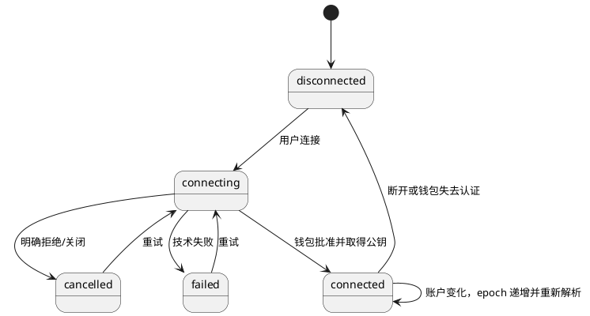
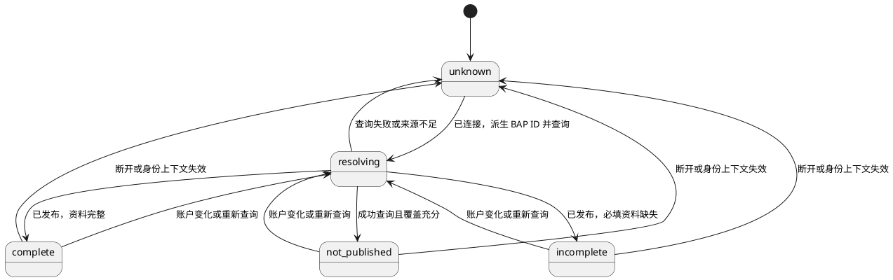
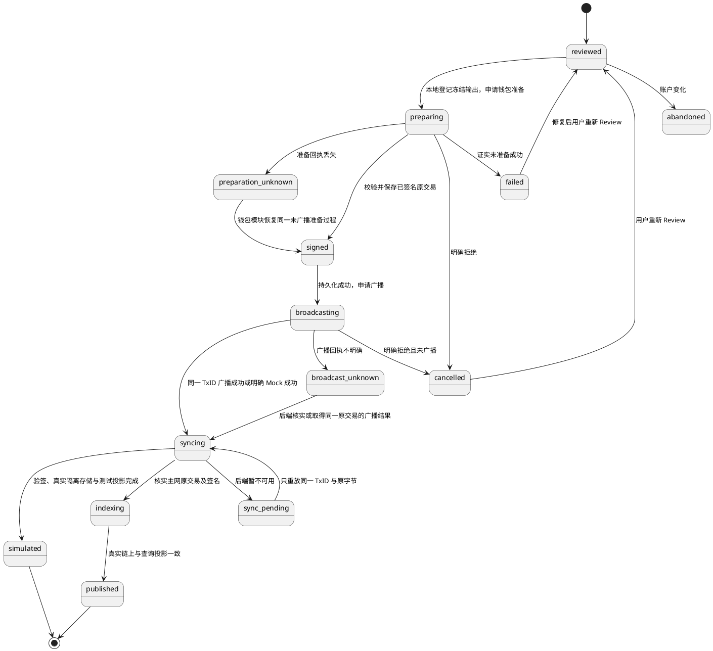

# OwnWord v0.1.0 前后端实现核心认知

## 0. 定位

本文指导本次前端、后端和集成测试的实现原则，独立保留，并以[总核心认知](../核心认知.md)为上位依据。本文只补充实现边界、运行实体、数据一致性及验证要求，不建立第二套产品事实。产品术语、实体、属性、签名、状态和约束与总核心认知一致；发生冲突时先按总核心认知修正本文，不由代码或版本设计覆盖总认知。

依据顺序为：总核心认知 → 本次实现核心认知 → [具体设计文档](设计文档v0.1.0-真实集成-20261013-183000.md) → 代码与测试。本文回答实现必须保持什么；设计文档回答页面、技术选型、HTTP、存储及流程如何落地。包版本、路径、组件选择、接口字段和构建命令不另升格为产品事实。

用户已确定：从官方 S2 原型实现 v0.1.0；后端现有成果先合入 dev，再建立版本 worktree；仅钱包交互和充值前主网广播结果允许模拟，其余服务真实；真实主网发布等待充值。模拟阶段不能关闭最终主网集成验收。本期身份创建、资料更新和头像发布均先经钱包构造、授权签名和广播，再调用后端 POST 同步同一原交易。用户确认第一阶段沿用本地钱包适配器、Mock 广播，后端解析、存储、投影与业务查询全部真实。钱包为独立模块，业务层通过稳定 WalletProvider 接口调用；更换钱包只替换适配器。总认知第 10.8 节的主网事实边界仍适用。

### 0.1 与总核心认知的对应关系

| 总认知依据 | 本次实现要求 |
| --- | --- |
| 第 4.1、7.1 节，WalletConnection 与 Identity 分离 | WalletSession 是连接的运行时映射，IdentityResolution 是查询结果，不新建或替代产品 Identity |
| 第 4.2、6.4、11.16 节，BAP ID 稳定及身份签名 | 钱包根公钥、当前签名密钥和 BAP ID 分别处理；客户端在可能广播的钱包调用前完成身份签名及冻结内容校验；后端在广播后独立验证原交易 |
| 第 5.3、9.2 节，链上事实与公共存在性 | 原始交易、公共查询及验签决定已发布；未发布需成功查询且覆盖充分，索引无记录不能独立证明不存在 |
| 第 7.3 节，Profile 属性 | 表单及 DTO 只是字段映射，校验与长度边界继承总认知，不重新定义 |
| 第 9 节，产品状态与原始枚举分离 | 会话、查询、操作状态是实现层状态，不能替代 BAPIdentity 生命周期 |
| 第 10.1 节，私钥与账户授权边界 | 私钥只在钱包侧；账户变化终止未提交授权，已提交交易仍归原身份 |
| 第 10.5 节，设计体系与偏好 | 官方 S2 为唯一主系统；语言、主题和复制不进入签名输入 |
| 第 10.8 节，测试来源与真实验收 | 模拟回执隔离且标明未广播，不能更新生产公开投影或关闭主网验收 |

总认知中 Content 的 Draft 与这里的 ProfileDraft 不同：前者是内容实体，后者是尚未提交的表单缓冲。IdentityProjection 也只是总认知实体的查询投影，不成为新的权属事实来源。

## 1. 术语与命名

| 编号 | 术语 | 定义 |
| --- | --- | --- |
| T01 | 产品 Identity | 含义见全局核心认知第 2、7.2 节，公开主标识为 BAP ID |
| T02 | walletIdentityPublicKey | BRC-100 钱包根身份公钥，用于会话识别；不是 BAP ID，也不直接作为 BAP 当前签名者 |
| T03 | Wallet Transport | 钱包适配器内部到具体钱包的传输机制；Yours CWI、RPC 与 SDK 类型不进入业务接口 |
| T04 | Wallet Test Adapter | 替代扩展交互与授权的受控实现；不得替换产品 Actions、后端或公共索引 |
| T05 | broadcastMode | live 或 simulated；后者明确表示没有真实网络接收证据 |
| T06 | operationId | 应用一次用户操作的关联键；不加入 BAP 协议，不替代 TxID |
| T07 | sessionEpoch | 会话代数，账户变化或断开后递增；旧异步结果不能覆盖新上下文 |
| T08 | Projection | 后端从已验签原交易生成的身份与资料查询结果；生产公开投影与广播 Mock 测试投影按来源隔离 |
| T09 | Observation | 来源、时点、网络、交易及验证依据；缺失时结果为未知 |
| T10 | 无资金集成 | 真实前端、后端、数据库、文件存储、主网只读及验签，加允许的 Wallet Test Adapter；不声称完成新交易上链 |

| T11 | WalletProvider | 独立钱包模块的稳定接口；提供会话、公开密钥、授权签名、交易准备、广播及未广播准备过程恢复，不提供 BAP 资料查询 |
| T12 | BroadcastReceipt | 绑定同一 TxID 的广播结果；accepted/rejected/unknown 与 live/simulated 分开，Mock 成功不证明主网接受 |

## 2. 目标

G01：按 v0.1 PRD 的既有裁决完成 Wallet、Identity、Profile 和偏好闭环，覆盖 28 条适用 BDD；Key Rotation 属于 v0.1.1。

G02：还原指定官方 S2 原型中的身份页面，不带入 Content、Artifact、公开主页和 Relationship 管理功能。

G03：接口缺失先设计后实现；真实服务配置缺失时明确报错。页面的 BAP、资料、头像及已广播业务交易只从后端查询，不从钱包 basket、Actions 返回资料或 simulationPreview 分支读取。

G04：模拟授权和广播能够验证账户隔离、取消、失败、结果未知及页面流程；真实公共查询、链上头像解析和签名验证可独立复跑。

G05：充值后以真实创建与 Profile 更新贯通广播、网络读取、签名验证、持久化、索引和浏览器回读，之后才能完成最终集成验收。

## 3. 结构

```text
Web 页面 → 身份业务模块
                ├─ 协议编码与冻结校验 → 稳定 WalletProvider 接口
                │                         └─ 钱包模块：Yours 适配器 / 本地适配器
                │                                      └─ 构造、授权签名、真实或 Mock 广播
                └─ HTTP → 真实后端 API
                              ├─ 原交易验签、存储与历史
                              ├─ 来源隔离的可重建身份与资料投影
                              └─ 业务查询、图片缓存与真实链上核验
```

前端依赖版本化 HTTP 契约，不依赖后端内部对象；后端不接收用户私钥。组件只依赖领域接口，钱包适配是唯一 CWI 接入点。前后端共享协议含义及校验规则，分别负责交互、服务、持久化和验证。钱包模块不导入 Profile、IdentityResolution、后端客户端或业务同步代码；业务模块不访问 window.CWI、WalletInterface、钱包私有 reference 或实现类。具体钱包内部可以读取账户、公钥、资金输入与未广播准备过程，以完成授权动作；这些读取不成为业务事实查询。技术选型及实现文件组织见设计文档。

## 4. 功能

| 编号 | 功能 | 独立验收 |
| --- | --- | --- |
| F01 | 连接、取消、重试、断开与账户变化 | 会话状态准确，旧操作不污染新账户 |
| F02 | 本地 BAP ID 计算与公共解析四态 | 完整、未发布、不完整、失败分流，未知不等于不存在 |
| F03 | 资料输入、头像发布与 Review | 先本地预览；钱包发布图片后同步后端，资料交易引用已发布图片 |
| F04 | 首次身份创建、资料补全 | ID 与 ALIAS、身份签名和冻结内容在可能广播前通过校验 |
| F05 | 当前身份查看、编辑、复制和会话内预览 | 完整值复制、取消保留草稿、无改动不保存、未保存离开保护 |
| F06 | 语言、主题与响应式无障碍 | 默认英文浅色，偏好持久化，协议值不变 |
| F07 | 交易与操作追踪 | 已签名原交易先持久化，再广播；广播成功后同步后端；已广播业务交易与历史统一后端查询，恢复不重新签名 |
| F08 | 真实集成验收 | API、数据库、头像、主网只读先通过；真实创建和更新充值后补跑 |

## 5. 实体

产品实体引用总核心认知第 7 节。以下是本次运行数据的角色划分，具体物理存储由设计文档落实。

| 编号 | 实体 | 含义、存储与事实来源 |
| --- | --- | --- |
| E01 | WalletSession | WalletConnection 的运行时映射；当前连接和公开钱包身份，来自 CWI |
| E02 | IdentityResolution | 当前 BAP ID 的读取结果；来自后端实际查询与来源元数据 |
| E03 | ProfileDraft | 尚未发布的资料及头像选择；浏览器内存，用户输入 |
| E04 | IdentityOperation | 身份发布流程的草稿、钱包回执与同步状态；提交前在浏览器持久化，提交后后端仅保存交易验证与同步结果 |
| E05 | AvatarAsset | 钱包已发布的图片及摘要；链上原交易是来源，后端文件只是可重建读取缓存 |
| E06 | TransactionObservation | 原始交易、网络接收、确认与 AIP 验证的独立观测；原始网络结果与可重建记录 |
| E07 | IdentityProjection | 产品 Identity/Profile 的生产公开查询投影；后端持久存储，可由已验证主网交易重建 |
| E08 | UIPreference | locale/theme；应用偏好存储，来源为用户选择 |
| E09 | OperationJournal | 广播前草稿及每笔交易的本地恢复日志；浏览器持久存储，不是公开身份事实 |

| E10 | PreparedTransaction | 钱包生成并已签名的同一原交易；不可修改，广播前保存于本地日志 |
| E11 | BroadcastReceipt | 钱包模块返回的真实或 Mock 广播结果；与 E10 的 TxID 绑定 |
| E12 | BroadcastTestProjection | 后端从真实验签的测试原交易派生并持久化的隔离投影；与生产公开事实分开，供相同业务查询契约读取 |

## 6. 属性

所有公开协议标识保存完整原值。TxID 为 64 个小写十六进制字符；不填充、不截断。BAP ID 校验 Base58 解码后的 20 字节，不能套用 Bitcoin 地址长度。钱包公钥必须能解析为压缩 secp256k1 公钥。

| 编号 | 属性与类型 | 唯一性、必填、可编辑、默认和判断作用 |
| --- | --- | --- |
| P01 | E01.sessionEpoch: 非负整数 | 必填，初始 0，仅应用递增；隔离异步结果，不持久化授权 |
| P02 | E01.walletIdentityPublicKey: string/null | 连接后必填，钱包给出；不能用户填写，不作为 BAP ID |
| P03 | E01.status: enum | 必填，初始 disconnected；连接过程和异常见第 8 节 |
| P04 | E02.bapId: string | 必填，必须等于当前派生值；只读，不能根据后端错误值切换身份 |
| P05 | E02.kind: enum | 必填；生产来源为 published/incomplete/not-published/unknown；测试来源另有 stored/empty，不能解释为主网公开存在或不存在 |
| P06 | E02.profile: Profile/null | 已解析时给出快照，缺失字段显式为 null；产品属性引用全局第 7.3 节 |
| P07 | E02.observation: object/null | 实际取得依据时保存来源、网络、观测时点和覆盖证据；无观测时为 null，响应时间不替代观测时间 |
| P08 | E03.profile: object | 可修改；name/type/bio/imageUrl 只是界面映射，协议使用 Schema.org |
| P09 | E03.avatarFile: File/null | 可选、可替换，初始 null；blob URL 仅本地预览，不能进入 ALIAS |
| P10 | E04.operationId: UUID | 必填、唯一、不可修改；可能广播的钱包调用前在浏览器持久化，重复同步绑定同一原交易 |
| P11 | E04.bapId: string | 必填、不可修改；与会话、签名及交易内容三方核对 |
| P12 | E04.kind: create/profile-update/identity-init/avatar | 必填、不可修改；决定允许的协议输出，不包含延期能力 |
| P13 | E04.profileDigest: 32 字节 SHA-256 hex | 授权前冻结；编码后精确比较，改变资料需要重新 Review |
| P14 | E04.expectedProfileTxid: TxID/null | 更新时保存读取的版本；广播前以只读查询发现变化则重新 Review，不能宣称跨设备原子锁 |
| P15 | E04.txid: TxID/null | 未取得交易证据时为 null，结果不明仍可按 operationId 恢复；取得后只读 |
| P16 | E04.broadcastMode: live/simulated | 必填；启动配置决定，不能由普通 HTTP 请求升级信任 |
| P17 | E04.status: enum | 必填；初始 reviewed，经本地校验后请求钱包；回执先保存再同步，模拟不能迁移 published |
| P18 | E05.assetId: TxID | 唯一、不可编辑，由图片原交易计算；另存输出位置和图片 SHA-256，不以缓存路径替代链上引用 |
| P19 | E05.url: URI | ALIAS 引用 b://TxID，最多 2048 字符；页面通过后端只读解析取得图片，缓存域名不写入签名资料 |
| P20 | E05.contentType/byteLength | 必填、只读，依据交易内实际图片字节检查；发布限额为实现配置 |
| P21 | E06.rawTx: hex/bytes | 从钱包或网络取得；来源明确、摘要必须对应 TxID，不能仅信任 JSON 声称 |
| P22 | E06.networkAccepted: boolean/null | 实际网络证据决定；模拟及未知必须为 null |
| P23 | E06.identitySignature: valid/invalid/unverified | 真实验证器决定，与网络接收独立；valid 不证明现实身份 |
| P24 | E06.confirmations: 非负整数/null | 主链归属核实后才给出；模拟为 null，不用缓存推导确认 |
| P25 | E07.key: network+bapId | 复合唯一，投影只接受真实主网数据；同 txid+vout 的事件幂等 |
| P26 | E07.profileTxid/source/observedAt | 只读、可重建；排序依赖交易链关系及主链位置，不能使用前端时钟 |
| P27 | E08.locale/theme | en/zh-CN 与 light/dark；必填、默认 en/light，可修改，独立于签名输入 |
| P28 | E04.localValidation: object/null | 初始 null；客户端验证实际编码、冻结字节与当前签名者；后端不依据客户端的成功标记信任交易 |
| P29 | E09.submissionAttempt: object/null | 初始 null；浏览器原子登记本次转交后才能调用钱包；超时不自动释放或授权第二次调用 |
| P30 | E04.walletReference: string/null | 初始 null；取得真实钱包引用后保存，用于恢复同一交易，不能替代公开发布证据 |
| P31 | E02.indexCoverage: object | 必填；只有历史范围、同步进度及近期交易覆盖均有实际依据时才充分，不由 HTTP 成功或配置开关推导 |

| P32 | E02.scope: mainnet/broadcast-mock | 服务配置决定，必填、不可由普通请求切换；所有投影查询带实际来源 |
| P33 | E10.txid/rawTx: TxID/hex | 必填、不可修改、两者互相计算核对；签名后取得，先持久化再调用广播 |
| P34 | E11.status/mode: enum | accepted/rejected/unknown 与 live/simulated 独立；只对应原交易，不能由表单伪造网络接受 |
| P35 | E01.providerId/capabilities: string/object | 来自适配器；提供所需能力，能力不足明确拒绝；不得暴露具体 SDK 类型 |
| P36 | E12.key: scope+network+bapId | 复合唯一；只从验签原交易生成，重复同步沿用原版本，不写生产公开投影 |

## 7. 关系

| 编号 | 关系、基数与约束 |
| --- | --- |
| R01 | E01 → E02：当前会话 1:0..1，按本地派生 BAP ID 定位；账户变化失效 |
| R02 | E02 → E03：1:0..1 编辑快照，不能以草稿覆盖公开事实 |
| R03 | E01 → E04：1:N；每次操作固定 sessionEpoch+bapId，未提交授权随账户变化终止 |
| R04 | E03 → E05：1:0..1；图片交易取得回执并同步后才写入资料 URI；取消资料发布不撤回已发布图片 |
| R05 | E04 → E06：1:0..N；首次 ID+ALIAS 同交易也保留两个输出验证结果 |
| R06 | E06 → E07：N:1；签名、网络来源及顺序均满足后才能更新生产投影 |
| R07 | E07 → 真实事件：1:N；按 network+txid+vout 定位，重放不重复产生资料版本 |
| R08 | E01 → E08：无依附；断开钱包不清空主题和语言 |

| R09 | E04 → E10 → E11：1:0..N，逐笔保持原字节及 TxID；广播成功后才向后端同步 |
| R10 | E06 → E12 → E02：已验签测试记录生成真实隔离投影；同一查询契约读取，禁止前端构造 Profile |

## 8. 状态

产品状态以总核心认知第 9 节为准；以下表达运行迁移，分别维护会话、解析和操作。WalletSession 始终可以在 IdentityResolution 解析时保持 connected；查询失败不会将已发布 BAPIdentity 改成未发布。







published 只表示真实主网交易和公开资料已核实。签名、广播和后端同步分别记录状态；只有广播成功后才能业务 POST。已知已签名原交易后，同步失败只重放相同字节，不生成第二笔交易。广播结果未知先由后端核实；Mock 阶段可以由用户明确重试广播同一已签名交易，不能重新构造或签名。准备回执丢失属于钱包内部未广播过程恢复，封装于适配器，不以钱包历史代替 BAP 业务查询。旧无原交易操作继续保留未知，不推断为未提交。

首次身份带头像时，先用真实 BAP ID 声明建立签名路径，再发布图片，最后发布引用图片的 ALIAS；每笔交易都先钱包后后端，并独立保留回执。Review 说明可能产生多笔交易和多次钱包授权。中途取消保留已发布结果，不能显示整组交易已撤回；恢复同步不自动授权尚未执行的下一笔交易。

## 9. 界限

B01：业务范围引用 v0.1 PRD 第 9 节裁决，另落实用户明确要求的链上头像发布。后续原型页面仅作为指定视觉资料，不扩展内容管理等本期外功能。

B02：仅 Wallet Transport/授权及明确的模拟广播分支允许测试替代。HTTP 服务、数据库、文件存储、身份派生、产品 Actions、AIP 验证器和主网只读保持真实；不得保留通用 Mock 后端。

B03：Wallet Test Adapter 必须覆盖锁定 CWI 的完整方法表，逐方法可调用、输入输出类型正确。实际 v0.1 调用路径必须通过真实密码学实现；非本期方法可明确 unsupported，但不能称为完整功能钱包，也不能伪造成功。

B04：测试钥匙只存在隔离的测试钱包进程，生产前端和后端不得接收钥匙。测试钱包不监听公网，不读取用户真实钱包种子。记录公开公钥、交易及输出摘要，不记录私钥。

B05：模拟原始交易可以由真实验证器验证内容签名，但不证明资金输入可花费、广播或确认；测试记录与生产公开投影隔离，用户界面明确显示未广播。广播 Mock 成功后，后端从收到的已验签原交易生成真实隔离测试投影；页面通过正常 profile 查询字段回读，禁止 simulationPreview 或固定 Profile 数据源。scope=broadcast-mock 的 stored/empty 只描述测试空间，不成为主网 not-published 或 ACTIVE；主网查询保持真实覆盖要求。

B06：首次创建的 ID、ALIAS 分别验证；现有 Planaria 转换器只选单一输出，不能直接证明支持 SDK 的双输出首次创建。

B07：最终验收失败、未执行、凭据缺失或等待充值都保持未完成；既有 SDK、JungleBus 的验收不能替代本期端到端测试。

B08：本次全部业务 POST 都位于对应钱包交易回执之后，包括身份创建、资料更新和头像图片。广播前的意图、转交尝试及未知结果只在浏览器持久化；本地存储失败时不调用钱包。读取身份、签名历史和网络信息的 GET 可在广播前执行。刷新、重启和超时不能产生隐式重签。

B09：客户端在最早可能广播的钱包调用前验证真实身份签名、BAP 归属、冻结内容和账户；不能假定只有 signAction 会广播。后端在广播后从原交易重新计算 TxID、解析图片或 ALIAS、验证签名及真实网络来源，不接收另一份资料 JSON 作为事实。钱包不能保证保留业务输出与账户时阻塞 live。

B10：not-published 同时要求实际查询成功、明确无有效身份记录及覆盖充分。空表、索引 404、分页无结果、网络读取暂时找不到交易都不足以单独判定；证据不足为 unknown。

B11：响应时间与事实观测时间独立。没有取得事实观测时，来源和观测时间可为空；读取缓存时保留原观测时间，不用响应时间刷新事实。

B12：实现遵守项目已确定的技术栈、版本治理和模块边界，具体组合以设计文档及任务锁文件/POM 为准。缺失能力在既有前后端模块与钱包适配边界内补齐，不以替换框架、设计系统或持久化方案绕过问题。

B13：交易和后端按同一 scope+network+TxID+vout 对应；资料、图片字节和摘要必须一致。生产投影排序依据真实链序，无法核实则待核实。隔离测试用服务实际接收顺序作为固定测试版本，重复同步不改变原顺序，不能把该顺序用作主网依据。

B14：WalletProvider 为唯一钱包依赖接口；具体 SDK、CWI、传输和私有错误在适配器内部归一化。新增钱包必须通过相同输入输出、拒绝、账户变化、准备、广播与恢复契约检查；业务层不得使用 providerId 条件实现钱包差异。

B15：准备与广播必须可分离；Mock 分支禁止具体钱包在准备步骤实际发送主网交易。仅有 noSend 选项名不足以证明实现符合要求；适配器能力未实证时保持未验证。

## 10. 依据与待验证

已读本地源码是技术结论的主要依据：

- [v0.1 PRD](../prd/v0.1/设计文档v0.1.md)、[设计总指南](../../../../standard/OwnWord设计与设计系统.md)。
- [指定原型](../../../prototype-worktree/ownword-official-s2/AGENTS.md)、[官方绑定](../../../prototype-worktree/ownword-official-s2/ownword-prototype/_d_meta.json)。实现固定消费[设计文档第 0.2 节](设计文档v0.1.0-真实集成-20261013-183000.md#02-原型实现基线)登记的 tag，后续原型变动按提交差异核对。
- [Yours CWI](../../../../reference/yours-wallet-main/yours-wallet-main/src/cwi.ts)、[钱包初始化](../../../../reference/yours-wallet-main/yours-wallet-main/src/initWallet.ts)、[Provider API](../../../../reference/yours-wallet-main/yours-wallet-main/docs/provider-api.md)。本地 package 实际为 5.0.2，来源清单旧记录 5.1.0，实施不能仅凭清单决定版本。
- [身份 Actions](../../../../reference/1sat-sdk/packages/actions/src/identity/index.ts)、[AIP 签名](../../../../reference/1sat-sdk/packages/actions/src/signing/aip.ts)、[完整 CWI 方法表](../../../../reference/1sat-sdk/packages/wallet/src/cwi/factory.ts)。
- [Actions 提交流水线](../../../../reference/1sat-sdk/packages/actions/src/pipeline/runPipeline.ts)、[签名与广播](../../../../reference/1sat-sdk/packages/actions/src/utils/completeSignedAction.ts)、[钱包权限模块](../../../../reference/1sat-sdk/packages/permission-module/src/handlers.ts)：权限模块可能在 createAction 的响应处理中完成 signAction，校验不能仅挂在外部 signAction 调用上。
- [公共 BAP 路由](../../../../reference/1sat-stack/pkg/bap/routes.go)、[BAP 查询服务](../../../../reference/1sat-stack/pkg/bap/lookup.go)、[索引存储](../../../../reference/1sat-stack/pkg/bap/store_sql.go)：无记录响应来自索引存储，未包含全网不存在证明。
- [Mongo BAP 服务](../../../../backend/metanet4j-component/metanet4j-component-bap/src/main/java/com/metanet4j/component/bap/service/MongoBapService.java)、[多输出转换差异](../../../../backend/metanet4j-component/metanet4j-tx-convertor/src/main/java/com/metanet4j/tx/convertor/impl/PlanariaBapConvertor.java)。
- [BRC-100 官方规范](https://github.com/bsv-blockchain/BRCs/blob/master/wallet/0100.md)、[钱包工具库](https://github.com/bsv-blockchain/wallet-toolbox)：标准接口和真实钱包能力的外部依据，不代表已完成兼容验证。

待验证均由本次主代理实施关闭：钱包与 Actions 的实际锁定包兼容；首次 ID+ALIAS 逐输出验证；公共索引完整性及最新 ALIAS 排序；账户切换事件；真实资金输入和主网发布。无资金阶段不要求关闭最后一项，但最终交付必须保留它。
