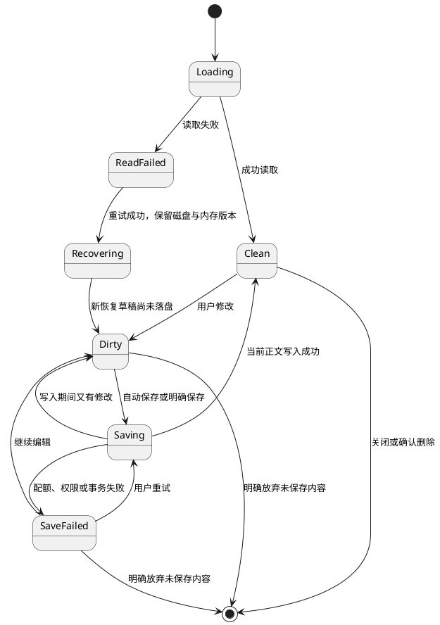
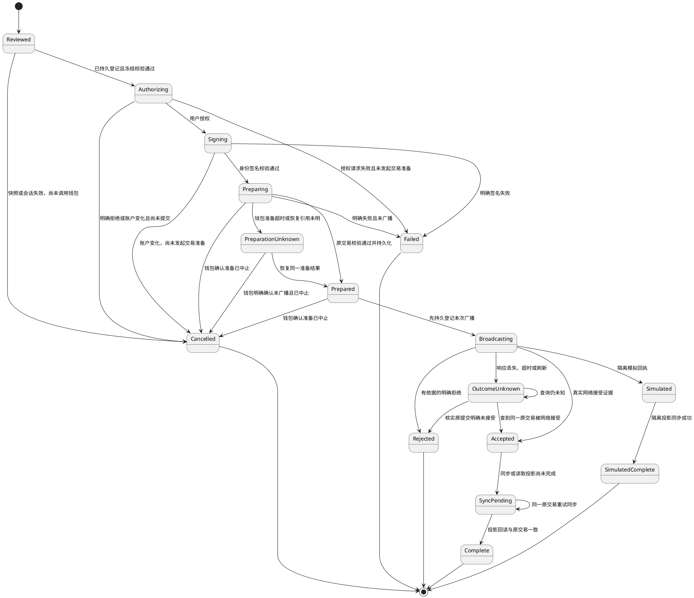

# OwnWord v0.2.0 内容真实集成核心认知

## 0. 定位与审核状态

本文是 v0.2.0 实现约束的待审稿，回答内容闭环必须保持什么。[总核心认知](../核心认知.md)仍是产品事实的唯一来源；本文继承其中的 Identity、Content、ContentRevision、Signature 和 Transaction 定义，并承接 [v0.1 实现认知](集成核心认知v0.1.0-20261013-183000.md)的钱包、来源隔离和恢复边界。[实现设计](设计文档v0.2.0-内容真实集成-20261014-215514.md)负责页面、接口、存储和实施映射。

用户要求先完成认知与设计、审核通过后开始实现。本轮仅交付文档和原型取证；R01 修订链上契约待用户裁决，本文不授权任何私有协议扩展，也不表示 v0.2.0 已通过功能验收。

## 1. 术语与命名

编号使用 `V2-` 前缀，与全局及 v0.1 编号分开；已有产品术语引用总认知第 2、7 节。

| 编号 | 术语 | 本期含义 |
| --- | --- | --- |
| V2-T01 | Markdown 原文 | 用户编辑、导入、导出的唯一正文源；预览 HTML 是派生展示 |
| V2-T02 | 内容草稿 | 总认知 Content 在发布前的本地工作副本；属于固定 BAP Identity |
| V2-T03 | ReviewSnapshot | 作者、原文和修订基线的冻结快照；是一次授权的输入 |
| V2-T04 | ContentPublicationOperation | 一次内容发布操作，沿用 v0.1 Operation 的恢复和账户互斥语义 |
| V2-T05 | ContentProjection | 已解析内容的后端读取投影；原交易及验证依据是其事实来源 |
| V2-T06 | RevisionResolution | 基于可验证原交易得到的版本关系、覆盖范围和分支结论 |
| V2-T07 | WriterLease | 同一浏览器 origin 的内容工作区写入资格；不代表跨设备锁或作者身份认证 |
| V2-T08 | 公共阅读 | 无需钱包的后端查询；公开链接固定到某一 TxID，不能定位本地私有草稿 |
| V2-T09 | 查询覆盖 | 查询实际覆盖的历史、进度和观测时点；空结果或一次 HTTP 成功不证明覆盖充分 |

## 2. 目标

- V2-G01：完成 [v0.2.0 PRD](../prd/v0.2.0/设计文档v0.2.0-20260917-210556.md) C01–C10、X01/X02 的 33 条场景，并把原型模拟结果落实为有来源的真实集成状态。
- V2-G02：基于指定官方 S2 最新原型还原工作台、编辑、确认、进度、阅读和历史；正文、身份、签名与网络结果一致。
- V2-G03：取消、存储失败、账户变化、断网和刷新均保留可恢复正文；未知广播结果不造成重复付款或重复版本。
- V2-G04：同一已发布版本在独立浏览器中无需连接钱包即可读取；原文、旧链接和有效作者归属可核验。
- V2-G05：修订关系可以从签名交易重建；本地技术通过、用户视觉复核、真实钱包及主网验收分别有证据。

## 3. 结构

```text
内容页面 → 草稿与编辑模块 → 同一份 Markdown → 共用渲染模块
        → 发布模块 → 冻结与协议校验 → 稳定 WalletProvider
                   → 共用操作日志       → 钱包准备、签名、广播
        → 后端查询/同步 → 原交易解析、验签及公共观测
                       → 内容投影、版本关系、Proof
```

钱包职责沿用 v0.1；不增加内容数据库、草稿查询或版本查询职责。后端只从实际原交易生成公开内容。草稿和未完成操作用于恢复，不参与公开内容发现。模拟广播投影与生产投影隔离，页面明确实际来源。界面、协议、钱包和存储分别可验证，不以原型场景面板替代业务服务。

## 4. 功能

产品功能编号直接使用 PRD 的 C01–C10，不再建立另一份需求表。

| 编号 | 实现约束 | 对应 PRD |
| --- | --- | --- |
| V2-F01 | 私有工作台按当前身份查询草稿，公开列表读取真实后端；错误与空白分开 | C01 |
| V2-F02 | 可视化、源码、预览共享原文；模式与偏好变化不产生正文修改 | C02、C03、X01 |
| V2-F03 | 保存、恢复、删除、导入导出均保护原文、作者和存储失败状态 | C04、C05 |
| V2-F04 | 冻结最新正文及作者；实际签名字节与 Review 一致，账户变化使未提交授权失效 | C06 |
| V2-F05 | 先登记操作，再调用钱包；准备后的原交易持久化后才广播；按同一交易恢复及同步 | C07 |
| V2-F06 | 无钱包读取固定版本，完整复制标识、分享及导出，缺失与不可用分开 | C08 |
| V2-F07 | 原作者追加修订，历史不可覆盖；关系未经验证或最新版本不明时阻止追加 | C09 |
| V2-F08 | 内容签名、BAP 归属、网络接收、确认和来源分别表达 | C10 |
| V2-F09 | 复用 S2 的键盘、焦点和主题机制，320px 主流程可操作 | X01、X02 |

## 5. 实体

本节只描述实现映射，产品实体含义见总认知第 7.4、7.5 节。

| 编号 | 实体 | 存储、角色与事实来源 |
| --- | --- | --- |
| V2-E01 | ContentDraft | 浏览器持久存储及未保存内存；用户输入，是尚未发布正文的来源 |
| V2-E02 | ReviewSnapshot | 当前会话内冻结；提交时随操作日志保存，不恢复授权本身 |
| V2-E03 | ContentPublicationOperation | 浏览器共用交易日志；后端只保留原交易同步结果，不接收私有草稿 |
| V2-E04 | ContentProjection | 后端持久存储，可由原交易重建；标题、摘要及展示资料均为派生值 |
| V2-E05 | RevisionResolution | 后端可重建关系投影；链上签名关系为依据，具体契约见 R01 |
| V2-E06 | ContentProof | 后端验证与观测的组合结果；来源包含原交易、历史 BAP 签名者映射和网络观测 |

## 6. 属性

公开 BAP ID、TxID 和公钥的格式、完整值及校验继承 v0.1 认知第 6 节。TxID 必须为 64 位小写十六进制；UUID 是本地实体标识，不是链上内容标识。所有时间带时区，精度到毫秒；本地编辑时间不能成为链上排序依据。表中“空”表示显式 null，不补造值；未注明唯一的字段均不唯一。

| 编号 | 属性、类型及长度 | 必填、默认、可变性与作用 |
| --- | --- | --- |
| V2-P01 | E01.id: UUID | 必填、生成后唯一且不可改；恢复副本必须有新 ID |
| V2-P02 | E01.authorBapId: BAP ID | 必填、无默认、创建后不可改；限定草稿归属 |
| V2-P03 | E01.markdown: string | 必填、默认空串、可编辑；UTF-8 字节计量，编辑超限仍保留 |
| V2-P04 | E01.savedRevision: 非负安全整数 | 必填、初始 0；持久化成功才递增，用于避免陈旧覆盖 |
| V2-P05 | E01.updatedAt: ISO 时间 | 必填、由成功保存写入；只表示本地更新时间 |
| V2-P06 | E01.baseTxid: TxID/null | 必填、普通草稿为空；修订创建后不可改 |
| V2-P07 | E01.recoveredFrom: UUID/null | 必填、默认空；恢复副本记录原稿，不能替换其作者 |
| V2-P08 | E01.saveState: enum | 内存必填、初始 clean/dirty 依读取结果；见第 8 节，失败不得写成 saved |
| V2-P09 | E02.draftId: UUID | 必填、不可改；关联草稿 |
| V2-P10 | E02.authorBapId: BAP ID | 必填、不可改；等于草稿与当前授权身份 |
| V2-P11 | E02.markdown: string | 必填、不可改；逐字节冻结，非空且符合应用发布限制 |
| V2-P12 | E02.contentDigest: SHA-256 hex | 必填、64 位、不可改；从 E02 正文 UTF-8 字节计算，不签预览 HTML |
| V2-P13 | E02.sessionEpoch: 非负安全整数 | 必填、取当前会话代数；变化后旧 Review 失效 |
| V2-P14 | E02.baseTxid: TxID/null | 必填；与草稿一致，绑定修订基线 |
| V2-P15 | E02.signingContext: object | 必填；含当前签名者及解析依据；无法核实时不能授权发布 |
| V2-P16 | E03.operationId: UUID | 必填、唯一、不可改；与 v0.1 操作日志同一编号空间 |
| V2-P17 | E03.snapshot: E02 | 必填、不可改；用于中断恢复及实际字节校验 |
| V2-P18 | E03.kind: content-post/content-revision | 必填、不可改；修订仅在 R01 获准并实现后开放 |
| V2-P19 | E03.preparedTransaction: object/null | 默认空；取得后含不可变 rawTx、TxID 和钱包恢复引用，沿用 v0.1 格式 |
| V2-P20 | E03.submissionAttempt: object/null | 默认空；调用广播前原子登记，保留次数、时点和对应 TxID |
| V2-P21 | E03.status: enum | 必填、初始 reviewed；迁移见第 8 节 |
| V2-P22 | E03.broadcastMode: live/simulated | 必填、由受控运行环境决定；客户端请求不能提升信任 |
| V2-P23 | E03.syncState: idle/pending/complete/failed | 必填、初始 idle；与网络接收及确认独立 |
| V2-P24 | E04.txid: TxID | 必填；在网络及来源范围内唯一且不可改，固定公开版本链接 |
| V2-P25 | E04.authorBapId: BAP ID | 验证归属后必填；来源为 AIP 签名者的 BAP 映射，不能只信请求参数 |
| V2-P26 | E04.markdown: string | 支持的文字版本必填、不可改；精确来源于 B 载荷，不由摘要回填 |
| V2-P27 | E04.contentDigest: SHA-256 hex | 必填、64 位、不可改；对应原交易正文 |
| V2-P28 | E04.mediaType: string | 本期发布固定 text/markdown；不可改，不据此扩展媒体发布 |
| V2-P29 | E04.encoding: string | 本期发布为 UTF-8，协议字段值 utf-8；严格解码，原始载荷字节保留 |
| V2-P30 | E04.firstObservedAt: ISO 时间/null | 无证据则空；实际首次观测时间，不冒充签署时间 |
| V2-P31 | E04.scope: mainnet/broadcast-mock | 必填、服务配置决定；分库存储或隔离集合 |
| V2-P32 | E05.rootTxid: TxID/null | 关系验证后填写；首版以自身 TxID 为根，证据不完整时为空 |
| V2-P33 | E05.previousTxid: TxID/null | 首版为空，修订经契约核验后指向前版；不可后台手动替换 |
| V2-P34 | E05.revisionNo: 正安全整数/null | 完整无环路径下从 1 派生；缺前版时为空，不信客户端自报序号 |
| V2-P35 | E05.status: complete/incomplete/conflict/unverified | 必填；缺资料与分支冲突分别表达，不自动选择覆盖版本 |
| V2-P36 | E05.coverage: object | 必填；记录实际查询来源、范围、进度及时点，未知字段为空 |
| V2-P37 | E06.signatureStatus: valid/invalid/unverified | 必填、默认 unverified；包含 AIP 字节验证及历史身份归属验证 |
| V2-P38 | E06.networkAccepted: boolean/null | 必填、默认空；仅实际网络观测能置 true，模拟为 null |
| V2-P39 | E06.confirmations: 非负整数/null | 默认空；依据当前主链观测，可因重组回退 |
| V2-P40 | E06.observation: object/null | 无证据则空；包含来源、网络、观测时点及区块依据 |
| V2-P41 | E06.signer: string/null | 原交易签名者；归属未验证时不能标记为作者身份有效 |
| V2-P42 | E06.blockTime: ISO 时间/null | 仅核实主链区块后提供；不能用客户端发布时间填充 |

## 7. 关系

| 编号 | 关系与基数 | 唯一定位及约束 |
| --- | --- | --- |
| V2-R01 | Identity 1 → N ContentDraft | authorBapId 固定；账户切换只能切换可见集合，不能改属主 |
| V2-R02 | ContentDraft 1 → N ReviewSnapshot | 同时仅当前代数和正文对应的快照可授权；旧快照只可作为日志证据 |
| V2-R03 | ReviewSnapshot 1 → 0..1 未终结操作 | 首次登记原子完成；同一身份的身份/头像/内容未终结操作共用互斥 |
| V2-R04 | Operation 1 → 0..1 PreparedTransaction | 一次操作绑定同一原交易；结果未知时禁止另造交易代替 |
| V2-R05 | 原交易 1 → 0..1 本期内容版本 | 本期构造一个内容数据输出；由 TxID 唯一定位版本，重复同步幂等 |
| V2-R06 | ContentProjection 1 → 1 ContentProof | 验证状态与网络观测均绑定原交易和输出位置，不能借用其他版本的证明 |
| V2-R07 | 前版 1 → N 后继版本 | 每个后继最多一个前版；同根、同作者、无环；链上可能出现分支，不能假设全球唯一后继 |
| V2-R08 | 基线版本 1 → 0..1 本地活动修订草稿 | 当前 origin、作者和 baseTxid 下复用已有草稿；不是跨设备排他承诺 |

## 8. 状态

草稿状态是保存状态，发布状态继承总认知第 9 节；两者独立。关闭页面不会自动持久化未保存内存。





明确取消和失败后可基于保留草稿重新 Review，产生新操作。未知结果不允许回到 Reviewed。已签名但未广播的交易可在钱包确认中止后结束；未经中止确认仍保留互斥。Accepted 已是网络接受事实，即使同步失败也不能显示“发布失败”；此时显示“已接收，正在同步”并保留草稿恢复入口。只有投影回读与日志一致后才清理对应草稿。Simulated 永不迁移为真实 Published。

确认状态随真实区块观测变化，重组可回到待确认；与草稿、签名和同步状态互不替代。外部账户变化使新授权失效，但已提交记录始终归原作者。

## 9. 界限

1. 工作台与发布资格沿用 PRD 第 4.1 节；公开阅读无需钱包。路由里的 BAP ID、知道草稿 UUID 或仅连接任意钱包，都不构成访问其他身份草稿的条件。
2. 原文保存、导入、超限处理及未保存保护沿用 PRD 第 4.3、4.4 节。100 KiB 是本期应用限制，不是链上协议或钱包费用承诺；手动超限原文仍可导出。
3. 本期采用文字渲染；不执行原始 HTML、不加载正文媒体、危险链接不可激活。可视化实际编辑才允许规范化 Markdown；单纯切换显示不能改写原文。
4. 同 origin 内容工作区只允许一个写入页面；无法取得安全互斥能力时只读。此限制不影响公共阅读，也不承诺多设备草稿同步。
5. Review 必须与实际签名字节一致，包括获准后的修订引用；身份归属或版本基线无法核实则停在检查阶段。任意服务查询错误不能被解释为“身份未发布”或“没有更新”。
6. 生产内容由原交易、AIP 验证和网络事实支撑。请求体中的 authorBapId、数据库版本号、钱包余额或签名成功提示都不能独立证明公开发布。
7. Revision 的产品要求明确，链上字段尚无获准契约。R01 关闭前，版本关系、线性历史和最新修订能力不得宣称已实现；总认知禁止 Custom Post 的边界仍生效。
8. 原型含 v0.3 Artifact 和 v0.4 主页/媒体/关系能力；本期仅继承与 C01–C10 相关的界面改进。协议扩展、密钥轮换、协作和媒体发布不自动进入范围。
9. 测试可沿用 v0.1 已授权的钱包交互、隔离测试资金和广播 Mock；业务解析、验签、数据库和查询必须真实。实际扩展、公共历史覆盖、资金与主网门禁逐项记录，不能用模拟通过替代。

## 10. 依据与待裁决项

| 依据 | 本文使用范围 |
| --- | --- |
| [总核心认知](../核心认知.md) §6.1、6.4、7.4、7.5、9、10.3、10.8 | 内容、身份签名、修订和来源边界 |
| [v0.2.0 PRD](../prd/v0.2.0/设计文档v0.2.0-20260917-210556.md) | C01–C10、33 条验收、草稿与编辑规则；生产契约不由其原型模拟推定 |
| [v0.1 实现认知](集成核心认知v0.1.0-20261013-183000.md) | 稳定 WalletProvider、同一交易恢复及隔离来源 |
| [OwnWord 设计与设计系统](../../../../standard/OwnWord设计与设计系统.md) | 设计方法、官方 S2 和验证要求 |
| [原型 content-model.js](../../../prototype-worktree/ownword-official-s2/ownword-prototype/content-model.js) | 当前版本关系来自本地模拟记录，不能充当链上契约 |
| [BitcoinSchema 内容规范](https://bitcoinschema.org/docs/schemas/content)及[本地 Post 定义](../../../../reference/schema-master/schema-master/docs/social_schema.md) | 标准 Post/Reply；Reply 的 tx 引用不等于 Revision |
| [官方 Actions social 实现](../../../../reference/1sat-sdk/packages/actions/src/social/index.ts) | 当前已有 Post 构造能力，未发现 Revision 构造入口 |

R01 的候选方案、字段约束、取舍与审核要求见实现设计第 5 节。本文所有与具体修订编码有关的实现均受该裁决约束；负责人为用户，取证与方案准备由实现任务承担。
