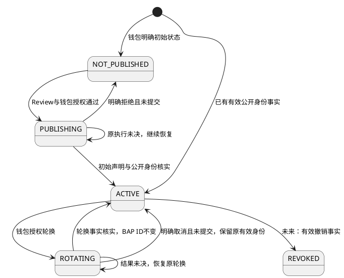
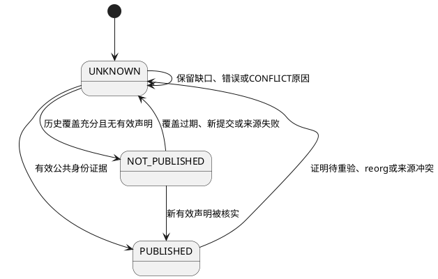
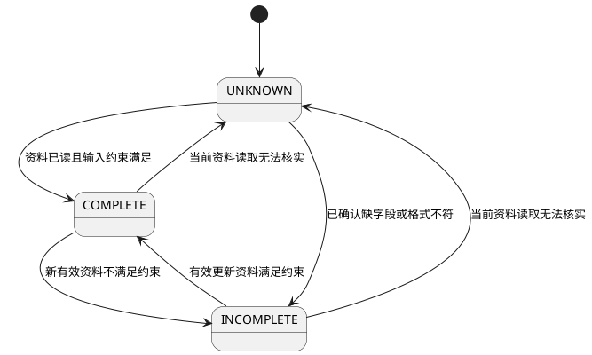
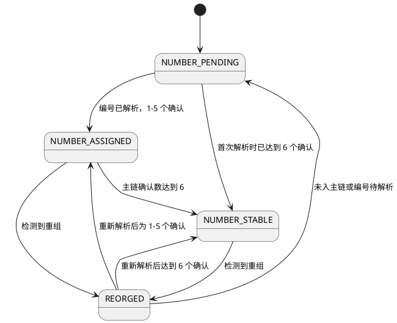
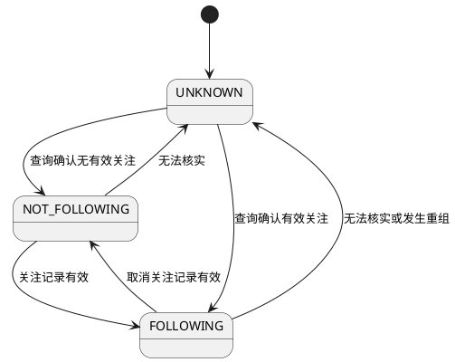
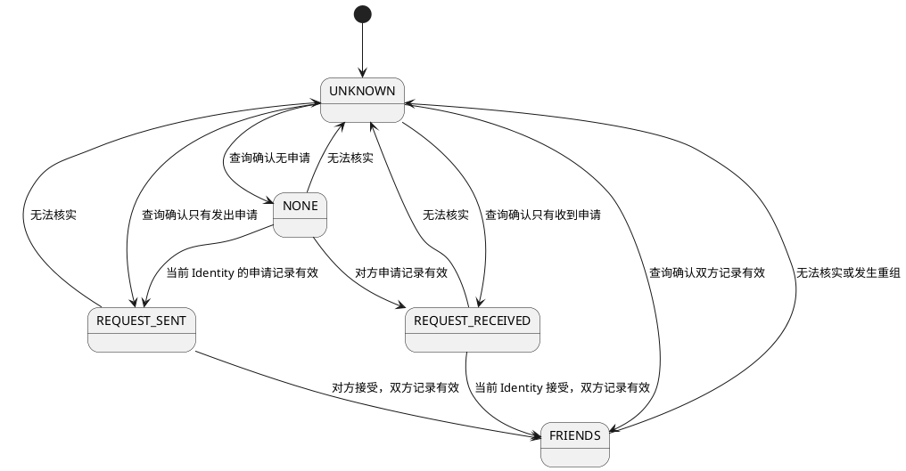

# Ownword 核心认知

> **Own your identity. Own your words.**
>
> 拥有你的身份，为你的言论负责。

## 0. 文档定位

本文是 Ownword 产品、设计、原型、代码和测试的**唯一事实来源（SSOT）**。

- 本文只保存跨模块、跨版本必须稳定的认知，不复述页面细节。
- 跨模块稳定的术语、功能、实体/值对象、属性、关系、业务状态、领域事件和约束在本文定义；Domain 引用这些定义，编排用例并映射职责，不建立第二份产品实体表或业务状态机。
- `设计文档V6.md` 是本文的直接设计依据；外部协议和代码是技术事实依据。
- 本文与设计稿、原型、代码或普通设计文档冲突时，以本文为准。
- 新需求先修改本文，再同步设计、原型、代码和测试。禁止在下游重复定义同一规则。
- 未经协议或可执行代码验证的结论，必须标记为“待确认”，不得写成既定事实。

规范词：

- **必须/禁止**：不可违反的产品或技术约束。
- **应该**：默认实现；偏离时必须记录原因。
- **可以**：允许但非必需。

## 1. 是什么

Ownword 是以**区块链 Identity 为中心**的个人或组织身份、关系与内容平台。

平台回答三个问题：

1. **Who am I?** — Identity
2. **What did I say?** — Words
3. **Can it be proven?** — Proof

三个根原则：

1. **Identity belongs to the user.** Identity 由用户 Wallet 控制，不属于平台账户。
2. **Words are signed by the identity.** 发布内容必须能归属并验证到明确 Identity。
3. **Blockchain is the source of truth.** 链上事实以 Bitcoin sv为最终依据，数据库只保存草稿和派生数据。

核心模型：

```text
Wallet（控制能力）
  ↓
BAP Identity（产品中心）
  ├── Words
  ├── Relationship
  └── Identity Artifact
          ↓
        Bitcoin（链上事实）
```

Wallet 是基础设施，Identity 是产品中心。Words、Relationship、Artifact 是 Identity 的平行能力；Artifact 不是使用其他能力的前置条件。

所有由 Ownword 发起或委托构造的链上交易，都必须使用 `identityKey` 执行身份签名，并能验证归属到明确 BAP ID。具体范围和签名边界以第 6.4 节为准。

## 2. 术语与命名

### 2.1 领域术语

| 术语 | 唯一定义 |
| --- | --- |
| Wallet | 管理密钥、权限、资产、签名和交易能力的非托管钱包；不是平台账号或 Identity |
| Yours Wallet | MVP 默认支持、基于 BRC-100 的 Wallet |
| Wallet Provider | 平台对 Wallet 能力的统一抽象 |
| BAP Identity / `BapIdentity` | 由 BAP 定义、用户 Wallet 控制的主权数字身份；领域模型见第 7.2 节 |
| BAP ID / `BapId` | 由 Identity 根密钥确定性派生的稳定、公开身份主标识；在模型中作为不可变值对象 |
| identityKey | 本产品指 BAP 当前有效的身份签名密钥，私钥由 Wallet 持有；与 BAP ID 字符串、UTXO 花费密钥及 BRC-100 API 的钱包根身份公钥参数分别处理 |
| BAP Profile / `BapProfile` | Identity 的可修改展示信息；不是 Identity 本身，模型见第 7.3 节 |
| `IdentityKeyHistory` | 同一 BAP ID 的签名路径及有效变更证据视图，用于签名发生时的归属核验 |
| `IdentitySignatureProof` | 本笔交易业务载荷、关键目标、签名者及历史 BAP 归属的可验证材料，不能由钱包连接或花费签名代替 |
| `IdentityResolution` | 公共身份查询结果，附网络、来源、覆盖及观测时点；取值和条件见第 9.2 节 |
| `WalletIdentityState` | 当前钱包提供的本人身份、资料和操作能力观测；不代表全网公开状态 |
| `ProfileCompleteness` | 依据已读取资料与第 7.3 节必填约束派生的完整度；与身份发布状态独立 |
| `ChainObservation` | 对原交易、网络或公共索引事实的来源、覆盖和时点记录；不把缓存或读取失败当作全网不存在 |
| Key Rotation | 保持 BAP ID 不变，更新当前签名路径 |
| Words | 用户侧内容概念；使用 BitcoinSchema Post 表达，文字编辑与公开媒体读取范围遵循第 6 节 |
| Content Revision | 已发布内容的新链上版本；不能覆盖旧版本 |
| Proof | 对签名、协议、标识、交易和链上状态的可验证说明 |
| Identity Artifact | 与 Identity 关联的 1Sat Ordinal 资产，以 Inscription Number 提供可记忆的数字 ID，并承载视觉表达；领域实体名为 `BapNFT` |
| Binding | Identity 与 Artifact 的独立关联记录 |
| Inscription ID | 某次 Inscription 的输出标识，格式 `txid_vout` |
| Inscription Number | Inscription 确认后按区块顺序分配的编号，用作可记忆的数字 ID；经有效 Binding 查找 BAP Identity；稳定状态遵循第 9.4 节，受 reorg 影响 |
| OpNS Name | 后续考虑的可记忆名称；本期不实现，不替代 Inscription Number 的数字 ID 角色 |
| Ordinal Number | 精确标识 satoshi 的编号 |
| Origin | 当前 1Sat 单聪输出链的起点；Ordinal 被装入大于 1 satoshi 的 Output 后不再延续 |
| Outpoint | 当前交易输出；Artifact 转移后改变 |
| Relationship | Identity 与 Identity 的关系；双方始终用 BAP ID 标识 |
| Follow | Identity 之间的单向关注；关注列表表示出向关系，粉丝列表表示入向关系 |
| Friend | 通过申请和对方接受建立的双向好友关系，与 Follow 独立；协议与授权边界遵循第 6.2、7.8 节 |
| Transaction | 链上操作对应的 Bitcoin sv 交易 |

### 2.2 用户术语与协议术语

普通界面优先使用：

```text
Identity / Profile / Words / Identity Artifact
Publish / Signature / Transaction
```

协议细节通过 Details 或 Proof 渐进披露：

```text
BAP / B / MAP / AIP / Ordinal / Origin / Outpoint / BEEF
```

两个主标识不得降级为隐藏协议细节：

- Identity 的主标识是 **BAP ID**。
- **Inscription Number** 是用户记忆、展示和查找 Identity 的数字 ID；其链上对象仍是 Artifact，解析到 Identity 必须经过有效 Binding。

### 2.3 用词禁区

- 禁止把 Wallet Connection 称为传统“注册账号”或“登录账号”。
- 禁止用 `Verified Identity` 表示仅通过密码学签名验证的 Identity。
- 应使用 `Signature valid` 或 `Signed by this identity`；它不证明现实人物身份。
- 禁止把 Identity Artifact 的主要操作写成 `Create BAP NFT`；用户侧统一为 `Create Artifact`。
- 同一操作和状态必须使用同一文案，禁止在 `Publish / Submit / Broadcast / Push` 间随意切换。

## 3. 目标

用户必须能够：

1. 使用自己的 Wallet；
2. 创建、拥有、查看和维护 BAP Identity；
3. 用明确 Identity 签名并发布 Words；
4. 在 Bitcoin 上独立验证 Identity、签名、内容和交易；
5. 通过 BAP ID 查找 Identity；
6. 创建或选择自己持有的可选 Identity Artifact，以 Inscription Number 作为可记忆数字 ID，查找其当前关联 Identity；
7. 离开平台后仍保有 Identity、已发布内容和 Artifact；
8. 通过公开个人主页浏览 Identity 已发布的博客、图片、视频和音频，以及公开关注与粉丝列表；
9. 以 BAP ID 关注其他 Identity，或申请并经对方接受建立好友关系。

体验必须满足：

- **易用性**：用户完成目标前不必学习底层协议。
- **一致性**：相同行为使用相同组件、文案、状态和交互。
- **确定性**：用户始终知道当前 Identity、发生的动作、业务结果和下一步。
- **可验证性**：关键链上结果能追溯到原始标识、签名和交易。

## 4. 全局不变量

以下规则优先于所有页面和实现细节：

1. `BAP Identity != WalletConnection != BAPProfile != Identity Artifact`。
2. BAP ID 稳定且不可编辑；Profile 可修改；Key Rotation 不改变 BAP ID。
3. Identity 可在没有 Artifact 时被查找、建立 Relationship、写作和发布。
4. 一个 Identity 可以关联多个 Artifact，但有效 Current Artifact 最多一个。
5. `creator`、签名者、当前 owner、Current Binding 是四个独立概念，禁止互相推断。
6. 已发布内容不可覆盖；修改必须创建 Revision，旧版本保持公开。
7. Content 产品状态、Transaction/Blockchain 状态必须独立建模。
8. Inscription Number 只在确认后存在，禁止预估或本地分配；reorg 后允许变化。
9. Inscription Number 是可记忆数字 ID，不替代 BAP ID；查找须先定位 Artifact 再验证 Binding，Content 归属与 Relationship 端点始终保存 BAP ID。
10. 展示值可以缩略，复制和协议输入必须使用完整原始值。
11. Wallet 连接不等于自动签名授权；需授权的操作必须交由 Wallet 确认。
12. 用户拒绝或关闭 Wallet 是 `Cancelled`，不是系统 `Failed`。
13. Locale、Theme 和 Copy 状态只影响 UI，不得进入签名输入或改变链上事实。
14. 数据库缓存不能替代 Bitcoin 或可重建的 Indexer 事实。
15. 所有链上交易必须满足第 6.4 节的 identityKey 身份签名约束；钱包连接、付款、UTXO 花费签名或写入 BAP ID 字段都不能替代该证明。

## 5. 结构

### 5.1 模块

业务模块：

```text
Wallet / Identity / Content / Artifact / Explorer / Relationship
```

各业务模块拥有独立工作区，跨模块只展示必要的身份上下文或引用，不在 Identity 中连续堆叠其他模块的管理界面。

| 模块 | 职责 |
| --- | --- |
| Identity | 身份生命周期、Profile、BAP ID，以及当前有效数字 ID 的引用 |
| Artifact | 资产集合、创建、数字 ID 状态、Binding 与转移 |
| Content | 草稿、发布、版本与内容 Proof |
| Explorer | 标识查找及公开身份、内容、资产的读取入口 |
| Wallet | 为各业务模块提供连接、授权、账户上下文和交易能力 |
| Relationship | 关注、好友申请与接受、关系状态，以及可重建的关系查询 |

公开个人主页是 Explorer 对 Identity、已发布 Content 和公开 Relationship 的读取聚合，不将各模块的管理工作区合并到主页。

后续模块：

```text
Attestation / Messaging
```

横切能力：

```text
Internationalization / Theme
Identifier Display & Copy / Exact Identifier Lookup
Proof / Transaction Tracking / Error Semantics
```

### 5.2 接口边界

业务层只依赖以下抽象：

| 接口 | 职责 |
| --- | --- |
| `WalletProvider` | Wallet 会话、权限、身份上下文和通用交易能力；适配 Yours Wallet 与其 SDK |
| `IdentityProvider` | 通过 Wallet/SDK 管理本人的 BAP ID、发布、Profile 与 Rotation；公共身份解析及历史签名归属由公开查询与验证端口提供 |
| `ContentProtocol` | 内容编码、签名和发布 |
| `RelationshipProtocol` | Identity 关系编码和发布 |
| `OrdinalProvider` | Inscribe、查询 Wallet 当前 Ordinal Output、Transfer |
| `BlockchainIndexer` | 解析交易、编号、Origin、Outpoint、链状态和派生元数据 |
| `IdentifierResolver` | 将 BAP ID 或 Inscription Number 解析为 Identity、Artifact、Binding |

禁止业务组件直接依赖 Yours Wallet API。适配关系必须为：

```text
业务组件 → 领域接口 → Yours Wallet Adapter / Indexer Adapter
```

Inscription Number 所需的编号解析、精确查找、确认数与重组追踪等缺失能力，后续由 metanet4j 提供 API 补齐。metanet4j 是链上事实的解析与服务层，不自行分配编号，也不以数据库记录替代链上事实。具体接口签名、路径及部署未确定前，不在原型中宣称已经接入；本期使用可控样例表达行为。

### 5.3 事实来源

| 事实 | 权威来源 |
| --- | --- |
| Identity 发布、Published Content、Relationship 公开记录、Signature、Ordinal Ownership、Transaction | Bitcoin |
| BAP ID 的本地确定性计算 | Wallet/BAP 密钥派生；公开存在性须由公共 BAP 链上解析结果确认，不能只凭钱包本地记录 |
| Inscription Number、Ordinal Number、Origin、Current Outpoint、MAP merge | 可重建的 Indexer 解析结果 |
| 当前关注关系、好友关系、关注与粉丝列表及人数 | 对有效签名和关系记录的可重建派生结果；必须保留查询来源与时点 |
| Draft、搜索索引、缓存、UI 偏好、交易跟踪 | 应用数据库 |
| 私钥、Seed Phrase、签名授权 | 用户 Wallet |

查询派生事实必须保留来源、更新时间和重新解析能力。

### 5.4 支撑能力与产品领域的责任

| 支撑能力 | 能力提供方 | OwnWord 的责任 |
| --- | --- | --- |
| Wallet 与本人身份管理 | Yours Wallet 及其 SDK：连接、账户、权限、密钥、本人身份与 Profile 管理 | 接入钱包结果、执行产品资料校验、处理账户切换；不维护第二套钱包授权或密钥生命周期 |
| 交易签名与提交 | Wallet 执行身份签名、UTXO/资产解锁签名及交易提交；SDK 复用已有协议构造与 Action | Review 冻结业务意图、关联操作和子交易、保存可恢复材料、校验结果；metanet4j 可构造和验证交易，不接收私钥 |
| 链上与 Ordinal 查询 | 公共节点/广播服务、Indexer、SDK 查询客户端及 metanet4j 适配 | 核实交易、链状态、主链归属、Ordinal 输出/花费/Origin/历史与查询覆盖；产品领域据此判断发布、Binding 和数字 ID 状态 |

本人钱包身份状态与公共身份可发现性分别记录。公共查询为未知时，不把它改写成“未发布”，也不单独据此否决钱包提供的身份管理操作；是否可执行须遵循钱包实际契约、授权、冲突与未完成操作的恢复约束。已知公开身份与钱包记录冲突时先恢复或核实，不重复初始化。

身份签名、花费签名、提交回执、网络接收、确认、索引和业务回读分别提供证据。签名要求遵循第 6.4 节；提交结果未知时按原钱包操作引用/TxID 恢复，不自动创建另一笔交易。SDK 的一体化 Action 可以合并执行步骤，不能因此合并这些证据。

Ordinal 钱包列表表示当前钱包管理的资产；公共输出、当前花费、Origin 和转移历史属于公开查询事实。Inscription Number 的定义与验证遵循第 2、9.4、12 节，不能从 OrdFS sequence、钱包 tracking id 或列表位置推算。

具体用例、状态、端口、源码依据与能力缺口见[支撑域设计](domain/supporting/README.md)。上述职责是逻辑边界，不要求新增独立微服务。

## 6. 功能

### 6.1 MVP

#### Wallet

- 发现并连接 Yours Wallet。
- 显示压缩后的连接状态。
- Account Switch 时终止待处理敏感操作，清除旧 Identity 上下文，再解析新 Identity。

#### Identity

| 编号 | 功能/用例 | 输入与可验证结果 |
| --- | --- | --- |
| F-ID-01 | ResolveMyIdentity | 连接后读取钱包 BapId/身份/资料与独立公共查询，分别得到钱包观测、公共结果和资料完整度；分流见第 9.2 节 |
| F-ID-02 | PublishIdentity | 经 Review 与钱包授权请求已有发布能力，跟踪原执行并独立回读公共声明；不新增 OwnWord 初始化许可协议 |
| F-ID-03 | UpdateBapProfile | 校验并更新资料，新声明生效后更新公开投影；Setup 可组合首次身份与资料，实际交易逐笔跟踪 |
| F-ID-04 | RotateIdentityKey | 钱包执行轮换，验证稳定 BAP ID 与有效历史；OwnWord 不自行管理钱包密钥序号 |
| F-ID-05 | GetPublicIdentity | 按完整 BAP ID 查询公开 Identity/Profile/Proof 与来源覆盖；失败或缺证据明确为未知 |

`computeBapId` 只表示本地派生；钱包 basket 的 `resolveBapId` 不自动成为公共解析。Public Identity 展示、BAP ID 精确查找与复制消费 F-ID-05。

#### Content

- 创建和导入 UTF-8 Markdown Draft。
- Write、Preview、Review 后用明确 Identity 执行 `Sign & Publish`。
- MVP 链上协议为 `B + MAP(type=post) + AIP`。
- 发布取消时保留 Draft；成功广播并被网络接收后，业务状态可为 Published，确认状态单独展示。
- 已发布内容只允许 `Create Revision`。

#### Identity Artifact

- 创建 1Sat Ordinal Artifact，或选择钱包已持有的 Artifact；创建后以当前身份为默认关联目标；编号分配且可核实后才开放设为 Current Artifact，创建与 Binding 的结果分别反馈。
- 创建时请求 BAP identity signing，写入 `ord` 所需 MAP 字段。
- 编号由 Indexer 回填，展示待确认、已分配和稳定状态；判定规则以第 9.4 节为准，不在本地预估或发号。
- 支持多 Artifact、切换 Current Artifact、Transfer 后重新校验 ownership 和 Binding。
- Artifact 详情分层展示 Inscription Number、Associated BAP ID，以及 Proof 标识。

#### Explorer 与偏好

- 使用完整 BAP ID 或 `165`/`#165` 精确查找。
- BAP ID 直接解析已发布 Identity；Inscription Number 经 Artifact、Origin、Current Binding 解析 Identity。
- 默认语言为英文，可切换 `zh-CN`；用户选择持久化。
- 支持 Light 与 Dark；组件使用语义 Token，并满足 WCAG AA。

### 6.2 公开主页与关系

- 个人主页以 BAP Identity 为主体，展示公开 Profile、身份标识及该 Identity 的已发布内容。访问主页、内容、关注列表和粉丝列表均不要求连接 Wallet；Draft 不进入公开展示。
- 公开内容读取支持 Markdown 博客，以及独立的图片、视频、音频 Post；博客中也可以包含媒体。展示分类依据内容的 `mediaType`，不为图片、视频或音频新建私有 Post 类型。第 6.1 节的文字编辑与发布范围仍为 Markdown。
- Follow 是单向关系；Unfollow 取消该方向的关注。关注列表由当前主页 Identity 的有效出向 Follow 派生，粉丝列表由有效入向 Follow 派生，两者及其人数对所有访客公开。Follow 不自动产生 Friend，Friend 也不自动产生 Follow。
- Friend 需要发出申请并由对方接受，好友成立必须有双方的身份授权。申请和接受沿用 BitcoinSchema 的 `friend` 记录，包含目标 `bapID` 和用于通信的 `publicKey`，以 AIP 表达身份签名；单方申请不能显示为已是好友。
- Ownword 将两个方向的有效 Friend 记录归并为双向关系，以单方记录表达等待接受。这是落实申请流程的产品解释；官方 Social Schema 未单独规定申请、接受或撤销类型。具体归并、通信公钥派生和钱包适配契约按第 12 节验证，禁止自行添加 `friend_request`、`friend_accept` 或 `unfriend` 私有协议。
- 关系操作由当前操作 Identity 授权，对象始终为目标 BAP ID，遵循第 6.3、6.4 节。公开浏览的主页 Identity 不得替代操作 Identity。

### 6.3 统一高影响操作流

```text
User Intent
  → Review
  → Wallet Confirmation
  → Processing
  → Business Result
  → Blockchain Details
```

Review 必须显示当前操作 Identity、完整可复制 BAP ID、主要影响和将产生的公开结果。

### 6.4 全部链上交易的身份归属

- 所有 Ownword 发起或委托构造的链上交易均须经用户授权，由 Wallet 使用 `identityKey` 签名。范围包括 Identity 首次发布、Profile 更新、Key Rotation、Content 发布和 Revision、Follow/Unfollow、Friend 申请与接受、Artifact 创建和 Transfer，以及实际产生链上交易的 Binding 变更、支付及后续能力。一次操作拆成多笔交易时，每笔均适用，不得仅签第一笔或主业务交易。
- 身份签名与 UTXO 花费签名职责不同：前者证明操作归属 BAP ID，后者满足被花费输出的锁定条件。两者均须满足，不要求所有输入改用同一身份密钥花费，也不把付款账户推断为操作 Identity。
- 身份签名必须绑定本笔交易的业务内容和关键目标。Review 后改变内容、关联目标或转移目标，必须重新授权和签名；签名失败、缺失、归属不匹配或账户变化时，禁止继续广播，不得静默退回仅有花费签名的交易。
- 首次发布按 BAP 初始身份声明规则建立并验证签名归属；Key Rotation 使用当时有效的身份签名路径授权。历史交易依据签名发生时有效的 BAP 密钥历史验证，不能因当前密钥已轮换而判为无效。
- Proof 必须能追溯交易、操作 BAP ID、身份签名者、签名证据与验证结果；密码学签名有效只证明签名归属，不证明现实人物身份。外部历史交易可以只读展示，但未验证的归属不得显示为有效，也不能据此推导 Current Binding。
- AIP、Sigma 等封装应复用现有协议并经实际交易和验证器确认。SDK 选项名、钱包本地标签或 `signWithBAP: true` 不能单独作为满足本节的证据；封装能力不足由后续钱包适配与 metanet4j 实现补齐，本期原型明确使用签名样例。

### 6.5 后续能力

```text
Reply / Repost / Like / Message / Tag / Attachment 发布 / Attestation
OpNS Name（可记忆名称，本期不处理）
```

后续能力优先采用 BAP 或 BitcoinSchema 已有协议，禁止无依据创建私有 Schema。

## 7. 实体与属性

以下 Identity 相关实体和派生模型使用稳定编号。编号用于跨文档引用，不代表必须新建同名 Java/TypeScript 类、数据表或 HTTP DTO。

| 编号 | 模型/类别 | 归属、存储与事实源 | 定义 |
| --- | --- | --- | --- |
| E-WAL-01 | WalletConnection / 会话 | Wallet 管理，应用只保留会话引用与能力 | §7.1 |
| E-ID-01 | BapIdentity / 聚合根 | 钱包管理本人身份；链上声明提供公开证据；OwnWord 保存可重建视图 | §7.2 |
| E-ID-02 | BapProfile / 当前资料投影 | 由有效 ALIAS/图片等声明派生，原交易保存版本依据 | §7.3 |
| V-ID-01 | BapId / 不可变值对象 | 引用 E-ID-01 的公开主标识，不产生另一份身份 | §2.1、§7.2 |
| V-ID-02 | IdentityKeyHistory / 证据视图 | 钱包持有密钥；公开核验端保存可验证历史引用 | §7.10 |
| V-ID-03 | IdentitySignatureProof / 证据值对象 | 原交易及独立验证器；由 BlockchainTransaction 引用 | §7.9、§7.10 |
| Q-ID-01 | IdentityResolution / 公共查询结果 | 公共来源与核验结果；应用缓存保留来源和时点 | §7.10、§9.2 |
| Q-ID-02 | WalletIdentityState / 钱包查询结果 | 当前 Wallet 提供；应用不复制其权限或身份写模型 | §7.10、§9.2 |
| V-ID-04 | ProfileCompleteness / 派生值 | 从已读取 Profile 与必填规则计算，不单独存为身份生命周期 | §9.2 |

属性中的“必填”针对资料充分的完整模型；公开或钱包读取不完整时使用查询结果表达缺失，不能补造路径、TxID 或时点。未在现有依据中规定的协议长度/编码不自行发明，适配器按实际协议校验完整原值。

### 7.1 `WalletConnection`

当前应用与 Wallet 的会话。它只提供上下文和能力，不代表平台 User 或 BAP Identity。

### 7.2 `BapIdentity`

E-ID-01 是身份稳定标识、已验证声明与历史约束的聚合根。Root/Current/Previous 路径由钱包管理；OwnWord 只使用其允许返回的公开引用或可验证路径，公共 API 不要求暴露钱包派生秘密。完整钱包身份与公开读模型不必具有相同字段集合。

| 编号 | 属性/类型 | 必填与默认 | 唯一性、可变性与格式/来源 |
| --- | --- | --- | --- |
| ID-A01 | `bapId: string`（V-ID-01） | 必填，无默认 | 唯一、稳定、不可编辑；保留完整协议原值，不截断或补齐 |
| ID-A02 | `rootPath: string` | 完整钱包模型必填，无默认 | 稳定根路径/引用，钱包为管理方；不能用 currentAddress 冒充 |
| ID-A03 | `currentPath: string` | 完整钱包模型必填，无默认 | 按有效轮换更新；公开归属须有历史证据 |
| ID-A04 | `previousPath?: string` | 可缺，无默认 | 保留轮换历史引用；单个 Previous 不替代完整 V-ID-02 |
| ID-A05 | `type: PERSON \| ORGANIZATION` | 必填，无默认 | 身份声明类型；与 Profile.type 的变更一致性待 §12.7 确认，不默认同步或声明永久不可变 |
| ID-A06 | `status: IdentityStatus` | 完整业务视图必填，不默认 ACTIVE | 只读派生，取值与转换见 §9.2；不是公共查询或钱包原始枚举 |
| ID-A07 | `publishTxid?: string` | 发布证据建立前可缺，建立后必填 | 对应初始声明的实际完整 TxID，记录不可变；重组/冲突改变当前证明有效性，不覆盖原字节 |
| ID-A08 | `createdAt: datetime` | 完整模型必填，无默认 | 身份记录来源中的创建时点，不可变且保留来源；不能把 HTTP 到达时间伪装成链上时间 |

E-ID-01 不持有可变的 Current Binding；Identity 只读 E-ID-02 和 Artifact 的有效关联摘要，不与链上资料或 Artifact 聚合强制组成同一数据库事务。

### 7.3 `BapProfile`

E-ID-02 是同一 BAP ID 的当前有效展示资料，可由链上声明重建；每次有效更新保留新交易和历史，不能用本地编辑直接覆盖公开事实。

| 编号 | 属性/类型 | 必填与默认 | 唯一性、可变性及长度/来源 |
| --- | --- | --- | --- |
| PR-A01 | `bapId: string` | 必填，无默认 | 当前投影按 BAP ID 唯一定位，不可修改 |
| PR-A02 | `name: string` | 必填，无默认 | 可修改，最多 100 字符 |
| PR-A03 | `image?: URI` | 可缺，无默认 | 可修改，最多 2048 字符；保留 URI/链上内容引用及对应证据 |
| PR-A04 | `description?: string` | 可缺，无默认 | 可修改，最多 1000 字符 |
| PR-A05 | `type: Person \| Organization` | 必填，无默认 | 可修改的展示声明；与 ID-A05 的变更映射待 §12.7 明确 |
| PR-A06 | `updatedAt: datetime` | 完整已核实投影必填，无默认 | 随有效资料记录派生可信时点，不能用浏览器或 HTTP 到达时间补造；缺证据返回部分资料/未知时点 |

资料完整度按 PR-A02/PR-A05 等必填输入及类型/长度校验派生；updatedAt 是证据元数据，不要求用户输入。首次资料、发布身份、上传图片可以由钱包按其 Action 组合或拆成多笔，不能因单步取消删除已提交子交易。

### 7.4 `Content`

| 属性 | 约束 |
| --- | --- |
| `id: UUID` | 本地唯一标识 |
| `txid?: string` | 发布后唯一、不可变 |
| `authorBapId: string` | 必填、不可变 |
| `type: POST` | 内容沿用 BitcoinSchema Post；界面展示分类不改变协议类型 |
| `content: text / binary` | 内容载荷；Draft 可修改，发布后不可变；公开媒体读取按协议解析 |
| `mediaType: MIME string` | 必填，发布后不可变；文字编辑固定为 `text/markdown`，公开读取可识别支持的图片、视频和音频 |
| `encoding: string` | 发布后不可变；Markdown 使用 UTF-8，二进制媒体遵循实际协议编码，不强制转成文本 |
| `status` | 必填，遵循 Content 产品状态机 |
| `publishedAt?: datetime` | 发布后必填、不可变 |

### 7.5 `ContentRevision`

每个 Revision 是新 Content 版本，使用 `rootContentId`、`previousContentId`、`revisionNo` 和新 `txid` 串联，不修改旧 Content。

Revision 沿用标准 BitcoinSchema Post，允许通过 OwnWord 命名空间的 MAP 元数据声明根版本和直接前版，声明与正文一并受 AIP 签名覆盖。链上引用使用完整 TxID；首版根为自身交易，修订序号从已验证路径派生，不依赖客户端自报或数据库时间。此约定是 OwnWord 应用扩展，不宣称为通用 Revision 标准；具体编码见 [v0.2.0 实现设计第 5 节](frontend/设计文档v0.2.0-内容真实集成-20261014-215514.md)。

修订必须归属同一 BAP Identity，根与前版关系可核验且无环。多个设备可能产生分支；关系缺失、归属未验证或查询覆盖不足时不能声称唯一最新，发生分支时保留各版本并停止继续追加，不用本地排序覆盖历史。

### 7.6 `BapNFT`

| 属性 | 约束 |
| --- | --- |
| `inscriptionId: string` | 唯一、必填、不可变，格式 `txid_vout` |
| `inscriptionNumber?: decimal string` | 确认并解析后存在；reorg 后可变；禁止使用浮点数；不包含显示前缀 `#` |
| `numberStatus` | 编号解析与稳定性派生状态；取值和判定遵循第 9.4 节，与 Artifact、Binding 及交易状态分别保存 |
| `numberConfirmations?: int` | 编号对应铭文交易在当前主链的确认数；未入块为 0，来源不可用时为未知，不能伪装成 0；Transfer 交易的确认数不替代此值 |
| `numberObservedAt?: datetime` | 最近一次成功核实编号、确认数及所在链的时间；派生只读，保留查询来源 |
| `ordinalNumber?: decimal string` | 解析后存在，使用字符串避免精度丢失 |
| `origin: string` | 当前 1Sat 链的领域定位键；burn 后可产生新 Origin |
| `currentOutpoint: string` | 必填，Transfer 后更新 |
| `currentSequence?: int` | 当前 1Sat 转移/重铭刻位置 |
| `contentType`, `contentUri` | Inscription 内容描述 |
| `owner` | 当前 Output 控制者；不得自动解释为 BAP ID |
| `status`, `createdAt` | 产品状态与创建时间 |

### 7.7 `IdentityNFTBinding`

使用 `bapId + ordinalOrigin` 关联 Identity 与 Artifact。状态为 `ACTIVE / HISTORICAL / INVALID`；同一 `bapId` 的 `ACTIVE` Binding 必须不超过一个。

同一 `ordinalOrigin` 同时最多关联一个有效当前 BAP ID，确保数字 ID 精确查找没有歧义。切换 Current 保留旧关联历史，只有有效 ACTIVE Binding 可用于当前 Identity 解析。Binding 的授权证据、公开记录和撤销验证由后续实现契约明确，不得仅以数据库写入、创建者或签名者推导有效绑定。

### 7.8 `Relationship`

以 `fromBapId + toBapId + type` 定位某一方向的关系语义；Inscription Number 不得保存为关系端点。链上关系事件保留原始交易和身份签名引用；Friend 还保留协议通信公钥。通信公钥与身份签名地址分别处理，不得互相替代。

同一方向、同一类型的重复记录不能重复增加人数；当前关系由有效事件派生，不能以数据库布尔值替代链上记录。Follow 的两个方向独立，Friend 按第 6.2 节归并；查询失败或签名尚未核实时是未知，不能推断不存在关系或接受成功。

### 7.9 `BlockchainTransaction`

统一记录 Identity 发布、Profile 更新、Content 发布、Relationship 操作、Artifact 创建/变更和 Key Rotation 的链上交易与状态。

| 属性 | 约束 |
| --- | --- |
| `operationBapId: string` | Ownword 发起的交易必填；表示操作归属的 BAP ID，不根据 owner 或付款地址推断 |
| `identitySigningAddress: string` | 身份签名者的公开地址；由签名证据取得，按 BAP 密钥历史验证，不允许用户任意填写替代证明 |
| `identitySignatureProof` | 实际签名及其链上定位、封装和验证所需材料的引用；不得包含私钥；具体编码属于实现契约 |
| `identitySignatureStatus` | 身份签名验证状态，与广播、确认及编号稳定状态独立；未验证或不匹配不得显示有效 |

### 7.10 Identity 证明与查询模型

本节是逻辑属性与证据要求，不是新增 API Schema；属性编号标识语义，不要求当前接口采用同名字段。`?` 表示可缺，缺失不默认空数组、false 或已验证；时间保留来源与原始精度，历史顺序按有效链序核验。所有证明保留原交易或可靠来源引用，派生结果可重放，不用空串/零值伪造已核实事实。

| 模型 | 属性编号与逻辑内容 | 约束与来源 |
| --- | --- | --- |
| V-ID-02 IdentityKeyHistory | KH-A01 `bapId: string`；KH-A02 `records?: 证据引用[]`（有效路径及声明/轮换）；KH-A03 `context: object`（网络、链序与覆盖）；KH-A04 `observation: object`（来源、`observedAt?: datetime`） | BapId 必填稳定，用于定位同一身份历史；已知上下文必填，路径证据随读取提供，不默认历史完整。保留旧/新授权链，重组后重放，不由 OwnWord 管理钱包密钥 |
| V-ID-03 IdentitySignatureProof | SP-A01 `txid/operationBapId: string`；SP-A02 `signature?: object`（签名者、材料及链上位置）；SP-A03 `signedCoverage?: object`（载荷/关键目标）；SP-A04 `verification: object`（历史归属、验证结果及来源） | 已知交易和操作身份按完整原值记录；待验证材料可缺，验证结果不默认有效。建立有效归属时所有证据必须充分，按 TxID/签名位置定位；具体封装待 §12.2/§12.8 |
| Q-ID-01 IdentityResolution | IR-A01 `bapId: string`；IR-A02 `result: enum`（§9.2）、`reason?: string`；IR-A03 `observation: object`（网络/scope、来源、覆盖、时点）；IR-A04 `identity/profile/proof?: 引用` | 查询键和上下文必填，结果初始 UNKNOWN；不等同于身份实体。冲突以原因和证据表达，不能静默选择来源；缓存保留上次已核实观测 |
| Q-ID-02 WalletIdentityState | WI-A01 `context: object`（钱包/账户/scope 引用）；WI-A02 `bapId?: string / publication?: object`；WI-A03 `profile?: object`；WI-A04 `capabilityObservation?: object`（Action 能力、权限结果及来源） | 当前上下文必填，其余只保存钱包实际返回的字段与引用，未知时不制造默认状态/权限；不作为公共不存在证明，不单独维护身份写模型 |

V-ID-02 依赖实际交易的有效链序。首次声明按初始身份规则核验；旧交易按当时有效路径验证，不能仅查询当前地址。历史缺口、同块顺序不明、冲突或 reorg 时保留未决归属，不能将格式正确或密码学验签成功升级为有效 BAP 归属。

### 7.11 Identity 相关领域事件

事件是业务意图、执行观测或核实事实的记录，分类不能互相替代。适用时携带网络/scope、来源、观测时点及实际交易/Proof；交易尚未产生时不制造 TxID。消费方按原事件和交易引用幂等重放。

| 编号 | 事件 | 触发与可信度 |
| --- | --- | --- |
| EV-ID-01 | WalletIdentityObserved | 读取钱包本人身份/能力并附会话来源；不证明公共发布 |
| EV-ID-02 | IdentityPublicationRequested | 用户确认发布意图；不证明钱包签名或链上生效 |
| EV-ID-03 | WalletExecutionRecorded | 记录实际 Action/reference/可得交易；不单独证明网络接受 |
| EV-ID-04 | BroadcastResultObserved | 获得可追溯提交回执；仍需按链证据核实 |
| EV-ID-05 | IdentityPublicationVerified | 初始声明、身份签名归属及公共 BAP 事实充分，附网络和 Proof |
| EV-ID-06 | ProfileUpdateVerified | 有效资料更新已核实，附交易与版本，不改变 BAP ID |
| EV-ID-07 | IdentityKeyRotatedVerified | 轮换授权、稳定 BAP ID 和历史路径已核实，保留旧/新路径引用 |
| EV-ID-08 | ArtifactBindingVerified | Artifact 上下文发出的有效关联事实；须先关闭 §12.4 的公开验证契约，Identity 仅消费 |

## 8. 关系

| 编号 | 主体 | 关系 | 客体 | 基数及唯一定位 |
| --- | --- | --- | --- | --- |
| REL-01 | Wallet | controls | BAP Identity | 当前会话 1 : 0..1；按钱包/账户/scope 读取，不等同于全钱包只存在一个身份 |
| REL-02 | BAP Identity | has current profile | BAP Profile | 1 : 0..1；当前投影按 BAP ID 定位，历史保留原声明 |
| REL-03 | BAP Identity | publishes | Content | 1 : N；作者以 BAP ID 标识 |
| REL-04 | Content | revises | Content | 1 : N；版本关系遵循 §7.5 |
| REL-05 | BAP Identity | relates to | BAP Identity | N : N；端点始终为 BAP ID |
| REL-06 | BAP Identity | binds | BapNFT | 1 : N 历史关联，通过 IdentityNFTBinding 表达 |
| REL-07 | BAP Identity | current artifact | BapNFT | 1 : 0..1；同一 BAP ID 的有效 ACTIVE Binding 唯一 |
| REL-08 | BapNFT | current associated identity | BAP Identity | 1 : 0..1；同一 Origin 的有效当前 BAP ID 唯一 |
| REL-09 | 领域操作 | produces | BlockchainTransaction | 1 : 0..N；多笔子交易分别保存与恢复 |
| REL-ID-01 | BAP Identity | has verifiable history | IdentityKeyHistory | 1 : 0..1 当前历史视图，含 0..N 原始声明/轮换记录；按 BAP ID 与有效链序核验 |
| REL-ID-02 | BlockchainTransaction | carries | IdentitySignatureProof | 外部交易可缺；OwnWord 交易的有效归属必须满足 §6.4，按实际 TxID 与签名链上位置定位 |
| REL-ID-03 | IdentityResolution | observes | BAP Identity / BAP Profile | 同一身份可有多次来源观测；查询结果不拥有或修改钱包身份，网络/scope 不混用 |

Identity 与 Artifact 的关联必须经过 Binding 表达，禁止仅靠 Artifact 元数据、owner 或 signer 推断。关系基数描述业务约束，不自动等同数据库外键或复合唯一索引。

## 9. 状态

原则：系统状态可以详细；用户状态必须简单、可解释。产品状态不得直接复用 Wallet、SDK 或 Indexer 的原始枚举。

### 9.1 Wallet

```text
系统：DISCONNECTED → DETECTING → SELECTING → CONNECTING → CONNECTED
异常：CONNECTING → CANCELLED | FAILED
用户：Not connected | Connecting | Connected | Connection cancelled | Connection failed
```

### 9.2 Identity

生命周期、钱包观测、公共查询、资料完整度和操作结果分别表达，禁止合并为一个 published 布尔值。钱包内部发布/权限/轮换状态由 Wallet 管理；OwnWord 的阶段只用于业务表达和恢复，不重建钱包状态机。

#### 9.2.1 业务生命周期

IdentityStatus 保留 `NOT_PUBLISHED / PUBLISHING / ACTIVE / ROTATING`；`REVOKED` 为未来能力。初始化阶段须有钱包明确记录；不知道钱包状态时不能默认 NOT_PUBLISHED。PUBLISHING/ROTATING 从当前操作派生，进入 ACTIVE 需要相应已核实事实。



查询失败或冲突不创建新身份，也不擦除此前证据。当前可信度由公共查询结果表达；重组/覆盖变化后必须重查，不能仅用缓存 ACTIVE 宣称当前公开证明有效。资料更新不改变 BAP ID 或创建第二个生命周期。

#### 9.2.2 公共身份查询

| 结果 | 成立条件 | 不能推断 |
| --- | --- | --- |
| PUBLISHED | 有效初始声明、身份归属及公共来源充分 | Profile 完整、当前 Wallet 有权操作、所有子交易均完成 |
| NOT_PUBLISHED | 已核实网络/scope 且历史覆盖足以排除有效身份声明 | 钱包无记录、404、超时或空缓存本身不能满足此条件 |
| UNKNOWN | 初始值，或来源失败、缺覆盖/Proof、scope 不符、链序或来源冲突 | 身份不存在、未广播、未发布或已撤销 |



UNKNOWN 是 Q-ID-01 的结果，不加入身份业务生命周期。CONFLICT 保存在公共查询的原因及各来源证据中；历史路径验证接口可以返回 UNKNOWN/CONFLICT，但不能据此发明第四个公共发布生命周期。钱包计算 BapId 或读取 basket 不能替代公共证据；公共结果也不反写钱包发布开关。

#### 9.2.3 资料完整度

ProfileCompleteness 为 `COMPLETE / INCOMPLETE / UNKNOWN`。用户可填写字段按 §7.3 校验：已读且必填/格式满足为 COMPLETE，已确认缺必填或不合约束为 INCOMPLETE，读取失败或不足以判定为 UNKNOWN。Proof 时点等缺失另行保留，不要求用户填写链上元数据；公共身份可以 PUBLISHED 而资料 INCOMPLETE。



#### 9.2.4 本人操作与异常边界

| 情况 | 允许的处理 |
| --- | --- |
| Wallet 明确提供首次身份/资料 Action；公共 UNKNOWN；无已知冲突或未决原操作 | 可 Review 并请求钱包执行；公共结果继续 UNKNOWN，等待独立回读 |
| 钱包已有身份、Profile 不完整 | 更新资料，不再次初始化 |
| 公共已核实身份存在，但钱包无跟踪记录或路径冲突 | 先匹配/恢复钱包记录与控制能力，不自动再建 ID |
| 钱包读取失败、权限/能力未知或账户不匹配 | 保留 Draft，重读/授权或恢复，不当作新身份 |
| 原 Action 结果未知，或已有原 TxID/reference | 恢复原执行和原交易；查询未命中不能触发新建/重签 |
| 会话/网络/scope 切换 | 作废未提交 Review/旧授权；已提交子交易按原身份继续追踪 |
| 多笔操作后续取消 | 只终止尚未提交步骤，保留已提交子交易及其证据 |

钱包拒绝且确认未提交时才可表达已取消；错误文本、网络超时或丢回执无法证明未提交。高层 Action 可在内部组合签名和提交，应用只保存实际返回的材料，不统一假定广播前一定可取得最终 rawTx。具体调用与恢复能力由 Wallet Adapter 实证。

### 9.3 Content

```text
产品：DRAFT → PUBLISHING → PUBLISHED
异常：PUBLISHING → CANCELLED | FAILED
链上：BROADCAST → SEEN → ACCEPTED → MINED → IMMUTABLE
```

`PUBLISHED` 表示业务发布成功，不要求已经 `MINED`。实际 Wallet/Indexer 状态必须映射到产品语义。

### 9.4 Artifact 与 Binding

```text
Artifact 产品：DRAFT → CREATING → CREATED
编号：NUMBER_PENDING → NUMBER_ASSIGNED → NUMBER_STABLE
reorg：NUMBER_ASSIGNED | NUMBER_STABLE → REORGED → NUMBER_PENDING | NUMBER_ASSIGNED | NUMBER_STABLE
Binding 系统：UNBOUND | ACTIVE | HISTORICAL | INVALID
Binding 用户：Not Used | Current | Historical | Unavailable
```

编号稳定阈值默认是 **6 个确认**，属于产品策略，不是链上永久不可变保证。确认数针对生成该编号的铭文交易；该交易所在块算第 1 个确认。交易在当前主链时，确认数为 `当前主链高度 - 交易所在块高度 + 1`；节点或索引器未能核实主链归属时不能据此计算稳定状态。

| 编号状态 | 判定条件 | 用户表达 |
| --- | --- | --- |
| `NUMBER_PENDING` | 铭文未确认，或编号尚未成功解析；编号为空 | 编号待确认；已确认但解析未完成时显示“编号解析中” |
| `NUMBER_ASSIGNED` | 编号已解析，且当前主链确认数为 1–5 | 显示实际编号与确认进度，尚未稳定 |
| `NUMBER_STABLE` | 编号已解析、主链归属核实且至少 6 个确认 | 显示实际编号与“稳定” |
| `REORGED` | 检测到重组，编号或确认依据需重新核实 | 编号重新核实中；原值仅作历史信息 |



新增或替换 Current 要求编号处于 `NUMBER_ASSIGNED` 或 `NUMBER_STABLE`，并独立满足 Origin、控制权及 Binding 校验。编号待确认、解析中、重组或无法核实时不能新增关联；1–5 个确认且编号已分配的资产仍可关联，必须标明尚未稳定。新建资产的编号尚未分配时保留为未关联，不自动继续签署 Binding。编号不确定本身不撤销既有 Binding，也不直接禁止符合控制权要求的转移。

`REORGED` 不表示 Artifact 被删除。页面仍可展示 Inscription ID、Origin 和 Transaction；重新核实后可以回到较低确认状态，编号也可能变化。查询失败保留带时间的上次结果并显示“待核实”，不得把未知数据当作空值、稳定结果或已删除。1–5 个确认时可以展示和查询已解析编号，但必须明确尚未稳定；数字 ID 查找仍须独立验证当前 Binding。编号稳定不证明 ownership、Binding 或身份签名有效。

### 9.5 Relationship

Follow 的业务状态为 `NOT_FOLLOWING / FOLLOWING / UNKNOWN`。Friend 的业务状态为 `NONE / REQUEST_SENT / REQUEST_RECEIVED / FRIENDS / UNKNOWN`，均相对于当前操作 Identity 和目标 Identity 派生。Wallet 授权、交易处理中、取消、失败与结果待核实属于操作状态，不替代已知关系状态。

首次查询前状态为未知；只有查询证据才能确定不存在关系或申请。





取消 Wallet 授权或明确提交失败时保留原关系；已提交但结果不明时先查询，不重复提交。历史交易和双方记录需按签名发生时的 BAP 密钥历史验证。拒绝、撤销申请及解除好友的公开协议未形成契约前，不以新增私有类型实现这些迁移。

## 10. 界限

### 10.1 安全与权限

- 平台禁止获取 Private Key、保存 Seed Phrase 或要求输入 WIF。
- 所有签名由 Wallet 完成；每次高影响操作遵循 Wallet Permission。
- metanet4j 可以构造、解析和验证交易，但不得接收私钥或绕过第 6.4 节的 identityKey 授权与签名要求。
- Account Switch 或 Sign Out 必须终止 Review Publish、Awaiting Signature、Creating Artifact、Rotating Key 等流程中的未提交操作和旧授权；已提交交易保留在原身份下继续查询，不宣称已撤回。
- 取消后不得用新账户静默继续旧账户动作。

### 10.2 Identity

以下标识用于责任与验收映射，规则本体由所引章节定义；不在下游重新维护同名规则表。

| 规则标识 | 权威定义 |
| --- | --- |
| ID-01 | BAP ID 稳定及 Rotation 不变性：§7.2 ID-A01、§2.1 Key Rotation |
| ID-02 | 本地派生与公共发布证据：§6.1 F-ID-01、§9.2.2 |
| ID-03 | Profile 的有效更新与版本：§7.3 |
| ID-04 | 签名发生时的有效密钥历史：§6.4、§7.10 V-ID-02 |
| ID-05 | 每笔交易的身份签名与覆盖：§6.4、§7.10 V-ID-03 |
| ID-06 | Creator/Signer/Owner/Binding 不互推：§4、§7.7 |
| ID-07 | Current Binding 双向唯一与归属：§7.7、§8 REL-07/08 |
| ID-08 | 编号的分配及重组：§7.6、§9.4 |
| ID-09 | 查询未知与不存在的区别：§9.2.2 |
| ID-10 | 账户切换、旧授权和原交易归属：§9.2.4、§10.1 |
| ID-11 | 钱包执行资格、公共观测及原执行恢复：§5.4、§9.2.4 |
| ID-12 | Identity/Profile 类型声明与待确认变更策略：§7.2/§7.3、§12.7 |

可修改 Profile、Rotate Key；后续可 Attest 或 Revoke。Artifact 不成为 Identity 可发现性的必要条件（§4）。

### 10.3 Content

- 文字编辑与发布使用 `Post + Markdown + UTF-8 + BitcoinSchema`；公开主页可以读取第 6.2 节约定的独立媒体 Post，不据此扩展媒体发布编辑器。
- 禁止设计 Custom Post、Reply、Follow 或 Friend 协议；唯一限定例外是第 7.5 节的签名 MAP 修订元数据，Post 类型、B 载荷和 AIP 协议保持标准语义，不能将 Reply 引用解释为修订。
- Draft 可修改；Published 不可覆盖；Revision 追加历史。

### 10.4 Artifact

- 有效 1Sat Inscription 必须位于 1-satoshi Output。
- Transfer 前必须获取新鲜 `WalletOutput`；优先携带 BEEF，不能只复用历史 outpoint。
- Artifact 进入大于 1 satoshi 的 Output 后，原 Origin 失效；再次进入单聪 Output 会产生新 Origin，旧 Binding 不得静默沿用。
- Binding 有效性至少检查 Origin 可解析、当前 ownership 满足要求、Current Binding 不超过一个。
- Inscription body、可沿链更新的 MAP metadata、当前 ownership 必须分别展示和处理。
- Inscription Number 来自链上收录顺序，创建 Artifact 不承诺获得短号或指定号码；已有号码需取得对应资产控制权后再申请关联。

### 10.5 UI 与无障碍

- Ownword 固定使用 **Spectrum S2** 作为唯一主设计系统；所有版本默认遵循 Spectrum S2 的 Token、通用组件语义、交互状态和无障碍基线。版本设计文档可以定义具体应用方式，但不得替换主设计系统；外部设计 skill 不得引入第二套主设计系统。
- 设计 Ownword 页面时，必须先明确用户任务、信息层级、内容关系和操作顺序，再使用 Spectrum S2 组件和 Token 完成界面。

#### 10.5.1 设计原则

1. **秩序清晰**：同级信息使用一致的对齐基准、排列逻辑和页面结构。
2. **关系可感知**：遵循亲密性、相似性、连续性、封闭性、对称性及主体与背景关系，使视觉关系准确表达信息关系。
3. **密度适当**：根据任务和阅读节奏控制信息密度，强关联内容保持紧密，不同模块形成清晰分隔。
4. **表达准确**：图片、图标、文字和品牌视觉准确表达内容、状态与功能，并保持构图、层次、风格和视觉品质。

以上原则是跨版本稳定的 Ownword 设计判断标准。版本设计文档负责将原则落实到具体页面；设计系统和外部 skill 负责执行，不得另行定义或替换这组原则。

#### 10.5.2 页面与无障碍约束

- Identity 页首屏突出 BAP ID，并展示有效 Current Artifact 的数字 ID 与编号状态；Artifact 页首屏突出 Inscription Number 和 Associated BAP ID。
- 协议标识值不翻译、不本地化数字、不加千位分隔符。
- 默认 `locale=en`；无保存偏好时不得根据浏览器语言自动切换。
- Light/Dark 切换不得改变内容、协议字段、哈希、签名或交易。
- 状态不能只靠颜色表达；两种主题必须满足 WCAG AA。
- 异常必须说明：发生了什么、影响什么、下一步做什么。

### 10.6 平台责任

平台负责 UI、编辑、预览、索引、查询、搜索、缓存、解析、Proof 展示和交易跟踪。

平台不拥有 Private Key、Seed Phrase、BAP ID、已发布内容或 Artifact 所有权。

### 10.7 公开主页与关系

- 公开内容和关系列表不以 Wallet 连接、关注或好友关系作为读取门槛。
- 建立关系要求连接 Wallet、当前操作 Identity 已发布且完成设置；禁止关注或申请添加自己，禁止由路由参数、名称或数字 ID 授予权限。
- Review 必须分别展示操作方与目标方的完整可复制 BAP ID。切换操作 Identity 后重新查询关系，旧 Review 与未提交授权失效，已经提交的交易继续归属于原 Identity。
- 不以加载失败伪装零人数或空列表，不将待核实的关系显示为已生效；内容载荷、媒体资源和归属证明独立反馈读取与验证结果。

### 10.8 生产集成与测试事实

- 生产实现必须区分钱包交互、交易构造、身份签名验证、广播、网络接收、公共索引与应用读取；其中一项成功不能替代其他项的证据。
- 受控测试可以替代钱包扩展交互，并在明确授权下模拟广播结果；模拟结果必须带来源标记、隔离存储，不能进入生产公开身份投影，不能显示为真实网络接收或确认。
- 原型样例、钱包 basket、本地发布回执和应用数据库写入不能独立证明 Identity 已公开发布。真实发布验收必须能从实际网络读取交易、验证身份归属，并经索引回读同一 BAP ID 和 Profile。
- 测试不得把读取失败解释为身份不存在，不得用伪造 TxID、签名有效标记或确认数关闭真实验收。无法使用真实资金时，保留主网发布验收待办，先完成不依赖资金的实现和真实服务验证。

## 11. 可验证验收

1. 无 Artifact 的已发布 Identity 能被完整 BAP ID 搜索、复制并用于 Relationship。
2. `165` 与 `#165` 解析为同一 Artifact；存在有效 Binding 时返回同一关联 Identity。
3. Relationship 最终保存 BAP ID，不保存 Inscription Number。
4. Artifact 未确认时编号为 `null`，UI 显示 Pending，不显示猜测编号。
5. reorg 后重新解析 Inscription Number，不改变 Inscription ID 或伪造 Artifact 删除；原来稳定的编号必须允许重新核实和降级。
6. 页面显示缩略 BAP ID、TxID 或 Outpoint 时，Copy 返回完整原值。
7. Wallet 拒绝发布时状态为 Cancelled，Draft 内容保持不变。
8. 交易已成功广播并被网络接收但未挖矿时，Content 可显示 Published，同时显示 Confirmation pending。
9. Published Content 的修改产生新 Revision 和新 Transaction，旧版本可继续访问。
10. Account Switch 会终止未提交的敏感操作及旧授权，并显示新 Identity；已提交交易仍按原身份查询，不回滚链上结果。
11. 用户切换语言或主题并刷新后偏好保留，所有链上标识和内容保持不变。
12. Artifact owner、creator、signer 或 Binding 任一单独存在时，系统都不会推导另外三者。
13. 编号已解析且处于主链时，5 个确认显示尚未稳定，第 6 个确认变为稳定；首次查询已超过阈值时可以直接稳定。
14. 编号未解析、主链归属未知或查询失败时，不能仅凭高度或缓存显示当前已稳定；Transfer 交易确认数不改变原铭文编号的稳定性计数。
15. 同一 Origin 的有效当前 Binding 不会同时指向两个 BAP ID；转移后旧关联须重新校验，不把数字 ID 转让解释为 BAP Identity 或历史言论转让。
16. 每类链上操作及其拆分交易均有可归属到操作 BAP ID 的 identityKey 签名；仅有花费签名、归属不匹配或修改签名覆盖内容时均不能通过发布前校验。
17. 首次 Identity 发布可以按初始声明验证，Key Rotation 后旧交易仍按原签名时的密钥历史验证；切换账户不会以新身份继续旧授权。
18. 未连接 Wallet 的访客可以浏览公开主页、独立媒体、关注列表和粉丝列表；Draft 不会出现在公开主页。
19. 发出申请后显示等待接受；仅有 Follow 或单方 Friend 记录时不会显示已是好友，双方授权有效后才成立。
20. Follow/Unfollow 只改变相应方向的有效关系，列表和人数按 BAP ID 去重；读取失败不显示伪造的零值。

## 12. 待确认

以下问题未在当前本地资料中形成稳定契约，实现前必须用实际 SDK、Indexer 输出或验证器关闭：

1. **metanet4j 编号 API**：由 metanet4j 后续实现任务负责补齐编号解析、按编号精确查找、Origin 与当前输出追踪、确认数和重组修正。实现前明确编号算法和可重建事实来源、主链标识、更新时效及错误语义，以实际 API 输出和重组样例验证；接口路径尚未确定，不复用已属 Historical 的旧 API 作为既定生产契约。
2. **全部链上交易的签名封装**：第 6.4 节的产品要求已确定，具体编码尚待验证。由钱包适配与 metanet4j 实现任务逐类验证身份发布、内容、Artifact、Transfer 及 Binding 交易的 AIP/Sigma 封装、覆盖范围、签名时点与 BAP 密钥历史；本地 BAP 代码使用派生身份密钥，不能把 SDK 的 BRC-100 `identityKey` 参数解释为本产品的签名密钥角色。来源锁定清单中的 SDK 版本仅允许转移时对新增铭文使用 `signWithBAP`；普通转移传入该选项会返回 `sign-with-bap-requires-inscription`。因此不能直接用此选项完成普通 Transfer 的身份签名，也不能为绕过限制而给本期转移添加重铭刻；此能力仍由后续适配补齐。
3. **Blockchain 状态映射**：`SEEN / ACCEPTED / MINED / IMMUTABLE` 是产品归一化语义，不假定 SDK 已提供同名稳定枚举。
4. **Binding 的公开验证契约**：由 metanet4j 与钱包适配实现任务共同验证持有人授权、BAP 身份关联、双向唯一约束及转移后的失效，明确可重建记录和验证器；本期原型只演示结果，不把本地 Binding 记录宣称为链上事实。
5. **关系协议与钱包适配**：由 Relationship、钱包适配与 metanet4j 实施任务核实 Friend 通信公钥派生、AIP 与 BAP 密钥历史验证、双向记录归并、重复事件、事件顺序及重组恢复，以双方申请和接受的实际交易关闭。官方文档未规定完整申请生命周期，Unfollow 示例的目标占位符也存在歧义，不能直接将示例当作可运行契约。好友拒绝、撤销和解除需先确认既有协议支持，不擅自添加类型；本期原型演示已确认的申请与接受。
6. **公开媒体读取**：由 Content 与 Indexer 实施任务验证已有媒体 Post 的 MIME、编码、载荷获取和作者签名归属，并明确受支持格式与不可用状态；页面资源地址只是读取引用，不能替代原始内容及链上来源。
7. **Identity/Profile 类型一致性**：由 Identity 产品、Protocol 与 Wallet Adapter 负责人确认 ID-A05 与 PR-A05 的映射、变更授权及组织身份支持，以真实声明、Java/TS Mapper 样例关闭。当前钱包资料写入固定 Person，BAP ID 声明构造未见独立 PERSON/ORGANIZATION 字段；不能把 Profile 修改当作 Identity 声明已变更，也不能推断类型永久不可改。
8. **公共 Identity 与历史验签覆盖**：由 Identity/Indexer/验证器实施任务确定 NOT_PUBLISHED 所需历史覆盖及可信来源、Rotation 生效链序、同块顺序、未确认交易和 reorg 的核验规则，以原始交易向量及不同到达顺序验证。未关闭时沿 §9.2 保持 UNKNOWN/冲突原因，不新增 OwnWord 初始化许可协议。

## 13. 参考文档

### 13.1 直接设计依据

- [设计文档V6.md](./prd/设计文档V6.md)

### 13.2 协议与实现依据

- [参考资料查阅说明](../../../reference/README.md)与[来源锁定清单](../../../reference/sources.lock.json)：本地路径、官方上游、准确 commit 和文档差异入口；参考版本不等于生产已接入版本。
- [BAP](../../../reference/bap-master/bap-master/README.md)
- [BAP 实现](../../../reference/bap-master/bap-master/src/MasterID.ts)
- [BAP 密钥派生常量](../../../reference/bap-master/bap-master/src/constants.ts)
- [Yours Wallet Provider](../../../reference/yours-wallet-main/yours-wallet-main/docs/provider-api.md)
- [BitcoinSchema Social Schema](../../../reference/schema-master/schema-master/docs/social_schema.md)
- [BitcoinSchema 当前社交协议](https://bitcoinschema.org/docs/schemas/social-actions)与[内容协议](https://bitcoinschema.org/docs/schemas/content)：2026-10-12 核对，Friend 的产品申请流程解释见第 6.2 节，生产验证边界见第 12 节。
- [1Sat Ordinals](../../../reference/1sat-ordinals-master/1sat-ordinals-master/README.md)
- [1Sat 术语](../../../reference/1sat-ordinals-master/1sat-ordinals-master/readme/terms.md)
- [1Sat OrdFS](../../../reference/1sat-ordinals-master/1sat-ordinals-master/ordfs.md)
- [OpNS](../../../reference/1sat-ordinals-master/1sat-ordinals-master/name-service/opns.md)：仅供后续可记忆名称能力参考，本期不处理。
- [1sat-sdk 身份 Actions](../../../reference/1sat-sdk/packages/actions/src/identity/index.ts)、[Ordinal Actions](../../../reference/1sat-sdk/packages/actions/src/ordinals/index.ts)、[Sigma 签名](../../../reference/1sat-sdk/packages/actions/src/signing/sigma.ts)：钱包身份记录、资产动作及身份签名边界。
- [固定版本钱包/1sat 接入取证](contracts/upstream/接入依据-Yours与1sat-20261118-164032.md)：发布包、完整性、实际调用差异及验证范围；不代替本文产品规则。
- [Yours 身份 Hook](../../../reference/yours-wallet-main/yours-wallet-main/src/hooks/useIdentity.ts)：本人身份、Profile 类型与钱包执行的实际边界。
- [1sat-stack BAP 路由](../../../reference/1sat-stack/pkg/bap/routes.go)、[OrdFS 路由](../../../reference/1sat-stack/pkg/ordfs/routes.go)：公共解析的源码依据，不代表部署已验证。

## 14. 变更检查

每次变更本文，必须检查：

- 是否改变术语、实体、关系、属性、状态或边界；
- 是否破坏第 4 节任一不变量；
- 是否与协议资料或可执行 API 冲突；
- 是否需要同步设计、原型、代码、迁移和验收测试；
- 是否引入重复定义；若有，删除下游重复知识并改为引用本文。
